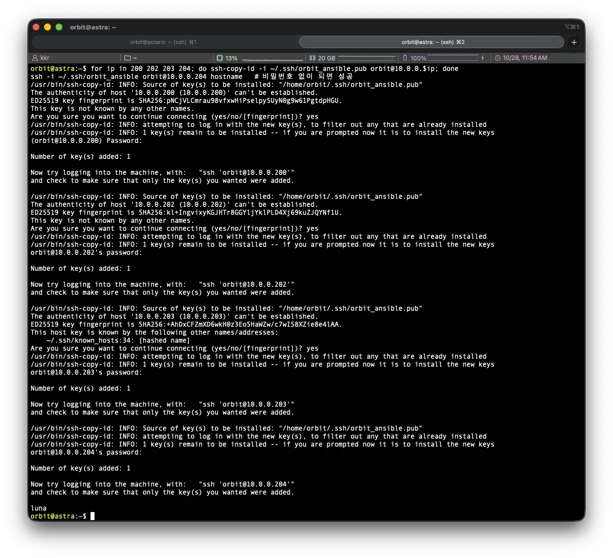
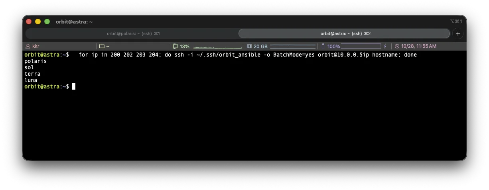
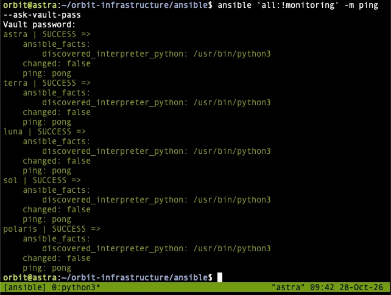
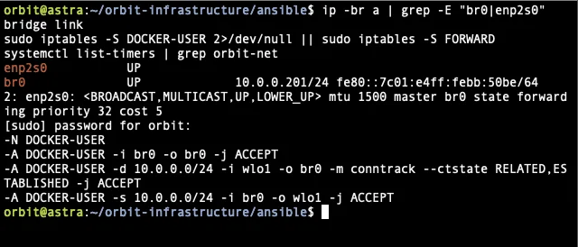
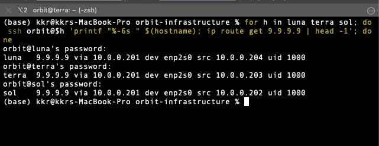
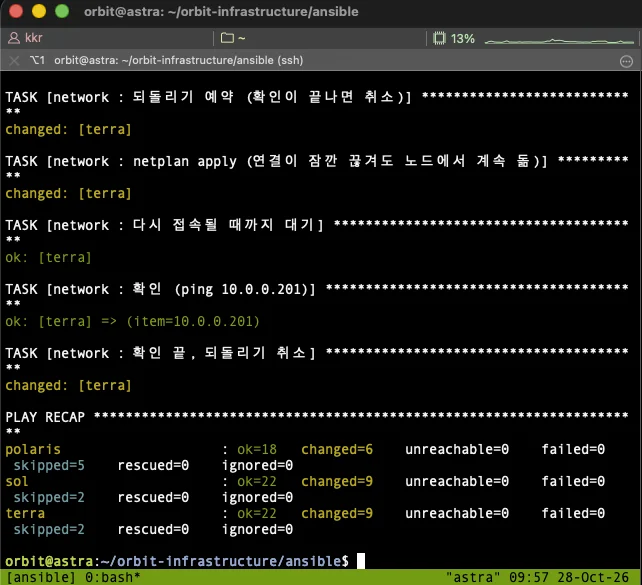
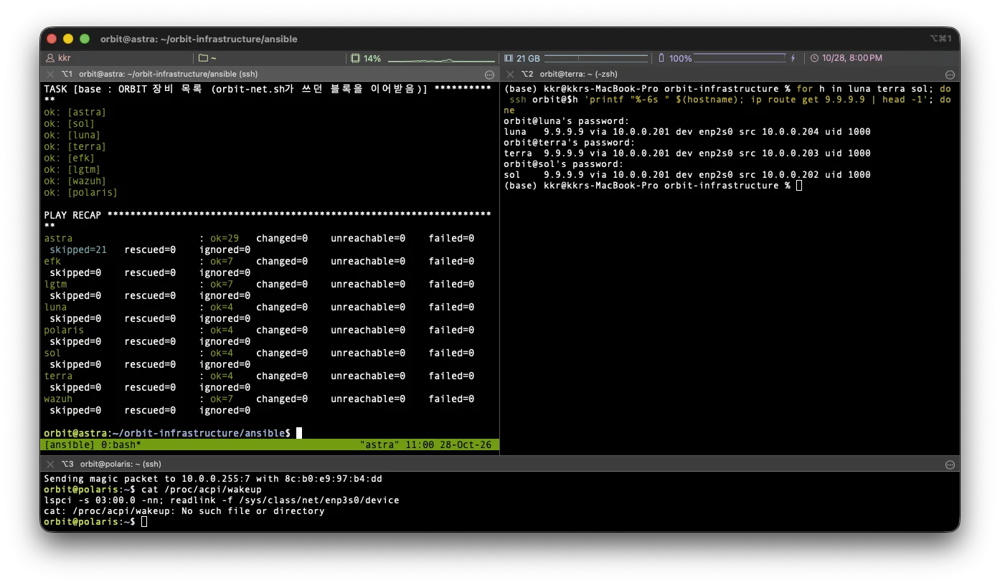

## 1. 아이디어

> 지난 글까지 노드 설정은 전부 손으로 하거나 `orbit-net.sh` 스크립트로 했습니다. 무엇을 설치했고 무엇을 바꿨는지는 기억과 문서에만 남아 있어서, 노드를 다시 설치하거나 팀원이 같은 환경을 만들려면 문서를 보고 하나씩 따라 해야 했습니다. 앞으로 설치하는 패키지부터 네트워크, VM, k3s까지 전부 코드로 남겨서 다시 실행만 하면 같은 환경이 나오도록 하고 싶다고 생각했고, 이번에 네트워크와 모니터링 VM부터 옮겼습니다.

글에서 사용하는 호스트 이름과 역할은 다음과 같습니다.

| 호스트 이름 | 기기 | 역할 |
|---|---|---|
| polaris | ODROID-M1S (SBC) | k3s Control Plane |
| astra | 데스크톱 | 게이트웨이(NAT), 모니터링 VM 호스트, Ansible 실행 위치 |
| sol, terra, luna | 갤럭시북 | k3s Worker |
| efk, lgtm, wazuh | astra 안의 VM | 모니터링 스택 (이번에 Ansible로 생성) |

### 1) 도구 선택

처음에는 Vagrant로 되는지 궁금했는데, 후보를 놓고 비교해 보니 각자 맡는 영역이 달랐습니다.

| 도구 | 하는 일 | 이번 작업에서 |
|---|---|---|
| Vagrant | VM을 만들고 지우는 도구 | 이미 있는 물리 노드 5대에는 쓸 곳이 없음 |
| Ansible | SSH로 들어가서 설정을 반복 적용. 몇 번 실행해도 결과가 같음 | 선택 |
| Terraform | 클라우드나 Vault처럼 API를 가진 대상의 설정 | 나중에 Vault 내부 설정에 |
| Git + Argo CD | 클러스터 안의 애플리케이션 | k3s 설치 이후 |

> **Ansible을 선택한 이유**
>
> 대상이 이미 설치된 물리 서버이고, 하고 싶은 일은 "그 서버에 들어가서 설정을 맞추는 것"입니다. Ansible은 대상 서버에 에이전트를 설치하지 않고 SSH와 python3만 있으면 동작하며, 같은 플레이북을 여러 번 실행해도 이미 맞춰진 항목은 건너뛰기 때문에 "다시 실행하면 같은 환경"이라는 목표에 맞는다고 판단했습니다. 노드에 직접 `apt install`을 하지 않고 코드에 넣어서 실행하는 것을 규칙으로 정했습니다.

Vault 도입도 계획에 있었지만 Ansible을 먼저 하기로 했습니다. Vault 자체도 Ansible로 설치해야 재현되고, Ansible은 Vault 없이도 비밀값을 `ansible-vault`로 암호화해서 쓸 수 있기 때문입니다.

### 2) 작성과 실행 위치

어디서 실행할지는 생각이 몇 번 바뀌었습니다.

| 단계     | 안                  | 바뀐 이유                                     |
| ------ | ------------------ | ----------------------------------------- |
| 1      | Mac에서 실행           | SSH 작업을 Mac에서 하고 있어서 처음엔 그렇게 적음           |
| 2      | astra에서 실행         | 항상 켜져 있고 내부망에 바로 붙어 있음. 팀원도 계정만 있으면 실행 가능 |
| 3      | Mac에서 실행           | 코드를 Mac에서 쓰고 Git으로 관리하니까                  |
| 4 (확정) | 작성은 Mac, 실행은 astra | 개발은 Mac이 편하고, 실행은 내부망에 있는 astra가 맞음       |

```text
Mac (작성) --git push--> GitHub --git pull--> astra (실행) --SSH 10.0.0.x--> polaris, sol, terra, luna, VM 3대
                                                 └── astra 자신은 SSH 없이 local
```

astra에서 실행할 때 주의할 점이 하나 있습니다. astra는 자기 자신의 네트워크도 바꾸는데, 내부망이나 NAT를 바꾸는 동안 와이파이로 들어온 tailscale SSH 세션은 유지됩니다. 다만 SSH가 끊기면 실행 중인 플레이북도 함께 죽으므로 astra에서는 항상 `tmux`세션 안에서 실행하기로 했습니다.

### 3) 네트워크도 Ansible로

Ansible이 접속하려면 네트워크가 먼저 되어 있어야 하니 네트워크 설정은 손으로 해야 하는 것 아닌지 헷갈렸는데, 손으로 미리 해 둘 것은 Ansible이 처음 들어갈 최소한뿐이었습니다. OS 설치, 아무 네트워크나 연결, `openssh-server`, `python3`, `orbit` 계정과 SSH 키까지입니다. 그 뒤로 `orbit-net.sh`가 하던 netplan, 장애 전환 감시, NAT는 전부 role로 옮길 수 있습니다.

대신 Ansible이 타고 들어온 연결을 스스로 바꾸게 되므로, 되돌리기 타이머와 접속 확인을 코드 안에 넣고 한 대씩 적용하도록 했습니다.

또한 스크립트와 Ansible이 같은 netplan 파일을 쓰면 서로 덮어쓰기 때문에, `orbit-net.sh`는 더 고치지 않고 참고용으로만 남겼습니다.

## 2. 코드 구조

### 1) 폴더 구조

```text
ansible/
├── ansible.cfg                 # 실행 기본값 (인벤토리 위치, 접속 계정, 키)
├── inventory/
│   ├── hosts.yml               # 노드 5대 + VM 3대: 주소, MAC, 그룹
│   └── group_vars/
│       ├── all/main.yml        # 공통 값 (대역, 게이트웨이, 와이파이, DNS, metric)
│       ├── all/vault.yml       # 비밀값. 암호화, Git 제외
│       ├── gateway.yml         # astra
│       ├── cp.yml              # polaris
│       ├── workers.yml         # sol, terra, luna
│       └── monitoring.yml      # VM 3대
├── playbooks/
│   ├── base.yml                # 호스트 이름, /etc/hosts
│   ├── network.yml             # netplan, 장애 전환 감시, NAT
│   └── vms.yml                 # 모니터링 VM 생성
└── roles/
    ├── base/
    ├── network/
    ├── gateway/
    └── libvirt/
```

| 구성 | 담는 것 |
|---|---|
| 인벤토리 | 어떤 장비에(`hosts.yml`), 어떤 값으로(`group_vars`) |
| role | 무엇을 어떻게 하는지 (설정 방법) |
| 플레이북 | 누구에게 어떤 role을 어떤 순서로 적용하는지 |

값은 인벤토리에만, 방법은 role에만 두었습니다. IP를 바꾸려면 `hosts.yml`만 고치면 되고, `orbit-net.sh`의 노드 목록 한 줄이 그대로 인벤토리의 호스트 한 항목이 되었습니다.

### 2) 인벤토리

```yaml
all:
  children:
    gateway:
      hosts:
        astra:
          ansible_connection: local       # 자기 자신은 SSH 없이 실행
          lan_ip: 10.0.0.201
          wifi_ip: 192.168.200.201
          lan_mac: "<유선 MAC>"
          wifi_mac: "<와이파이 MAC>"
          lan_bridge: br0                 # 유선 IP를 브리지에 붙임 (VM용)
    cp:
      hosts:
        polaris:
          ansible_host: 10.0.0.200
          lan_ip: 10.0.0.200
          wifi_ip: 192.168.200.200
          lan_mac: "<유선 MAC>"
          wifi_mac: "<와이파이 MAC>"
    workers:
      hosts:
        sol: { ansible_host: 10.0.0.202, ... }
        terra: { ansible_host: 10.0.0.203, ... }
        luna: { ansible_host: 10.0.0.204, ... }
    monitoring:
      hosts:
        efk: { ansible_host: 10.0.0.205, vm_cpu: 4, vm_mem_gb: 20, vm_disk_gb: 100 }
        lgtm: { ansible_host: 10.0.0.206, vm_cpu: 4, vm_mem_gb: 14, vm_disk_gb: 80 }
        wazuh: { ansible_host: 10.0.0.207, vm_cpu: 4, vm_mem_gb: 14, vm_disk_gb: 60 }
```

- `ansible_host` : Ansible이 접속할 주소. 내부망 주소를 사용
- `lan_mac`, `wifi_mac` : 장치를 찾는 기준. 장치 이름(`enp2s0`, `eth0`)은 노드마다 달라서 스크립트 때와 같이 MAC으로 찾음
- `lan_bridge` : astra만. 유선 IP를 `br0` 브리지에 붙여 VM이 같은 내부망에 들어오게 함

`group_vars/all/main.yml`에는 내부망 대역, 게이트웨이 주소, 와이파이 SSID와 게이트웨이, DNS, 장애 감시용 주소 `9.9.9.9`, metric 값을 두었습니다. 와이파이 비밀번호와 VM 계정의 sudo 비밀번호 해시는 `vault.yml`에 넣고 `ansible-vault`로 암호화한 뒤 `.gitignore`에 추가해 astra에만 두었습니다. 저장소에는 예시 파일만 올립니다.

> **vault.yml을 암호화해도 Git에 올리지 않는 이유**
>
> 처음부터 public으로 운영되는 레포지토리를 기반으로 검토하면서 정리한 기준입니다. 사설 IP와 MAC은 밖에서 쓸모가 없어 위험이 낮지만, 공인 IP와 포트 매핑은 Cloudflare로 원본 서버를 숨기는 의미가 없어지므로 올리면 안 되고, 비밀번호와 키는 암호화되어 있어도 public이면 오프라인으로 계속 시도할 수 있습니다. 그래서 암호화 여부와 상관없이 비밀값 파일 자체를 저장소에 올리지 않기로 했습니다. 

### 3) network 플레이북

```yaml
- name: 게이트웨이 (astra)
  hosts: gateway
  become: true
  roles:
    - network
    - gateway     # 브리지로 바뀌면 NAT 허용 규칙도 br0 기준으로 바로 바꿈

- name: 나머지 노드
  hosts: cp:workers
  become: true
  serial: 1       # 한 대씩. 실패하면 거기서 멈춤
  roles:
    - network
```

- astra를 먼저 따로 적용합니다. 게이트웨이라서 다른 노드보다 먼저 맞춰 두어야 하고, 유선이 브리지로 바뀌면 NAT 허용 규칙도 `br0` 기준으로 바로 바꿔야 해서 gateway role을 이어서 실행합니다.
- `serial: 1`은 나머지 노드를 한 대씩 처리하는 옵션입니다. 한 대가 실패하면 거기서 멈춰서 여러 대가 동시에 끊기는 일을 막습니다.

### 4) network role의 안전한 적용

`orbit-net.sh`에는 "120초 안에 Enter를 누르지 않으면 이전 설정으로 되돌리는" 확정 단계가 있었습니다. Ansible에서는 사람이 Enter를 누르는 대신 Ansible이 접속과 ping으로 확인하고 되돌리기 예약을 취소하는 방식으로 바꿨습니다.

```text
감시 서비스 재시작 (워커만, netplan보다 먼저)
  -> cloud-init이 네트워크를 다시 쓰지 않게 설정
  -> 지금 netplan 백업 (/root/netplan-backup/prev)
  -> 되돌리기 스크립트 설치
  -> 새 netplan 파일 생성. 내용이 같으면 여기서 끝
  -> (바뀌었을 때만) 다른 netplan 파일 치우기
  -> netplan generate (문법 확인)
  -> 300초 뒤 되돌리기 예약 (systemd 타이머)
  -> netplan apply (async: 연결이 끊겨도 노드에서 끝까지)
  -> 다시 접속될 때까지 대기 (최대 120초)
  -> ping 확인 (5초 간격 12번까지)
  -> 통과하면 되돌리기 취소
```

핵심 부분의 코드입니다.

```yaml
- name: 되돌리기 예약 (확인이 끝나면 취소)
  ansible.builtin.shell: |
    systemd-run --quiet --unit=orbit-net-revert --on-active={{ revert_after_sec }} /usr/local/sbin/orbit-net-revert.sh

- name: netplan apply (연결이 잠깐 끊겨도 노드에서 계속 돎)
  ansible.builtin.command: netplan apply
  async: 60
  poll: 0

- name: 다시 접속될 때까지 대기
  ansible.builtin.wait_for_connection:
    delay: 5
    timeout: "{{ reconnect_timeout }}"

- name: 확인 (ping)
  ansible.builtin.command: ping -c 2 -W 2 {{ item }}
  loop: "{{ net_checks }}"
  register: net_ping
  retries: "{{ check_retries }}"
  delay: 5
  until: net_ping.rc == 0

- name: 확인 끝, 되돌리기 취소
  ansible.builtin.systemd_service:
    name: orbit-net-revert.timer
    state: stopped
```

- `systemd-run --on-active=300` : 300초 뒤에 되돌리기 스크립트를 실행하는 일회성 타이머를 등록. Ansible이 끊겨도 노드 안에서 동작
- `async: 60`, `poll: 0` : `netplan apply`를 백그라운드로 실행하고 결과를 기다리지 않음. apply 도중 SSH가 끊겨도 명령은 노드에서 끝까지 실행됨
- `wait_for_connection` : 노드에 다시 SSH로 접속될 때까지 대기
- `retries`, `delay`, `until` : ping이 성공할 때까지 5초 간격으로 최대 12번 재시도
- `net_checks` : 그룹별로 확인할 대상. astra는 polaris 내부망 주소와 `9.9.9.9`, polaris는 `10.0.0.201`과 `9.9.9.9`, 워커는 `10.0.0.201`

| 실패한 곳 | 결과 |
|---|---|
| 문법 확인 | 바로 이전 설정으로 되돌리고 멈춤 |
| ping 확인 | 바로 이전 설정으로 되돌리고 멈춤 |
| 접속이 아예 끊김 | Ansible은 그 노드를 포기하고 멈춤. 노드에서는 300초 뒤 타이머가 이전 설정으로 되돌림 |

시간 값은 최악의 경우를 계산해서 정했습니다. 접속 대기 120초에 ping 12번 약 100초를 더해도 220초라 되돌리기 300초보다 짧습니다.

### 5) gateway role과 br0

모니터링 VM을 어느 대역에 둘지 비교했습니다. VM인지 IP만 보고 구분하고 싶어서 처음에는 `10.0.1.x`처럼 별도 대역을 생각했습니다.

| | 같은 대역 (`10.0.0.205~207`, br0) | 별도 대역 (`10.0.1.205~207`, astra 라우팅) |
|---|---|---|
| VM 구분 | IP로는 안 됨. `.205` 이상은 VM이라는 규칙으로 | 셋째 자리로 바로 구분 |
| 바꾸는 노드 | astra 한 대 (브리지) | 5대 전부 (고정 경로) + astra |
| 방화벽 | 노드와 VM 사이 통제 어려움 | astra에서 통제 가능 |
| VM 이전 | 같은 스위치면 IP 그대로 | IP 변경 필요 |

> **같은 대역과 br0을 선택한 이유**
>
> 작업량이 가장 적은 쪽을 골랐습니다. 별도 대역은 노드 5대 모두에 고정 경로를 추가해야 하지만, 같은 대역은 astra의 유선을 브리지로 바꾸는 한 번의 작업으로 끝납니다. 노드와 VM 사이를 방화벽으로 나누고 싶어지면 그때 별도 대역으로 옮기기로 했습니다.

`br0`은 astra 안의 가상 스위치입니다. 실제 랜카드 `enp2s0`은 브리지의 포트가 되고, astra의 IP `10.0.0.201`은 `br0`이 가집니다. VM도 `br0`에 꽂혀서 물리 스위치에 직접 붙은 장비처럼 보입니다.

```yaml
  ethernets:
    orbit-lan:
      match: { macaddress: "<유선 MAC>" }
      set-name: enp2s0
      dhcp4: false
  bridges:
    br0:
      interfaces: [orbit-lan]
      addresses: [10.0.0.201/24]
      parameters: { stp: false, forward-delay: 0 }
```

- `stp: false`, `forward-delay: 0` : 브리지가 켜질 때 기다리는 시간(기본 15초 이상) 없이 바로 통신

gateway role은 `orbit-net.sh gateway`가 하던 패킷 전달, MASQUERADE, 허용 규칙, `netfilter-persistent save`를 그대로 옮기고 `br0` 기준 규칙을 더했습니다. Docker가 설치된 호스트는 브리지를 지나는 패킷도 iptables를 거치게 되고(`br_netfilter`) Docker의 기본 정책이 막는 쪽이라, `br0`에서 `br0`으로 가는 통신을 허용하는 규칙이 없으면 VM과 내부망 사이가 막힙니다. 이 규칙을 추가하고 `enp2s0` 기준의 옛 규칙은 지우도록 했습니다.

### 6) libvirt role과 VM 사양

astra는 i5-12400(6코어 12스레드), 메모리 62GB, NVMe 500GB입니다.

| VM | IP | vCPU | 메모리 | 디스크 |
|---|---|---|---|---|
| efk | 10.0.0.205 | 4 | 20GB | 100GB |
| lgtm | 10.0.0.206 | 4 | 14GB | 80GB |
| wazuh | 10.0.0.207 | 4 | 14GB | 60GB |
| 합계 | | 12 | 48GB | 240GB |
| astra 호스트 | | 공유 | 14GB | 약 170GB |

> **vCPU 합계를 12로 맞추고 VM의 CPU 우선순위를 낮춘 이유**
>
> 첫 안은 vCPU 합계가 14로 스레드 수 12를 넘었습니다. vCPU는 미리 떼어 주는 것이 아니라 상한이라 VM이 쉬면 호스트가 쓸 수 있지만, 세 VM이 동시에 바쁠 때를 대비해 합계를 스레드 수 안으로 맞추고 VM 전체(`machine.slice`)의 CPU 우선순위를 50으로 낮췄습니다(호스트 기본 100). vCPU를 10으로 줄이는 안도 있었지만 Wazuh 공식 최소 사양이 4라서 유지했습니다. 메모리는 각 스택 최소 권장의 1.5배 이상으로 잡고 호스트에 14GB를 남겨 Vault와 nginx가 VM과 다투지 않게 했습니다. 디스크는 로그 보관 기간 7일을 기준으로 했습니다.

libvirt role이 하는 일은 다음과 같습니다.

1. `br0`과 `/dev/kvm`(CPU 가상화)이 있는지 확인하고 없으면 멈춥니다.
2. KVM, libvirt, virt-install, 이미지 도구를 설치합니다.
3. VM CPU 우선순위를 낮춥니다.
4. Ubuntu 24.04 클라우드 이미지를 받고 공식 체크섬을 확인합니다.
5. VM마다 이미 있으면 건너뛰고, 없으면 cloud-init 파일 3개를 `seed.iso`로 묶고 이미지를 복사해 디스크를 만든 뒤 `virt-install`로 정의하고 시작합니다.

cloud-init은 VM 첫 부팅 때 한 번 실행되어 hostname, `orbit` 계정(sudo 비밀번호는 vault의 해시, SSH는 Ansible 키로만), MAC 기준 고정 IP와 기본 경로 astra, DNS를 설정합니다. VM은 처음부터 Ansible 키가 들어간 상태로 켜지므로 손으로 들어가서 할 일이 없습니다.

### 7) base role

`base.yml`은 ansible 프로젝트 폴더 구조를 생각하며 미리 만들어 둔 비어있는 파일이었는데, VM도 hostname으로 접근하고 싶어서 내용을 작성했습니다. 호스트 이름과 `/etc/hosts`의 ORBIT 블록에 인벤토리의 모든 장비(노드 5대와 VM 3대)를 넣습니다. `orbit-net.sh`가 쓰던 블록 표시를 그대로 써서 기존 블록을 덮어쓰므로 줄이 두 번 들어가지 않습니다.

## 3. 실행 준비

### 1) Ansible 키 등록

astra에서 Ansible 전용 키를 만들어 나머지 노드 4대에 등록했습니다.

```bash
ssh-keygen -t ed25519 -f ~/.ssh/orbit_ansible -C "orbit@astra-ansible"
for ip in 200 202 203 204; do ssh-copy-id -i ~/.ssh/orbit_ansible.pub orbit@10.0.0.$ip; done
for ip in 200 202 203 204; do ssh -i ~/.ssh/orbit_ansible -o BatchMode=yes orbit@10.0.0.$ip hostname; done
```

- `ssh-keygen -t ed25519 -f` : Ansible 전용 키를 별도 파일로 생성. 기본 키와 섞이지 않게 함
- `ssh-copy-id -i` : 공개키를 각 노드의 `authorized_keys`에 등록. 노드마다 비밀번호를 한 번씩 입력
- `BatchMode=yes` : 비밀번호를 물으면 실패로 처리. 키로 접속되는지만 확인





이 단계에서 세 번 실수했습니다. 키는 astra에 만들어야 하는데 terra에서 실행했고, 보관함에 넣어 둔 옛 문서(Mac 기준, 와이파이 IP)를 보고 따라 했고, `ssh-keygen`을 빼먹고 `ssh-copy-id`부터 실행해서 키 파일이 없다는 오류가 났습니다. 마지막 확인에서 비밀번호로 접속된 것을 성공으로 착각할 뻔해서, 확인 명령에는 `BatchMode=yes`를 붙여야 한다는 것을 알게 됐습니다.

### 2) 저장소와 커밋

Phase 2 초기라 기존 저장소는 `legacy-infrastructure`로 이름을 바꾸고 `orbit-infrastructure`를 새로 만들었습니다. 첫 구성은 `main`에 바로 올리되, 커밋은 한 커밋에 하나의 논리적 변경이 들어가도록 9개로 나눴습니다.

```text
chore: ansible 실행 기본 설정 추가
chore: 노드와 VM 인벤토리, 공통 변수 추가
chore: 노드 역할별 네트워크 변수 추가
feat: 호스트 이름과 /etc/hosts를 맞추는 base role 추가
feat: netplan을 안전하게 적용하는 network role 추가
feat: astra NAT와 br0 허용 규칙을 거는 gateway role 추가
feat: 게이트웨이 먼저, 나머지 한 대씩 적용하는 network 플레이북 추가
feat: astra에 KVM을 설치하고 VM을 만드는 libvirt role 추가
feat: 모니터링 VM 3대를 만드는 vms 플레이북 추가
```

처음에는 3개로 나누려다가 더 잘게 나눴습니다. 나중에 한 role만 되돌리거나 변경 이유를 찾을 때 커밋 단위가 role 단위와 맞아야 보기 쉽다고 판단했습니다. 같은 파일에 두 수정이 섞인 경우는 GitHub Desktop에서 줄을 골라 나눠 커밋했습니다.

### 3) astra 준비와 첫 연결

astra 홈 폴더에는 Phase 1 저장소 5개와 리허설 로그, 도구 캐시 4.9GB가 남아 있었습니다. OS를 다시 설치하지 않고 "네트워크와 SSH만 된 상태"로 되돌리기로 하고 정리했습니다.

`vault.yml`을 만들고 모든 노드에 연결되는지 확인했습니다.

```bash
ansible 'all:!monitoring' -m ping --ask-vault-pass
```

- `all:!monitoring` : 아직 없는 VM 3대는 제외
- `-m ping` : SSH 접속과 python3 실행이 되는지 확인하는 모듈. 네트워크 ping이 아님
- `--ask-vault-pass` : vault 암호 입력. 비밀값을 쓰지 않는 명령이어도 Ansible은 `group_vars/all/`을 전부 읽기 때문에 암호화된 `vault.yml`이 있으면 암호가 필요함



astra는 local, 나머지 4대는 Ansible 키로 SSH 접속해 5대 모두 `pong`을 확인할 수 있습니다.

`vault.yml`을 만들 때 확인 명령 두 줄을 한꺼번에 붙여 넣었다가 터미널 글자 표시가 꺼진 채로 남는 일이 있었습니다. `ansible-vault view`가 암호를 물은 뒤 less 화면으로 열리면서 둘째 줄이 그 화면에 입력으로 들어간 것입니다. 안 보여도 `reset`을 입력하면 돌아오고, 가이드는 한 줄씩 실행하고 `PAGER=cat`을 쓰도록 고쳤습니다.

## 4. 실제 적용

### 1) astra br0

먼저 미리보기로 무엇이 바뀌는지 확인했습니다.

```bash
ansible-playbook playbooks/network.yml -K --ask-vault-pass --limit astra --check --diff
```

- `-K` : sudo 비밀번호 입력
- `--limit astra` : astra만 대상으로
- `--check --diff` : 실제로 바꾸지 않고 바뀔 내용만 출력. 파일 차이를 함께 표시

netplan은 유선 `enp2s0`에서 IP가 빠지고 `br0`이 `10.0.0.201/24`를 가지며 와이파이는 그대로입니다. gateway는 NAT는 그대로, `br0` 기준 허용 규칙 3개 추가, `enp2s0` 기준 옛 규칙 2개 삭제입니다. 적용 단계(apply, ping 확인)는 미리보기라서 건너뜁니다.

`--check --diff`를 빼고 실제로 적용한 결과는 `ok=33 changed=11 failed=0`입니다. netplan 적용 후 polaris `10.0.0.200`과 `9.9.9.9` ping이 통과해 되돌리기 예약이 취소되고, NAT 허용 규칙 교체 후 `netfilter-persistent save`까지 실행됐습니다. `Reset is not implemented for this connection` 경고는 astra가 local 실행이라 "다시 접속" 단계가 없다는 뜻이라 문제가 아닙니다.

```bash
ip -br a | grep -E "br0|enp2s0"
bridge link
sudo iptables -S DOCKER-USER
systemctl list-timers | grep orbit-net
```



`br0`이 `10.0.0.201/24`를 갖고 `enp2s0`은 IP 없이 `master br0 state forwarding`으로 브리지에 붙어 있으며, `DOCKER-USER`에 `br0` 기준 규칙 세 줄만 남고 `enp2s0` 규칙은 없고, `orbit-net` 타이머도 취소되어 없는 것을 확인할 수 있습니다. astra의 유선 링크 로컬 주소(fe80)가 `br0` 기준으로 바뀌어서 비상 접속 문서의 표도 함께 고쳤습니다.

Mac에서 워커 3대의 경로도 확인했습니다.



luna, terra, sol 모두 `9.9.9.9 via 10.0.0.201 dev enp2s0`으로, 브리지로 바뀐 astra를 거쳐 다시 인터넷으로 나가는 것을 확인할 수 있었습니다.

### 2) 나머지 노드

나머지 노드는 먼저 luna부터 시도 했습니다. 미리보기에서 netplan은 주석 제외 주소와 경로의 변경이 없다는 걸 확인할 수 있었고, 마이그레이션 된 `role`과 기존 `orbit-net.sh`의 `netplan` 내용의 비교가 동일한 것을 체크했습니다. 

다음으로, luna에 문제가 없다는 것을 확인한 후 남은 3대는 한 번에 실행했습니다. 이 과정에서 플레이북이 `serial: 1`이라 한 대씩 차례로 진행되는 것을 확인할 수 있었습니다.

```bash
ansible-playbook playbooks/network.yml -K --ask-vault-pass --limit 'polaris,sol,terra'
```



```text
polaris : ok=18 changed=6 failed=0 skipped=5
sol     : ok=22 changed=9 failed=0 skipped=2
terra   : ok=22 changed=9 failed=0 skipped=2
```

polaris는 워커가 아니기 때문에 감시 관련 서비스의 3개 단계를 건너뛰게 되고, 이로 인해 skipped가 더 많이 집계 됩니다. 이것으로 netplan은 5대 모두 Ansible이 관리하게 됐습니다.

하지만 여기서 polaris의 `9.9.9.9` ping이 4번 실패하고 5번째에 통과하는 문제 발견했습니다. 

polaris는 와이파이가 기본 경로라 netplan apply 때 와이파이가 다시 붙는 동안 20초 남짓 인터넷이 끊기게 되어 당시 재시도가 6번(5초 간격)이라 실제 의미가 있는 체크는 두 번에 불과했습니다. 당장은 문제가 되지 않을 수 있지만, 강의실의 WiFi가 항상 끊김 없이 네트워크를 내려주는 것이 아님을 체감해서 해당 부분은 수정했습니다.

### 3) base

```bash
ansible-playbook playbooks/base.yml -K --ask-vault-pass --limit 'all:!monitoring'
```

5대 모두 `ok=4 changed=1`로 `/etc/hosts`에 VM 3대 이름이 들어갔습니다. VM은 아직 없지만 만들면 바로 이름으로 찾을 수 있도록 했습니다.

### 4) 재실행으로 검증

이후 코드와 실제 상태가 같은지 보려고 두 플레이북을 그대로 다시 실행했습니다. 코드가 상태를 제대로 설명하고 있다면 두 번째 실행에서는 바뀌는 것이 없어야 했습니다.

하지만 결과는 아래와 같았습니다.

| 플레이북          | 결과                                        |
| ------------- | ----------------------------------------- |
| `base.yml`    | 5대 모두 `changed=0`                         |
| `network.yml` | 5대 모두 `changed=1`. 매번 "백업 폴더" 단계가 바뀜으로 나옴 |

원인은 백업 단계가 `cp -a /etc/netplan/. prev/`로 폴더째 복사해서 백업 폴더의 권한까지 `/etc/netplan`의 0755로 덮어쓰는 것이었습니다. 다음 실행에서 "백업 폴더는 0700" 단계가 다시 0700으로 바꾸고, 그다음 복사가 또 덮어쓰는 것을 반복했습니다. 되돌리기 스크립트도 같은 방식이라 되돌릴 때 `/etc/netplan` 폴더 권한을 바꿀 수 있었습니다.

따라서 이를 fix 커밋 2개로 수정했습니다.

1. 백업과 되돌리기 모두 폴더가 아니라 `*.yaml` 파일만 복사
2. polaris 와이파이 재연결 문제: 확인 재시도 6번을 12번으로, 접속 대기 150초를 120초로, 자동 되돌리기 180초를 300초로 (최악 220초가 300초보다 짧게)

고친 뒤 다시 실행할 때도 두 가지가 있었습니다. push 전에 astra에서 실행해서 결과가 그대로였는데, 실행 전에 `git log`로 커밋이 받아졌는지 확인했어야 했습니다. 그리고 `-K` 비밀번호 오타로 polaris에서 `Incorrect sudo password`가 났는데 astra는 직전 sudo 캐시 때문에 통과해서 polaris에서야 드러났습니다.

push 후 pull 받고 다시 실행한 결과입니다.

```text
astra   : ok=26 changed=0 failed=0
luna    : ok=15 changed=0 failed=0
polaris : ok=12 changed=0 failed=0
sol     : ok=15 changed=0 failed=0
terra   : ok=15 changed=0 failed=0
```

network와 base 모두 다시 실행해도 바뀌는 것이 없는 상태가 됐습니다.

### 5) VM 3대 생성

`vms.yml` 첫 시도는 두 군데서 실패했습니다.

| 단계 | 오류 | 원인 | 고친 것 |
|---|---|---|---|
| 미리보기 | `Could not find the requested service libvirtd` | 미리보기에서는 바로 앞의 패키지 설치가 "설치할 예정"으로만 나오고 실제로 설치되지 않아서, 없는 서비스를 켜려다 멈춤 | 미리보기에서는 이 단계를 건너뜀 |
| 실제 실행 | `'ansible_managed' is undefined` | `ansible_managed`는 template 파일 안에서만 쓸 수 있는 값인데 `copy`의 `content`에 넣음. 문법 검사와 lint로는 잡히지 않음 | 고정 문구로 교체 |

오프라인 검사(문법, lint, 템플릿 렌더)는 실제 실행을 대신하지 못한다는 것을 알게 됐습니다. 특히 모듈마다 쓸 수 있는 변수가 다릅니다.

fix 2개를 커밋하고 push, astra에서 pull 후 다시 실행했습니다.

```text
astra   : ok=48 changed=22 failed=0
efk     : ok=7  changed=2  failed=0
lgtm    : ok=7  changed=2  failed=0
wazuh   : ok=7  changed=2  failed=0
polaris, sol, terra, luna : ok=4 changed=0 failed=0
```

astra에서 이미지 받기, VM 3대 디스크와 cloud-init, `virt-install`까지 한 번에 진행되고, VM 3대에 SSH 접속과 hostname 확인이 통과했습니다. 손으로 VM에 들어가서 한 일은 없고 cloud-init이 넣은 키로 Ansible이 처음부터 접속했습니다.

| 확인 | 결과 |
|---|---|
| `sudo virsh list --all` | efk, lgtm, wazuh running |
| `machine.slice/cpu.weight` | 50 |
| `ansible monitoring -m ping` | 3대 모두 pong |
| efk 안 | `enp1s0 10.0.0.205/24`, 메모리 19GB, 디스크 96GB |
| efk에서 `9.9.9.9` | 됨 (astra NAT, br0 허용 규칙 동작) |
| efk에서 `wazuh`, `polaris` 이름으로 | 됨 |
| luna에서 `efk`, `lgtm`, `wazuh` 이름으로 | 됨 |

`virsh`는 sudo 없이 실행하면 사용자용 연결(`qemu:///session`)을 보기 때문에 VM이 안 보입니다. VM은 시스템용(`qemu:///system`)에 있어서 `sudo virsh`로 확인해야 합니다.

`vms.yml`을 한 번 더 실행한 결과입니다.



8대 모두 `changed=0`입니다. VM이 이미 있어서 만들기 단계를 건너뛰고, 이름과 `/etc/hosts`도 그대로인 것을 확인할 수 있습니다.

### 6) 결과

| 항목 | 결과 |
|---|---|
| network.yml 노드 5대 | 적용 완료, 재실행 `changed=0` |
| base.yml 노드 5대 | 적용 완료, 재실행 `changed=0` |
| vms.yml VM 3대 | 생성 완료, 재실행 8대 `changed=0` |
| 워커 인터넷 경로 | astra `br0` 경유 확인 |
| VM 인터넷, 이름 풀이 | 통과 |
| 손으로 한 설정 | 없음 (키 등록, vault.yml 생성 제외) |

노드 5대의 네트워크와 이름, VM 3대가 전부 코드로 만들어지고 다시 실행해도 바뀌는 것이 없는 상태입니다.

## 5. 다음 작업

### 1) WoL 대신 다른 복구 수단

지난 글에서 구상한 WoL 자체 복구는 여러 테스트를 거친 뒤, 해당 방식을 사용할 수 없다고 판단했습니다. sol과 astra의 랜카드는 모두 매직 패킷을 지원하고 astra BIOS의 Wake on LAN도 켜져 있었지만, astra를 `poweroff`한 뒤 polaris에서 `etherwake`와 `wakeonlan`으로 보내도 켜지지 않았습니다. 

외장 카드와 내장 포트 모두 꺼진 뒤 포트 LED가 계속 꺼졌고, `/proc/acpi/wakeup`에서 모든 장치가 S4 이하로만 되어 있어 꺼진 상태(S5)에서 보드가 랜 전원을 끊는 것으로 보였습니다. 

이는 삼성의 완제품 데스크탑과 랩탑을 사용하는 환경이 이유가 될 수 있다고 생각했고,  더 이상 작업과 테스트를 진행하기에는 리스크와 시간 소요가 심할 수 있을 것 같아 계획을 보류했습니다.

네트워크의 자동복구, 하드웨어의 자동복구를 구성해서 웬만해서는 죽지 않는 좀비 서버를 만들고 싶었지만 그러지 못한 것이 아쉬웠습니다.

### 2) 남은 것

앞으로는 Vault SSH CA를 적용하고, 클러스터를미리 구축해 팀원들이 작업을 시작할 수 있게 도와야 합니다. 따라서 남은 내용을 아래 내용으로 좁혔습니다.

- EFK, LGTM, Wazuh 설치는 각 팀원의 분담에 따라 진행, 추후 ansible role로 작성 
- 장애 전환 로그를 Discord로 받기. 감시 스크립트가 전환할 때 웹훅으로 보내거나, Loki가 모은 로그를 Grafana 알림으로 보내는 방법 중 선택하기. 웹훅 주소는 vault에 보관
- astra Docker 정리, `orbit` 계정을 `libvirt` 그룹에 추가
