> Phase 1 발표가 끝난 뒤 받은 피드백과 팀 회고를 바탕으로 프로젝트의 범위와 초점을 다시 잡았고, 바뀐 설계로 인프라를 구축한 첫 주의 결과를 발표했습니다. 발표는 회고와 개선, 설계, 진행 상황, 트러블슈팅, 향후 계획의 다섯 부분으로 구성했고, 이 글은 그 슬라이드와 대본을 순서대로 옮긴 기록입니다.

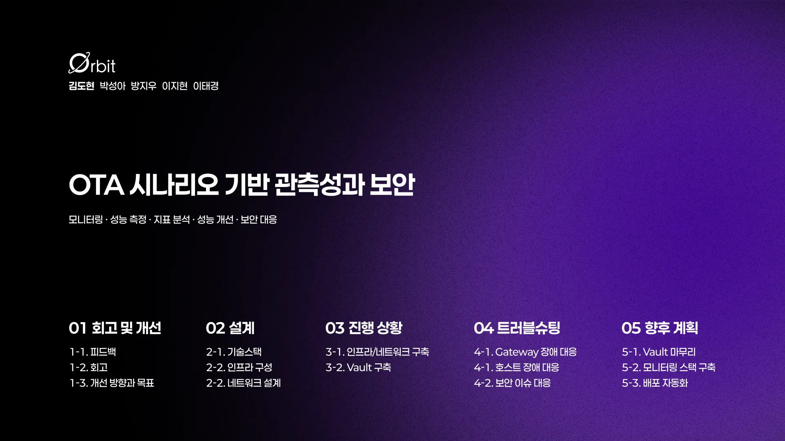

글에서 사용하는 호스트 이름과 역할은 다음과 같습니다.

| 호스트 이름 | 기기 | 역할 |
|---|---|---|
| polaris | ODROID-M1S (SBC) | k3s Control Plane |
| astra | 데스크탑 | 게이트웨이(NAT), 모니터링 VM 호스트, Vault, 클러스터 밖 |
| sol, terra, luna | 갤럭시북 | k3s Worker |
| efk, lgtm, wazuh | astra 안의 VM | 모니터링 스택 |
| io | 홈서버 | 부하 발생기, 클러스터 밖 |

## 1. 회고 및 개선

### 1) 피드백

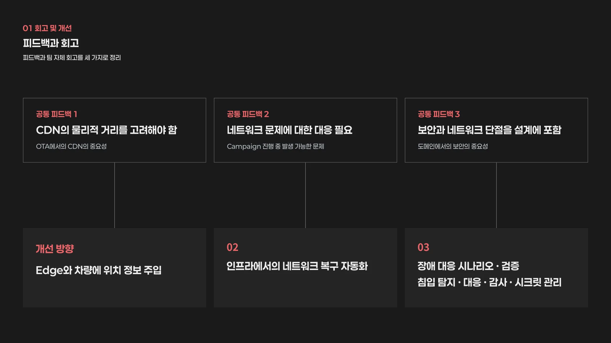

OTA 도메인은 저희 팀을 포함해 세 팀이 진행했고 방향은 모두 달랐지만, 공통으로 받은 피드백은 세 가지였습니다.

첫째로 OTA는 차량이 전 세계에 흩어져 있다는 특성상 CDN의 물리적 거리를 고려해야 한다는 점이었고, 이는 Edge와 차량에 위치 정보를 주입하는 방향으로 이어집니다.

둘째로 다운로드 중 네트워크가 끊겼을 때 이어 받는 문제였는데, 뒤에서 확정한 범위에 따라 차량 쪽이 아니라 인프라 쪽에서 네트워크 복구를 자동화하는 문제로 받아들였습니다.

셋째로 보안과 네트워크 단절을 설계에 포함하라는 점이었고, 이는 네트워크 장애 대응 시나리오와 검증, 그리고 침입 탐지와 대응, 감사, 시크릿 관리 같은 보안 강화로 이어집니다.

### 2) 회고

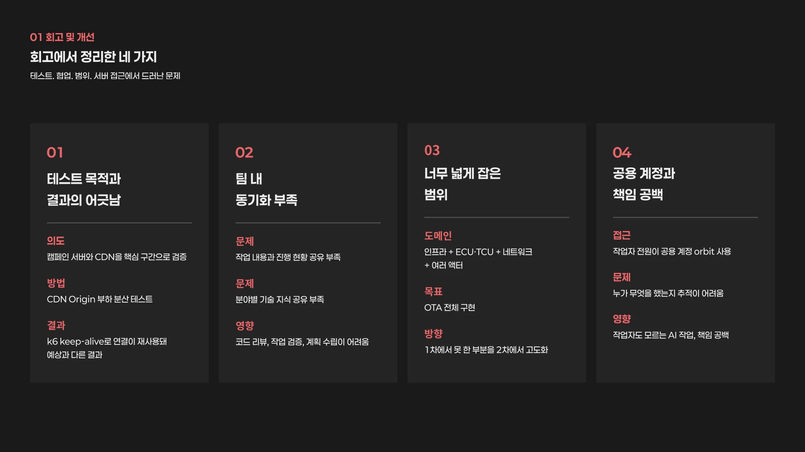

지난 프로젝트에서는 캠페인 서버와 CDN 두 곳을 가장 중요하게 보고 CDN Origin의 부하 분산을 확인하는 테스트를 진행했는데, 실제 차량 에이전트가 아닌 k6로 부하를 만들다 보니 HTTP keep-alive라는 k6의 특성 때문에 예상과 다른 결과를 얻었습니다. 이로인해 테스트 도구의 한계가 결과를 바꿀 수 있다는 것을 체감했습니다.

또한 팀원 사이에 작업 내용과 현황, 각자 맡은 기술에 대한 지식 공유가 거의 없었기 때문에, 코드 리뷰나 작업 검증, 계획 수립이 어려웠습니다.

범위에 대해서도 돌아봤습니다. OTA라는 도메인은 인프라뿐 아니라 차량의 ECU와 TCU, 네트워크, OTA 매니저 같은 액터가 모두 엮여 있는데, OTA 전체를 구현하려는 목표를 가지고 있었고 지난번에 못 한 것을 이번에 구현하자는 고도화 방향으로 가고 있었습니다.

마지막으로 서버 접근 방식입니다. 모든 작업자가 orbit이라는 공용 계정으로 서버에 접근했기 때문에 누가 무엇을 했는지 추적하기 어려웠고, AI를 활용해 작업하면서 작업자 본인도 모든 내용을 알지 못하는 상황이 생기면서 작업에 대한 책임이 비어 있다고 느꼈습니다.

### 3) 개선 방향과 목표

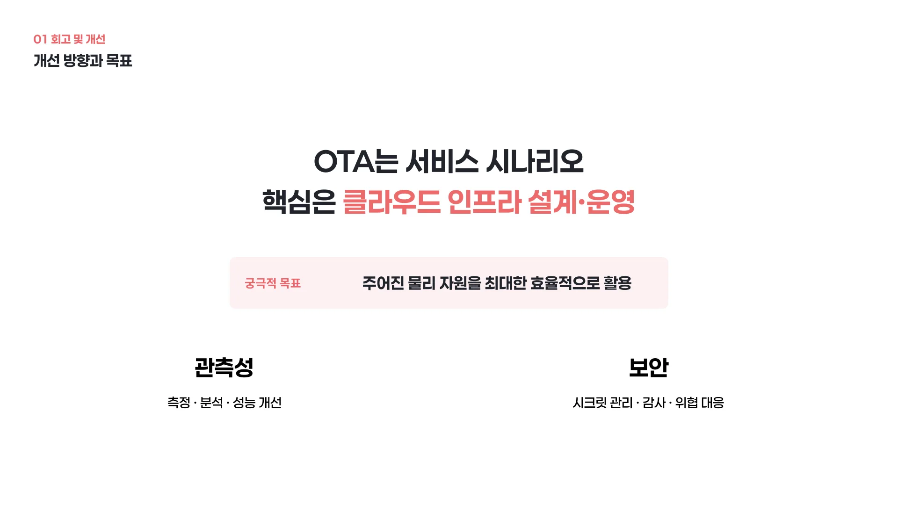

따라서 먼저 프로젝트의 범위를 다시 잡았습니다. OTA 자체를 구현하는 프로젝트가 아니라, OTA를 트래픽이 있는 서비스 시나리오로 삼아 클라우드 인프라의 설계와 운영 능력을 보여주는 프로젝트로 방향을 정했습니다. 즉 OTA는 도메인이고 클라우드 인프라가 본체입니다.

그렇다면 답해야 할 질문도 "OTA 서버를 어떻게 만들었는가"가 아니라, "주어진 물리 자원으로 클라우드 네이티브 환경을 어떻게 설계하고, 트래픽 변화에 어떻게 대응하며, 장애와 성능을 어떻게 관리했는가"가 됩니다. 궁극적으로는 주어진 자원을 최대한 효율적으로 사용하는 것을 추구합니다.

이에 따라 OTA는 시나리오로 활용하고, 모니터링과 성능 측정, 지표 분석, 성능 개선을 포함하는 관측성과, 개발 과정에서 생길 수 있는 내부와 외부의 보안 요소, 감사, 보안 대응을 챙기기로 했습니다. 뒤에 나오는 Vault와 Wazuh가 여기서 나온 선택입니다.

## 2. 설계

### 1) 기술 스택

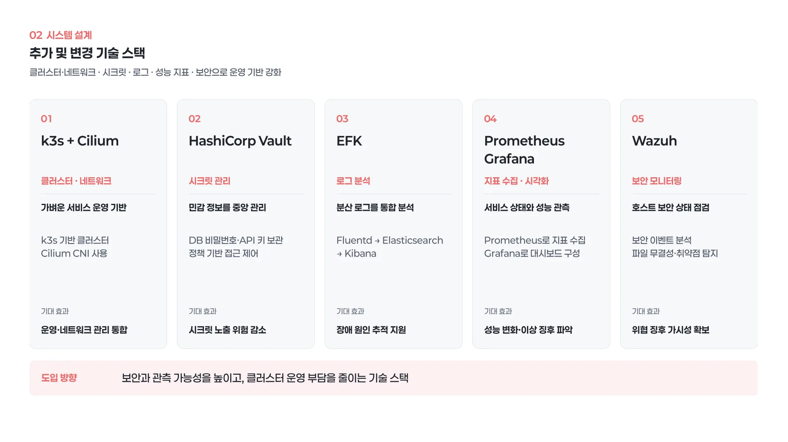

기술 스택은 지난 프로젝트와 같은 부분은 생략하고 바뀐 것만 적습니다.

먼저 Kubernetes는 kubeadm에서 k3s로 바꿨습니다. 지난 프로젝트에서는 한 호스트 위에 VM을 여러 대 띄워 클러스터를 만들었는데, VM마다 OS가 올라가기 때문에 그만큼 자원이 빠져나갔습니다.

이번에는 주어진 자원을 최대한 쓰고 싶었기 때문에 VM 없이 물리 호스트를 그대로 노드로 쓰기로 했고, 이를 위해 x86 기기는 전부 워커로 써야 한다는 자체 조건을 설정해 control plane 역할에 맞는 저전력 SBC를 들여왔습니다.

다만 이 보드는 ARM에 8GB 메모리라 kubeadm control plane을 올리기에는 부담이 있었고, etcd를 안정적으로 돌리기에도 맞지 않는 하드웨어였기 때문에, etcd 대신 SQLite를 기본 저장소로 쓰는 더 가벼운 k3s를 선택했습니다.

CNI는 Flannel 대신 Cilium을 선택했습니다. Hubble로 파드 사이 트래픽을 눈으로 볼 수 있어서 관측성이라는 목표와 맞고, Flannel에는 없는 NetworkPolicy를 지원하기 때문입니다. polaris에 붙은 LCD에는 Hubble의 트래픽 화면을 띄울 계획입니다.

다음으로 HashiCorp Vault를 추가했습니다. 회고에서 적은 시크릿 관리와 서버 접근 책임 문제에 대응하기 위한 선택입니다.

모니터링은 목적에 따라 세 스택으로 분리했습니다. 로그는 EFK, 메트릭은 Prometheus와 Grafana, 보안 이벤트는 Wazuh가 맡습니다.

### 2) 인프라 구성

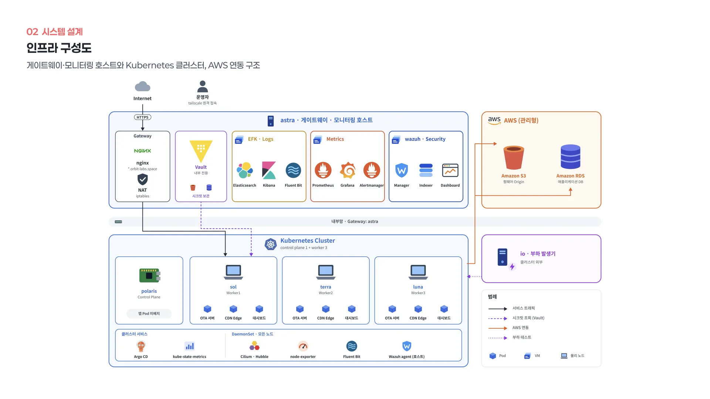

물리 호스트는 총 여섯 대를 사용합니다. 사양이 완전히 같은 갤럭시북 세 대를 sol, terra, luna라는 이름으로 워커 노드로 사용하고, 싱글보드 컴퓨터인 polaris가 control plane입니다.

데스크탑인 astra는 클러스터 밖에 두고 게이트웨이와 모니터링 호스트로 사용합니다. 모니터링 스택 세 개를 한 호스트에 두려면 최소 권장 메모리가 약 30GB인데, 32GB 노트북으로는 여유가 없고 62GB인 astra만 감당할 수 있었기 때문입니다. astra 안에는 efk, grafana와 prometheus, wazuh 세 개의 VM을 두고 스택을 하나씩 올립니다.

모니터링 저장과 화면을 클러스터 밖에 두는 것은 지난 프로젝트와 같은 원칙입니다. 클러스터 안에 두면 측정 대상의 자원을 같이 먹어서 값이 오염되고 클러스터 장애 때 같이 죽기 때문에, 클러스터 안에는 수집기만 두고 저장과 시각화는 밖에 격리합니다.

마지막으로 홈서버인 io는 부하 발생기로 사용합니다. 지난번 k6의 한계를 겪었기 때문에, 이번 프로젝트에서는 차량 에이전트를 사용하려 합니다.

### 3) 실제 구성

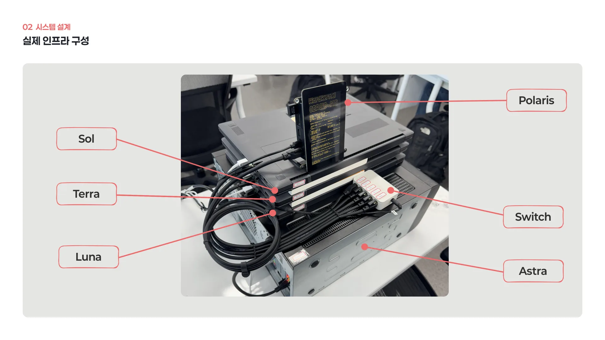

위 구성도를 실제로 구현한 모습입니다. 노트북 세 대와 control plane 보드, 데스크탑 한 대를 직접 쌓아 올리고 유선으로 묶어서, 이 장비들 위에 Kubernetes 클러스터와 모니터링 환경을 올렸습니다.

### 4) 네트워크 설계

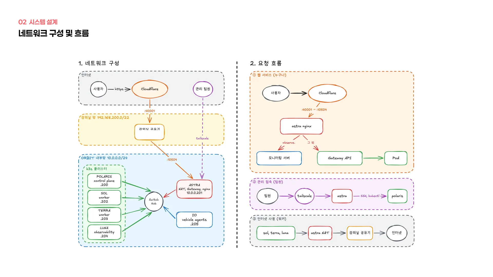

모든 호스트는 강의실 와이파이에 붙을 수 있는 무선 NIC를 가지고 있지만, 와이파이는 예약된 IP가 부족했고 호스트 사이 통신도 안정적이지 않았기 때문에, 스위치로 모든 호스트를 유선으로 묶어 내부망을 따로 만들었습니다.

이 내부망에서 astra가 게이트웨이 역할을 합니다. astra의 유선 포트를 브리지로 만들고 NAT를 설정해서, 워커 세 대와 VM 세 대가 astra의 와이파이를 통해 인터넷으로 나갑니다. VM은 astra의 브리지에 직접 붙어 내부망 IP를 받기 때문에, 노드의 수집기가 VM으로 바로 데이터를 보낼 수 있습니다.

control plane인 polaris만 예외로 자기 와이파이를 평소 인터넷 경로로 씁니다. 이렇게 한 이유는 뒤의 트러블슈팅에서 이어집니다.

## 3. 진행 상황

### 1) 인프라와 네트워크 구축

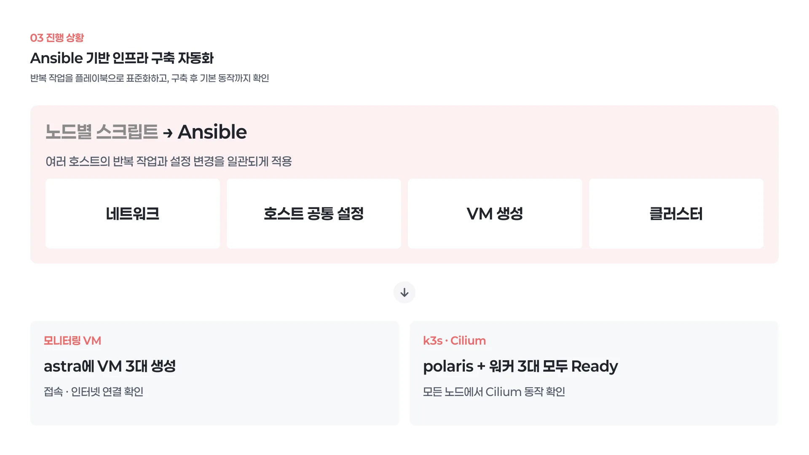

먼저 각 호스트에 OS를 설치하고, 앞서 적은 네트워크 구성을 적용했습니다. 처음에는 스크립트로 노드마다 직접 적용했지만, 같은 작업을 여러 대에 반복하고 설정이 바뀔 때마다 다시 적용해야 했기 때문에 Ansible로 전환했습니다.

네트워크, 호스트 공통 설정, VM 생성, 클러스터까지 네 개의 플레이북으로 나눠 작성했고, 모든 플레이북이 두 번째 실행에서 변경 없음으로 끝나는 것까지 확인했습니다.

이어서 astra 안에 모니터링 VM 세 대를 만들고, 접속과 인터넷 연결을 확인했습니다. k3s 클러스터는 polaris와 워커 세 대 모두 Ready 상태이고, Cilium이 모든 노드에서 동작하는 것을 확인할 수 있었습니다.

### 2) Vault 구축

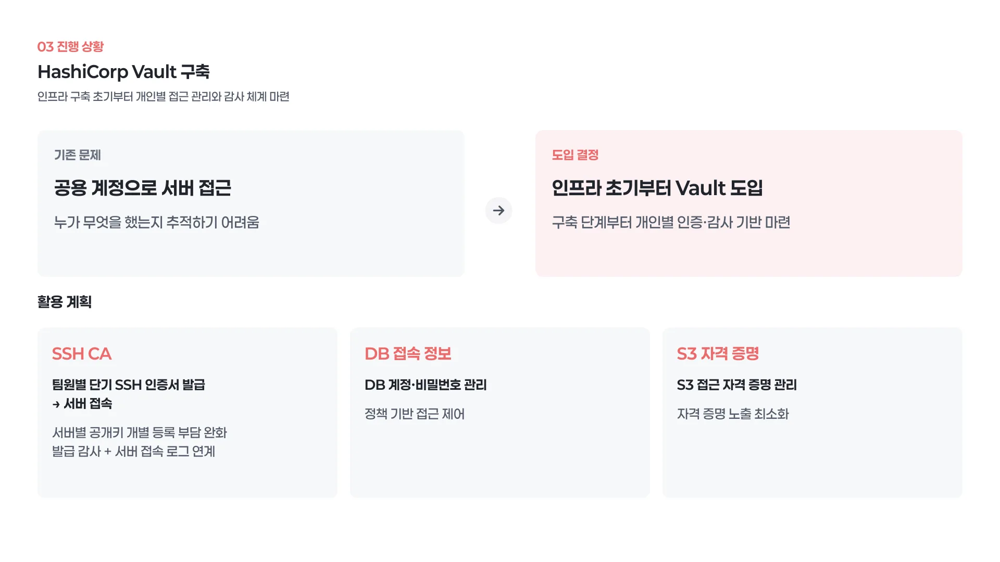

다음으로 HashiCorp Vault 구축을 시작했습니다. 보통 Vault는 서비스가 올라간 뒤에 붙이는 경우가 많지만, 인프라를 구축하는 초기에 두기로 했습니다. 회고에서 적은 것처럼 공용 계정으로 서버에 접근하면서 누가 무엇을 했는지 추적하지 못했던 문제를, 이번에는 구축 단계부터 막고 싶었기 때문입니다.

구체적으로는 Vault의 SSH CA를 사용합니다. 이 방식은 팀원마다 짧은 TTL을 가진 SSH 인증서를 발급받아 서버에 접근하도록 합니다. 그렇게 되면 서버에 공개키를 하나씩 등록하지 않아도 되고 접근 기록이 Vault에 남기 때문에, 누가 언제 어느 서버에 들어갔는지 확인할 수 있습니다.

그 외에 데이터베이스 접속 정보나 S3 자격 증명 같은 시크릿도 Vault에서 관리하도록 할 계획입니다.

## 4. 트러블슈팅

### 1) Gateway 장애 대응

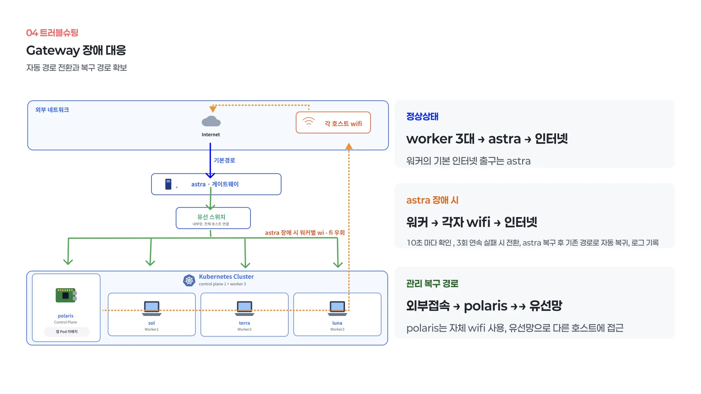

네트워크 구성 직후 astra가 꺼지는 일이 있었는데, 워커 세 대가 astra를 통해서만 인터넷에 나가는 구조였기 때문에, 집에서 astra뿐 아니라 나머지 호스트에도 접근할 수 없었습니다. 이로인해 게이트웨이 한 대에 모든 접근이 묶여 있다는 것을 체감했습니다.

따라서 두 가지를 적용했습니다. 먼저 워커마다 astra를 감시하는 서비스를 제작했습니다. 10초마다 astra를 거쳐야만 닿는 주소로 ping을 보내고, 세 번 연속 실패하면 자기 와이파이로 인터넷 경로를 바꿉니다. 그 후 감시를 지속하다 astra가 돌아오면 다시 원래 경로로 복귀합니다.

전환할 때마다 로그를 남기도록 했고, 실제로 작업 중 네트워크 장애가 생기자 자동 전환과 복귀가 동작하는 것을 로그로 확인할 수 있었습니다.

control plane인 polaris는 처음부터 자기 와이파이를 평소 경로로 사용하도록 수정했습니다. polaris는 스위치를 통해 모든 노드와 유선으로 연결되어 있기 때문에, astra가 죽었을 때 polaris에 접근하여 유선으로 나머지 노드에 닿을 수 있고 복구 경로가 된다고 판단했습니다.

### 2) 호스트 장애 대응

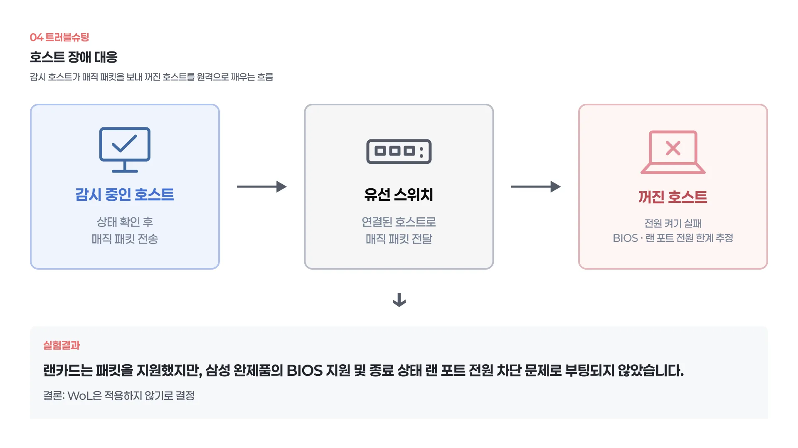

두 번째는 호스트 자체가 꺼지는 장애입니다. 스위치로 모든 호스트가 연결되어 있기 때문에 각 랜 포트로 매직 패킷을 보내면 꺼진 호스트를 원격으로 켤 수 있고, 이를 이용하면 호스트끼리 서로 감시하다가 꺼진 쪽을 깨우는 방식으로 자동 복구가 가능하다고 생각했습니다.

그래서 Wake-on-LAN을 여러 방법으로 시도했습니다. 랜카드 자체는 매직 패킷을 지원했지만, 노트북과 데스크탑이 모두 삼성 완제품이라 BIOS 단에서 완전히 지원하지 않았고, 꺼진 상태에서 보드가 랜 포트 전원을 끊는 것으로 보여 결국 켜지진 않았습니다.

따라서 하드웨어 한계로 판단하고 Wake-on-LAN은 사용하지 않기로 했습니다. 대신 정전처럼 호스트가 통째로 내려가는 경우를 위해 BIOS의 정전 후 자동 켜기와, OS가 멈췄을 때를 위한 워치독을 알아보고 있습니다.

### 3) 보안 이슈 대응

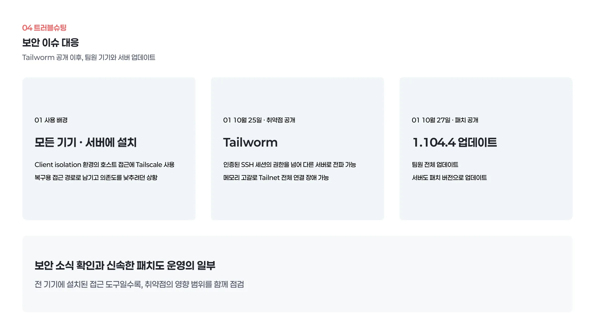

세 번째는 보안 이슈입니다. 지난 프로젝트부터 강의실의 client isolation 환경을 극복하기 위해 호스트에 접근하는 방법으로 tailscale VPN을 사용하고 있었습니다. 이 VPN은 모든 팀원 기기와 서버에 설치되어 있었고, 로그인만으로 TailNet이라는 가상 망 안의 모든 호스트에 쉽게 접속할 수 있었습니다.

다만 tailscale이 tailnet에 속한 호스트에 너무 쉽게 길을 열어 준다고 느꼈기 때문에, 이번 프로젝트에서는 복구용 루트 정도로만 두고 의존도를 낮추려던 참이었습니다.

그런 상황에서 10월 25일 Tailworm이라는 취약점이 공개됐습니다. 이는 인증된 SSH 세션이 허용된 권한을 넘어 다른 서버로 전파될 수 있고, SSH 세션으로 메모리를 고갈시켜 네트워크 전체를 끊을 수 있는 등, 모든 서버에 설치된 환경에서는 영향이 큰 내용이었습니다.

물론 해당 취약점이 발현되는 조건은 아니었지만, 보안 문제를 인식하고 있던 와중에 취약점이 공개되면서 위험성이 더 크게 체감되었습니다. 따라서 27일 패치 버전이 나오자마자 모든 팀원에게 즉시 업데이트를 요청했고, 서버도 즉시 버전 업데이트를 진행했습니다.

이를 통해 보안 이슈를 빠르게 인지하고 즉각적으로 대응하는 것도 운영의 일부라고 느꼈습니다.

## 5. 향후 계획

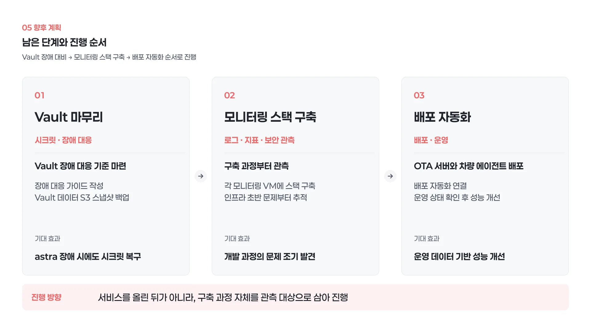

먼저 Vault 구축을 마무리하고, Vault 자체가 죽었을 때 어떻게 대응할지 기준과 가이드를 마련할 예정입니다. astra는 게이트웨이와 모니터링, Vault를 모두 맡고 있어서 장애 영향이 크기 때문에, Vault 데이터는 S3에 스냅샷으로 백업하도록 할 계획입니다.

다음으로 모니터링 스택을 각 VM에 구축해서, 인프라 초반부터 개발 과정에서 생기는 문제를 모니터링할 수 있게 할 예정입니다. 지난번처럼 서비스가 올라간 뒤에 모니터링을 붙이는 것이 아니라, 구축 과정 자체를 관측 대상으로 삼으려는 생각입니다.

이후 배포 자동화를 붙여 OTA 서버와 차량 에이전트로 테스트를 진행하고, 운영 상태를 확인하면서 성능을 개선하는 순서로 진행합니다.
