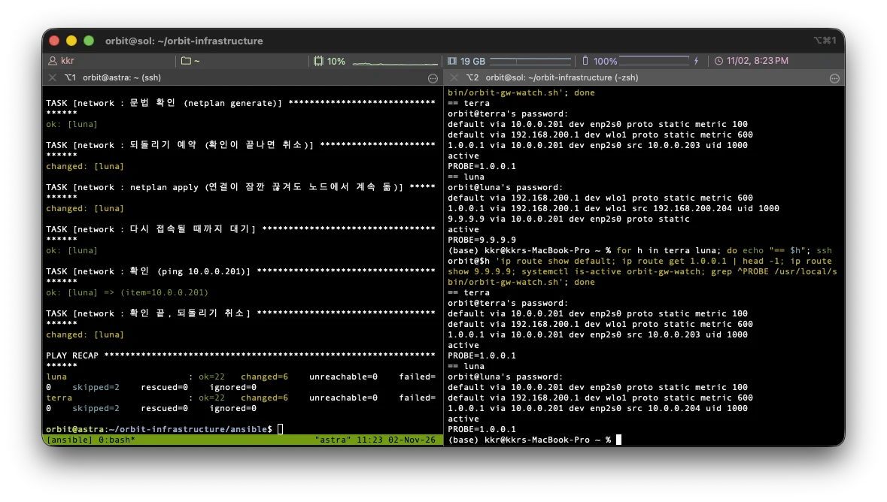
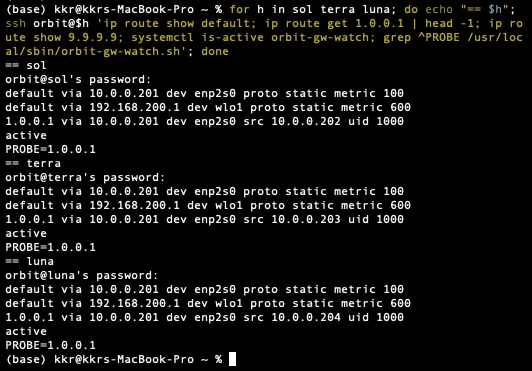
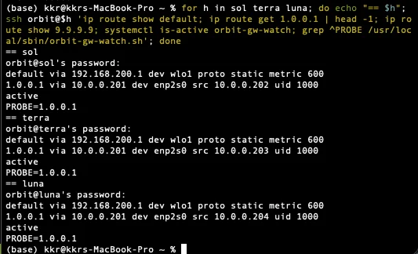
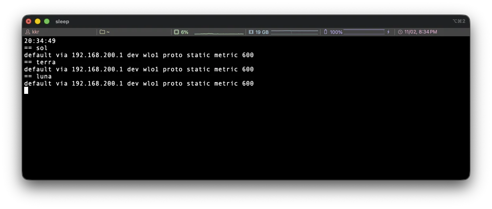
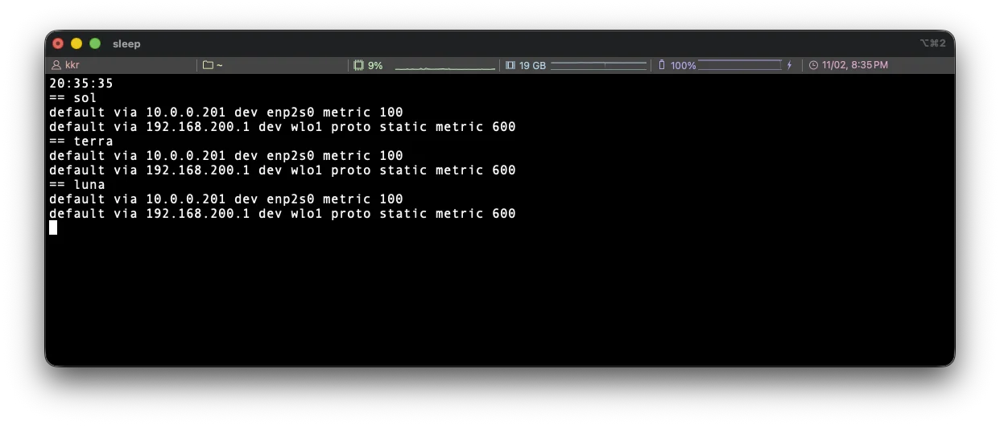

## 1. 아이디어

> 워커가 astra 너머로 인터넷이 되는지 10초마다 확인해서 안 되면 와이파이로 넘기는 `orbit-gw-watch`를 지난 글에서 만들었습니다. 그런데 Vault 작업 중에 워커에 접속해 보니 유선과 astra가 멀쩡한데도 워커 3대가 전부 와이파이로 나가고 있었고, 원인은 감시 대상으로 둔 `9.9.9.9`가 어느 시점부터 응답하지 않게 된 것이었습니다. 감시 주소를 바꿔 유선으로 되돌리고, 지난 글에서 시각을 기록하지 못했던 랜선 분리 시험을 이번에는 1초 단위로 보면서 다시 했습니다.

글에서 사용하는 호스트 이름과 역할은 다음과 같습니다.

| 호스트 이름 | 기기 | 역할 |
|---|---|---|
| polaris | ODROID-M1S (SBC) | k3s Control Plane |
| astra | 데스크탑 | 게이트웨이(NAT), Vault, 모니터링 VM 호스트, Ansible 실행 위치 |
| sol, terra, luna | 갤럭시북 | k3s Worker. 이 글의 대상 |

### 1) 감시 구조의 전제

워커는 유선 기본 경로(metric 100)와 와이파이 기본 경로(metric 600)를 함께 갖고, 평소에는 metric이 낮은 유선으로 astra를 거쳐 인터넷에 나갑니다. astra가 꺼져도 워커의 랜선은 스위치에 꽂혀 있어서 리눅스는 유선이 살아 있다고 보기 때문에, `orbit-gw-watch`가 10초마다 감시 주소로 ping을 보내 3번 연속 실패하면 유선 기본 경로를 지우고, 다시 응답하면 되돌리도록 했습니다.

감시 주소 `9.9.9.9`는 netplan에서 `/32` 고정 경로로 항상 astra를 거치게 두었는데, 와이파이로 넘어간 뒤에도 이 주소로 가는 ping만은 계속 astra 쪽으로 가야 astra가 복구됐는지 알 수 있기 때문입니다. 즉 이 구조는 "감시 주소가 응답하지 않는다"를 "astra가 죽었다"와 같은 뜻으로 보고 있었고, 감시 주소 자체가 응답을 멈추는 경우는 전제에 없었습니다.

### 2) 발견

Vault 관련 작업으로 sol에 들어갔다가 기본 경로를 보니 와이파이 경로만 남아 있었고, terra와 luna도 같았습니다.

```bash
ip route show default
```

```text
default via 192.168.200.1 dev wlo1 proto static metric 600
```

유선 `metric 100` 경로가 없다는 것은 감시 스크립트가 지웠다는 뜻이므로, 먼저 감시 주소가 실제로 응답하는지부터 확인했습니다.

```bash
ping -c 3 9.9.9.9
ping -c 1 1.1.1.1
ping -c 1 1.0.0.1
```

`9.9.9.9`만 0% 응답이었고 `1.1.1.1`과 `1.0.0.1`은 바로 응답했습니다. 이때 sol의 기본 경로가 와이파이였으므로 이 결과는 와이파이 경로에서의 결과이고, `-I wlo1`로 와이파이 장치를 지정해서 보내도 같았습니다. 와이파이로도 `9.9.9.9`가 안 되므로 astra의 NAT 문제가 아니라 강의실 네트워크 바깥 어딘가에서 이 주소가 막힌 것으로 보였고, 어디서 왜 막혔는지는 확인하지 못했습니다.

돌아보면 조짐은 있었습니다. Ansible로 옮기던 날 polaris의 `9.9.9.9` ping이 4번 실패하고 5번째에 통과한 적이 있었는데, 그때는 와이파이가 다시 붙는 시간 때문이라고 보고 재시도 횟수만 늘렸습니다. 감시 주소 하나에 복구 판단을 전부 맡겨 두고 그 주소가 멀쩡한지는 따로 보지 않았던 셈이라, 이번 일로 감시 설계의 전제가 어디까지인지 체감했습니다.

### 3) 유선 경로에서의 확인

새 감시 주소는 유선과 astra를 거쳐서 응답해야 의미가 있으므로, sol에 임시 고정 경로를 넣어 astra를 거치는 경로로 `1.0.0.1`을 확인했습니다.

```bash
sudo ip route add 1.0.0.1/32 via 10.0.0.201 dev enp2s0
ip route get 1.0.0.1
ping -c 5 1.0.0.1
sudo ip route del 1.0.0.1/32 via 10.0.0.201 dev enp2s0
```

- `ip route add ... /32 via 10.0.0.201 dev enp2s0` : 이 주소 하나만 유선으로 astra를 거치게 하는 임시 경로
- `ip route get 1.0.0.1` : 실제로 어느 경로를 타는지 출력. `via 10.0.0.201 dev enp2s0`이면 유선과 astra를 거침
- 확인이 끝나면 `ip route del`로 임시 경로를 지움

5번 모두 응답했고 TTL이 48로 와이파이 경로(49)보다 1 작아서 astra를 한 번 더 거친 것도 맞았습니다. astra 자체에서도 `1.0.0.1`이 5번 모두 응답하는 것을 확인했습니다.

> **감시 주소를 `1.0.0.1`로 정한 이유**
>
> `1.1.1.1`과 `1.0.0.1`은 같은 공개 DNS 서비스의 주소라 둘 다 응답했지만, `1.1.1.1`은 netplan의 DNS 서버 목록에도 들어 있는 주소입니다. 감시 주소에는 항상 astra를 거치는 `/32` 고정 경로가 붙기 때문에, `1.1.1.1`을 감시 주소로 쓰면 와이파이로 넘어간 상태에서 DNS 질의까지 죽은 astra 쪽으로 가게 됩니다. 감시와 DNS가 서로 영향을 주지 않도록 DNS 목록에 없는 `1.0.0.1`을 쓰는 것이 맞다고 판단했습니다.

## 2. 수정

### 1) 바꾼 값

감시 주소는 Ansible 인벤토리의 `group_vars/all/main.yml`에 `probe_ip` 하나로 정의되어 있고, 워커 netplan 템플릿의 `/32` 고정 경로와 감시 스크립트 템플릿의 `PROBE=` 두 곳이 이 값을 읽습니다. 그래서 고친 것은 이 한 줄입니다.

```yaml
probe_ip: 1.0.0.1           # 장애 감시용. 워커는 항상 게이트웨이를 거치게 고정 경로
```

지난 글에서 게이트웨이 주소를 스크립트에 적지 않고 고정 경로에서 읽어오게 바꾼 것과 같은 이유로, 감시 주소도 인벤토리 한 곳만 바꾸면 netplan과 스크립트가 같이 바뀌므로 템플릿은 손대지 않았습니다. Mac에서 `--syntax-check`와 `ansible-lint`를 통과한 뒤 `bug/16-probe-ip` 브랜치로 push했습니다.

### 2) 적용 순서

network role은 감시 서비스를 netplan보다 먼저 재시작합니다. 옛 서비스가 netplan apply 도중에 경로를 되돌리는 것을 막기 위한 순서인데, 이번에는 그 사이에 새 스크립트가 `ip route show 1.0.0.1`로 게이트웨이 주소를 읽으려 해도 아직 netplan에는 `9.9.9.9/32` 경로만 있어서 빈 값이 나오고, 스크립트는 빈 값이면 아무것도 하지 않고 다음 주기를 기다리므로 문제가 없었습니다.

적용은 astra에서 sol 한 대에 먼저 하고, 문제가 없으면 terra와 luna에 했습니다. 세 대가 같은 사양이고 같은 코드라 sol에서 확인되면 나머지는 한 번에 실행해도 되고, 워커 플레이가 `serial: 1`이라 한 번에 실행해도 한 대씩 차례로 적용되고 실패하면 다음 노드로 넘어가지 않기 때문입니다.

```bash
ansible-playbook playbooks/network.yml -K --ask-vault-pass --check --diff --limit sol
ansible-playbook playbooks/network.yml -K --ask-vault-pass --limit sol
ansible-playbook playbooks/network.yml -K --ask-vault-pass --limit terra,luna
```

- `-K` : sudo 비밀번호
- `--ask-vault-pass` : 와이파이 비밀번호가 들어 있는 `vault.yml`을 풀기 위한 암호. network 플레이북도 netplan에 와이파이 설정을 쓰므로 필요
- `--check --diff` : 바뀌는 줄만 보여 주고 적용하지 않음

## 3. 적용과 검증

### 1) sol

적용 후 Mac에서 sol의 경로와 서비스 상태를 확인했습니다.

```bash
ssh orbit@sol 'ip route show default; echo ---; ip route get 1.0.0.1; echo ---; ip route show 9.9.9.9; echo ---; systemctl is-active orbit-gw-watch; grep ^PROBE /usr/local/sbin/orbit-gw-watch.sh'
```

- `ip route show default` : 기본 경로 목록. 유선 `metric 100`이 돌아왔는지
- `ip route get 1.0.0.1` : 새 감시 주소가 유선으로 astra를 거치는지
- `ip route show 9.9.9.9` : 옛 감시 주소의 고정 경로가 남았는지
- `grep ^PROBE` : 서비스가 새 스크립트로 돌고 있는지

유선 `metric 100` 기본 경로가 다시 생겼고, `1.0.0.1 via 10.0.0.201 dev enp2s0`, `9.9.9.9` 경로는 없음, 서비스 active, `PROBE=1.0.0.1`까지 모두 기대한 대로였습니다. 옛 `9.9.9.9/32` 경로는 netplan apply가 지워 주어서 따로 정리할 것이 없었습니다.

다만 `journalctl -t orbit-gw`에는 복귀 로그가 없었습니다. netplan apply가 유선 기본 경로를 먼저 다시 만들었기 때문에 감시 스크립트 입장에서는 되돌릴 경로가 이미 있어서 복귀할 일이 없었고, 이 경우 로그가 없는 것이 정상이라고 판단했습니다.

처음에는 이 확인 명령을 sol 안에서 그대로 실행해서 `ssh orbit@sol`이 자기 자신(`127.0.1.1`)에 접속하려고 호스트 키를 물어보는 일이 있었는데, 취소하고 Mac에서 다시 실행했습니다.

### 2) terra, luna

terra와 luna는 한 번에 적용했고, 끝난 뒤 같은 확인을 반복문으로 돌렸습니다.

```bash
for h in terra luna; do echo "== $h"; ssh orbit@$h 'ip route show default; ip route get 1.0.0.1 | head -1; ip route show 9.9.9.9; systemctl is-active orbit-gw-watch; grep ^PROBE /usr/local/sbin/orbit-gw-watch.sh'; done
```



왼쪽이 astra의 플레이북 결과로 terra와 luna 모두 `ok=22 changed=6 failed=0`이고, 오른쪽이 확인 결과입니다. 첫 번째 확인 때는 luna가 아직 와이파이에 `PROBE=9.9.9.9`였는데, `serial: 1`이라 terra가 끝나고 luna 차례가 오기 전에 확인한 것이라 잠시 뒤 다시 실행하니 두 대 모두 유선 `metric 100`에 `PROBE=1.0.0.1`인 것을 확인할 수 있었습니다.

### 3) 랜선 분리 시험

지난 글에서는 랜선을 뽑은 시각을 기록하지 않아 로그의 전환 기록이 랜선 시험인지 주소 변경 작업인지 구분하지 못했습니다. 이번에는 로그 대신 세 워커의 기본 경로를 1초마다 직접 보면서 astra 쪽 랜선을 뽑았다가 다시 꽂았습니다.

먼저 뽑기 전후를 한 번씩 확인했습니다.

```bash
for h in sol terra luna; do echo "== $h"; ssh orbit@$h 'ip route show default; ip route get 1.0.0.1 | head -1; ip route show 9.9.9.9; systemctl is-active orbit-gw-watch; grep ^PROBE /usr/local/sbin/orbit-gw-watch.sh'; done
```





뽑은 뒤 세 대 모두 유선 기본 경로가 사라지고 와이파이 `metric 600`만 남았습니다. 그런데 `ip route get 1.0.0.1`은 여전히 `via 10.0.0.201 dev enp2s0`이어서 잠깐 그대로인 이유를 생각해 봤는데, 감시 스크립트가 지우는 것은 유선 기본 경로 하나뿐이고 감시 주소의 `/32` 고정 경로는 netplan에 있는 경로라 그대로 남는 것이 설계대로였습니다. 이 경로가 남아 있어야 와이파이로 넘어간 뒤에도 감시 ping이 astra 쪽으로 가서 복구를 알 수 있고, `ip route get`은 패킷을 보내지 않고 경로표만 보는 명령이라 선이 빠져 있어도 같은 줄이 나옵니다.

다음으로 전환과 복귀 시점을 보기 위해 1초마다 세 대의 기본 경로를 출력하도록 했습니다. 워커는 아직 비밀번호 로그인이라 1초마다 새로 접속하면 매번 비밀번호를 물어보므로, 노드마다 연결을 한 번 열어 두고 재사용했습니다.

```bash
for h in sol terra luna; do ssh -fNM -o ControlPath=/tmp/ssh-%r@%h -o ControlPersist=15m orbit@$h; done
while true; do clear; date '+%T'; for h in sol terra luna; do echo "== $h"; ssh -o ControlPath=/tmp/ssh-%r@%h orbit@$h ip route show default; done; sleep 1; done
```

- `-fNM` : 명령 없이(`-N`) 백그라운드로(`-f`) 마스터 연결(`-M`)만 열어 둠
- `ControlPath`, `ControlPersist=15m` : 이후 같은 호스트로의 ssh는 이 연결을 재사용하고, 마지막 사용 후 15분까지 유지
- Mac에는 `watch`가 없어서 `while`과 `sleep 1`로 반복





20:34:49에는 세 대 모두 와이파이 경로만 있었고, 20:35:35에는 세 대 모두 `default via 10.0.0.201 dev enp2s0 metric 100`이 돌아와 있는 것을 확인할 수 있었습니다. 복귀한 유선 경로에는 `proto static`이 붙어 있지 않은데, netplan이 만든 경로에는 `proto static`이 붙고 감시 스크립트가 `ip route replace`로 만든 경로에는 붙지 않으므로, 이번 복귀는 netplan이 아니라 감시 스크립트가 한 것이라는 점까지 경로 한 줄로 구분할 수 있었습니다. 지난 글에서 로그로만 보던 것을 이번에는 상태 변화로 직접 봤기 때문에 `orbit-gw` 로그는 따로 확인하지 않았습니다.

### 4) 결과

| 항목 | 결과 |
|---|---|
| `9.9.9.9` 응답 | 유선, 와이파이 모두 없음. 원인은 확인하지 못함 |
| `1.0.0.1` 유선과 astra 경유 응답 | 통과 (sol 5/5, astra 5/5) |
| `probe_ip` 변경, 문법 검사, lint | 통과 |
| 적용 | sol 후 terra, luna. `failed=0` |
| 유선 기본 경로 복귀 | 통과 (3대) |
| 옛 `9.9.9.9/32` 경로 | 3대 모두 없음 |
| `orbit-gw-watch` | active, `PROBE=1.0.0.1` (3대) |
| 랜선 분리 시 와이파이 전환 | 통과 (3대) |
| 재연결 후 유선 복귀 | 통과 (3대, 1분 안) |

## 4. 다음 작업

### 1) 감시 주소 하나에 의존하는 문제

이번 수정은 감시 주소를 응답하는 다른 주소로 바꾼 것이라, 그 주소가 또 막히면 같은 일이 생깁니다. 감시 주소 두세 개 중 하나라도 응답하면 정상으로 보거나, astra 자체(`10.0.0.201`)와 astra 너머의 주소를 나눠서 "astra는 살아 있는데 바깥이 안 되는 경우"를 구분하는 방향을 생각하고 있습니다. 다만 지금은 팀원들이 개인 계정과 Vault로 서버에 접속해 각자 작업을 시작할 수 있게 하는 것이 먼저라, 이 부분은 재발하면 그때 후속 이슈로 다루기로 했습니다.

### 2) 네트워크 변화를 디스코드로 받기

이번 문제는 워커가 와이파이로 넘어간 지 며칠이 지나서야 sol에 들어가 보고 알았습니다. 감시 스크립트는 전환할 때마다 journal에 로그를 남기지만 그 로그는 각 워커 안에만 있어서, 누군가 접속해서 보기 전까지는 전환이 일어났는지 아무도 모르는 구조입니다. 랜선 시험 때도 Mac에서 1초마다 세 대에 ssh로 물어보는 식으로 봤는데, 이런 관찰을 매번 사람이 하지 않고 팀이 쓰는 디스코드로 받도록 하고 싶다고 생각했습니다.

| 방식 | 하는 일 | 장점 | 한계 |
|---|---|---|---|
| 전환 시 웹훅 | 감시 스크립트가 `logger`로 기록하는 자리에서 디스코드 웹훅으로도 같은 문장을 보냄 | 스크립트에 `curl` 한 줄이라 바로 넣을 수 있고, 전환과 복귀가 일어난 시각이 채널에 남음 | 이벤트만 오므로 지금 상태를 알려면 메시지를 거슬러 올라가야 하고, 전환과 복귀가 반복되면 채널이 시끄러워짐 |
| 상태 봇 | astra에서 주기적으로 노드 5대의 기본 경로와 감시 서비스 상태를 모아 디스코드 메시지 하나를 계속 갱신 | 채널 상단 메시지 하나만 보면 지금 어느 노드가 유선이고 어느 노드가 와이파이인지 보임 | 봇 토큰과 실행 위치를 관리해야 하고, astra가 죽으면 봇도 같이 멈추므로 그 자체가 신호가 됨 |

두 가지는 역할이 달라서 하나를 고르기보다 같이 두는 쪽을 생각하고 있습니다. 전환 시 웹훅은 "언제 무슨 일이 있었는지"를 남기고, 상태 봇은 "지금 어떤 상태인지"를 보여 주므로, 먼저 웹훅을 감시 스크립트에 넣고 상태 봇은 모니터링 스택이 올라온 뒤 Loki에 모인 로그와 겹치지 않는 범위에서 만들 예정입니다. 웹훅 주소와 봇 토큰은 Vault에 두고 Ansible이 꺼내 쓰도록 하면, 지난 글에서 정한 "비밀값은 저장소에 올리지 않는다"는 기준도 그대로 지킬 수 있습니다.

### 3) 남은 것

이번 주는 팀원들이 각자 맡은 모니터링과 AWS 전환 작업을 시작할 수 있도록 접속 경로와 권한을 먼저 끝내야 합니다. 따라서 네트워크 쪽에서 남은 것은 아래로 좁혔습니다.

- 이번 변경의 PR 머지. 머지 전에 다른 브랜치에서 워커에 `network.yml`을 실행하면 감시 주소가 `9.9.9.9`로 돌아가므로, 그 전까지 워커 network 적용은 피하도록 팀에 알림
- `ansible-lint`가 collection을 내려받는 `ansible/.ansible/`을 `.gitignore`에 추가. 이번에 GitHub Desktop에 586개 파일이 변경으로 떠서 확인한 것
- 감시 스크립트에 디스코드 웹훅 추가. 상태 봇은 모니터링 스택 이후
