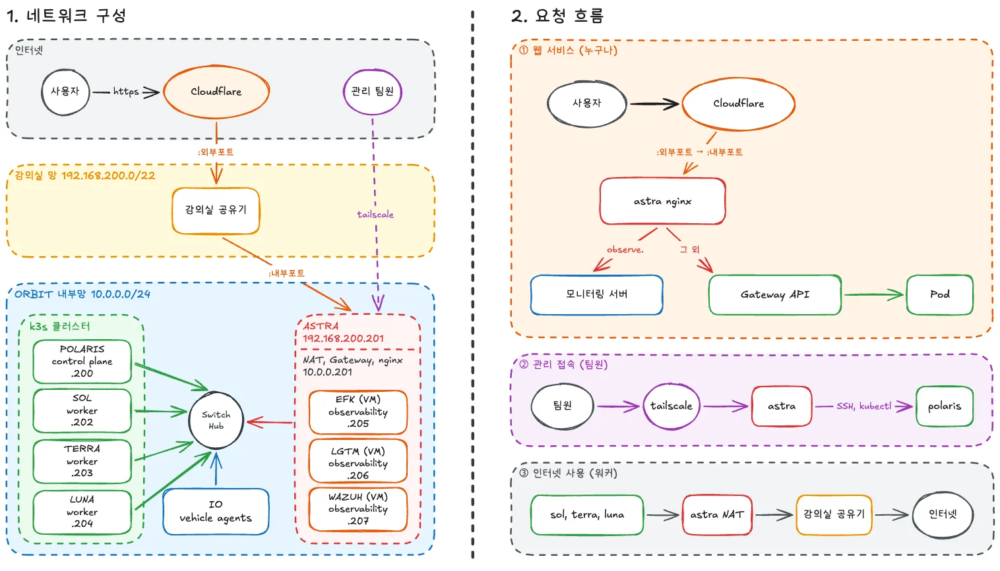
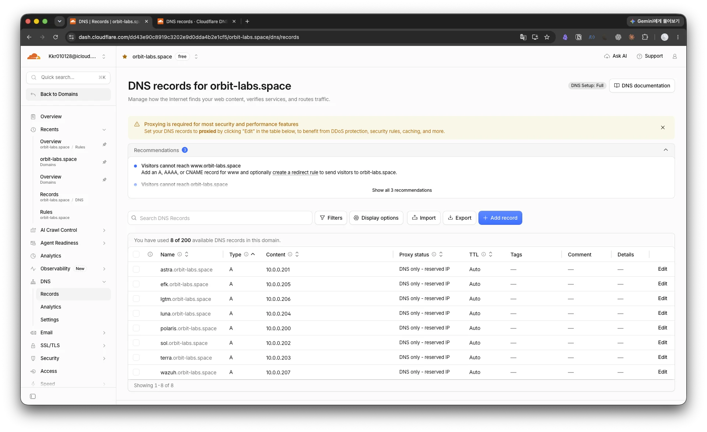
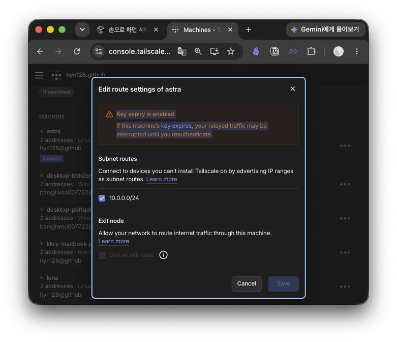
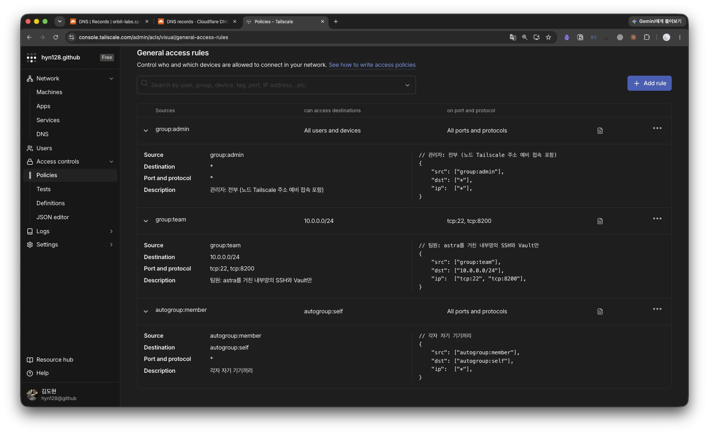
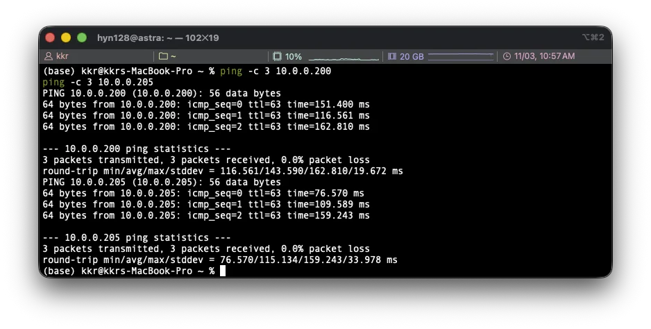
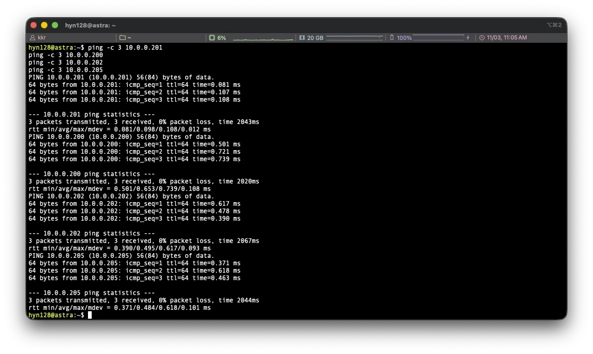

## 1. 아이디어

> 개인 계정과 Vault SSH 인증서로 서버에 접속하는 구성이 끝나가면서, 팀원이 서버에 닿는 길 자체를 정리해야 했습니다. 지금까지는 노드 5대에 각각 설치한 Tailscale 주소로 들어가고, Tailscale이 없는 VM 3대는 astra에 먼저 들어간 뒤 다시 접속했으며, Vault와 접속 스크립트도 astra의 Tailscale 주소를 바라보고 있었습니다. astra가 내부망 전체를 Tailscale에 광고하는 subnet router가 되면 팀원은 Tailscale만 켠 채 내부망 주소 하나로 전부 닿을 수 있다고 판단했고, 이번에 그 구성과 접근 정책까지 적용했습니다.

글에서 사용하는 호스트 이름과 역할은 다음과 같습니다.

| 호스트 이름           | 기기               | 역할                                                |
| ---------------- | ---------------- | ------------------------------------------------- |
| polaris          | ODROID-M1S (SBC) | k3s Control Plane                                 |
| astra            | 데스크탑             | 게이트웨이(NAT), Vault, 모니터링 VM 호스트. 이번에 subnet router |
| sol, terra, luna | 갤럭시북             | k3s Worker                                        |
| efk, lgtm, wazuh | astra 안의 VM      | 모니터링 스택. Tailscale 없음                             |

최종적으로 완성하려는 구조는 다음 그림과 같습니다. 왼쪽이 망 구성이고 오른쪽이 요청 흐름 세 가지입니다.



- 망은 세 겹입니다. 인터넷, 강의실 와이파이 `192.168.200.0/22`, 그 안의 ORBIT 내부망 `10.0.0.0/24`입니다. 내부망에는 k3s 클러스터(polaris와 워커 3대)와 astra가 같은 스위치에 유선으로 묶여 있고, astra만 와이파이에도 붙어 있어 바깥과의 접점이 됩니다. 모니터링 VM 3대는 astra 안에 있지만 astra의 가상 스위치 `br0`를 거쳐 같은 내부망에 직접 붙어 있어서, 노드가 보기에는 스위치에 꽂힌 다른 장비와 같습니다. 부하 발생기 io는 그림에서는 내부망에 두었지만 지금은 클러스터 밖 홈서버에서 돌고 있습니다.
- 흐름 ①은 누구나 쓰는 웹 서비스입니다. Cloudflare가 외부 포트로 강의실 공유기에 보내고, 공유기가 astra nginx로 넘기면 nginx가 이름을 보고 모니터링 서버나 클러스터의 Gateway API로 나눕니다.
- 흐름 ②는 팀원의 관리 접속입니다. Tailscale로 astra까지 온 뒤 내부망으로 SSH와 kubectl을 씁니다. 이 글은 이 흐름을 만드는 작업입니다.
- 흐름 ③은 워커가 인터넷으로 나가는 길로, astra NAT를 거쳐 강의실 공유기로 나갑니다. 지난 글들의 게이트웨이 장애 전환이 여기에 해당합니다.

### 1) 지금까지의 접속 경로

내부망 `10.0.0.0/24`는 강의실 와이파이에서 격리되어 있어서 밖에서는 바로 닿지 않습니다. 그래서 노드 5대에 Tailscale을 설치해 두고 각 노드의 Tailscale 주소로 접속했는데, 이 방식에는 세 가지 불편이 있었습니다.

| 대상 | 지금까지 | 문제 |
|---|---|---|
| 노드 5대 | 노드마다 다른 Tailscale 주소 | 저장소와 인벤토리는 내부망 주소를 쓰는데 사람만 다른 주소 체계를 씀 |
| VM 3대 | `ssh -J orbit@astra 10.0.0.205`처럼 astra를 거쳐 다시 접속 | 개인 계정 인증서로는 경유가 허용되지 않아 경유 구간만 공용 `orbit`을 써야 함 |
| Vault | astra의 Tailscale 주소 `:8200` | 접속 스크립트와 문서에 Tailscale 주소가 들어가고, 공개 저장소에는 두지 않기로 한 값이라 관리가 번거로움 |

개인 계정 작업(`#15`)이 끝나면 서버별 로그인 권한은 Vault 인증서와 개인 계정이 맡게 되므로, 경로는 하나로 단순해도 된다고 생각했습니다.

### 2) subnet router

Tailscale의 subnet router는 tailnet의 한 기기가 "이 대역은 나를 거쳐 가라"고 알리고, 다른 기기가 그 대역으로 보내는 패킷을 대신 전달하는 기능입니다. 대역 안의 서버에는 Tailscale이 없어도 되므로 VM 3대가 그대로 닿습니다.

```text
팀원 기기 --Tailscale 터널--> astra (subnet router, 전달만 함) --내부망--> 노드, VM
```

이때 라우팅을 Tailscale이 하는지 astra가 하는지가 헷갈렸는데, 둘이 나눠서 합니다.

| 하는 일 | 누가 |
|---|---|
| "`10.0.0.0/24`는 astra로 보내라"를 팀원 기기에 알림 (광고, 승인, 받기) | Tailscale |
| 팀원 기기에서 astra까지 암호화 터널로 운반 | Tailscale (`tailscale0`) |
| `tailscale0`로 들어온 패킷을 `br0`(내부망)로 넘김 | astra 리눅스 커널 (`ip_forward=1`, iptables FORWARD) |
| 출발지를 astra 주소로 바꿔 노드가 응답을 astra로 돌려주게 함 | astra 커널의 iptables. 규칙은 Tailscale이 넣음 |

길을 알려 주고 실어 나르는 것은 Tailscale이고 실제로 넘겨 주는 것은 astra 커널이기 때문에, Tailscale 설정이 맞아도 astra의 `ip_forward`가 꺼져 있거나 FORWARD에서 막히면 내부망에 닿지 않습니다. 워커가 인터넷으로 나갈 때 쓰는 내부망에서 와이파이로의 NAT는 Tailscale 없이 astra 혼자 하고 있었으므로, 이번에는 반대 방향인 들어오는 길을 추가하면서 경로를 알리는 일만 Tailscale에 맡기는 셈입니다.

> **Tailscale 없이 astra 혼자 하지 않은 이유**
>
> 팀원 기기마다 `10.0.0.0/24`를 astra로 보내는 경로를 직접 넣고, 밖에서 astra까지 닿는 터널(WireGuard, OpenVPN 등)을 따로 운영해야 합니다. 팀원 모두 이미 Tailscale을 쓰고 있어서 그 역할을 다시 만들 이유가 없다고 판단했습니다.

### 3) 접속 주소와 이름

접속 주소는 Tailscale 주소가 아니라 내부망 `10.0.0.200`~`.207`로 통일했습니다.

> **내부망 주소로 통일한 이유**
>
> 저장소, 인벤토리, 문서가 이미 내부망 주소를 기준으로 하고 있어서 팀원도 같은 주소를 쓰면 주소 체계가 하나가 됩니다. VM 3대는 Tailscale이 없어 tailnet 주소 자체가 없고, Tailscale 주소는 기기를 다시 등록하면 바뀔 수 있으며 공개 저장소에 적지 않기로 한 값이기 때문에 사람이 쓰는 주소로는 맞지 않다고 판단했습니다.

이름은 이미 가진 도메인 `orbit-labs.space`에 노드와 VM 8개를 내부망 주소로 가리키는 A 레코드로 등록했습니다. `sol.orbit-labs.space`를 물으면 공개 DNS가 `10.0.0.202`를 알려 주고, 경로를 받은 기기는 그 주소로 astra를 거쳐 접속합니다. 이름은 누구나 조회할 수 있지만 `10.0.0.x`에 실제로 닿는 것은 tailnet에 들어와 경로를 받은 기기뿐입니다.

```text
1. 이름 묻기:  팀원 기기 --DNS--> Cloudflare  ("sol.orbit-labs.space는 10.0.0.202")
2. 접속:      팀원 기기 --Tailscale 터널--> astra --내부망--> sol
```



등록한 레코드 8개입니다. 레코드는 반드시 회색 구름(DNS only)이어야 합니다. 주황 구름(프록시)으로 두면 Cloudflare 주소가 대신 나와서 SSH가 되지 않습니다. 나중에 붙일 웹 서비스 이름(`grafana`, `kibana`, `hubble` 등)은 주황 구름으로 공인 IP를 가리키고 astra nginx를 거치는 다른 경로라, 이름마다 레코드가 따로 있어서 서로 영향을 주지 않습니다.

## 2. 구성

### 1) 경로 광고와 승인

astra에서 경로를 광고합니다. `ip_forward`는 게이트웨이 role이 이미 켜 두었습니다.

```bash
sudo sysctl net.ipv4.ip_forward
sudo tailscale set --advertise-routes=10.0.0.0/24
```

- `tailscale set` : 이 옵션 하나만 바꿉니다. 설계 문서에 적어 두었던 `tailscale up --advertise-routes`는 이미 `up` 된 기기에서 다른 옵션을 전부 다시 적지 않으면 거부되기 때문에 `set`을 썼습니다.

여기서 광고는 astra가 Tailscale에 "`10.0.0.0/24`(내부망)로 가는 길을 알고 있으니 그쪽 주소로 가는 패킷은 나에게 보내라"고 알리는 것을 말합니다. 네트워크에서 경로를 알릴 때 쓰는 advertise(경로 알림)를 그대로 옮긴 말입니다. 이렇게 알려야 하는 이유는 팀원 기기가 처음에는 `10.0.0.203` 같은 주소로 가는 길을 모르기 때문입니다. 그 주소는 강의실 내부망에만 있어서, 기기는 집이나 강의실 와이파이 쪽으로 패킷을 보냈다가 실패하게 됩니다. astra는 내부망에 직접 붙어 있어 그 길을 알고 있으므로, astra가 자신이 그 길이라고 알려 주면 팀원 기기는 `10.0.0.x`로 가는 패킷을 Tailscale 터널에 실어 astra로 보내게 됩니다.

광고한 경로는 관리 콘솔에서 승인해야 다른 기기에 보입니다. Machines에서 astra의 Edit route settings를 열어 `10.0.0.0/24`를 켭니다.



창을 열어 보니 이미 체크되어 있고 Save가 비활성이었는데, 광고와 동시에 승인된 상태라 그대로 닫았습니다. 창 위의 Key expiry 경고는 astra의 기기 키가 만료되면 다시 로그인할 때까지 팀원 전원의 경로가 끊긴다는 뜻이라, 뒤에서 태그를 붙여 만료를 끄는 쪽으로 처리했습니다.

### 2) 내부망 전달 확인

설계 문서에는 Docker가 FORWARD 기본 정책을 DROP으로 바꿔 두므로 `DOCKER-USER`에 `tailscale0`와 `br0` 사이를 허용하는 두 줄이 필요하다고 적어 두었습니다. 그런데 Tailscale이 경로를 광고할 때 FORWARD 맨 앞에 `ts-forward` 체인을 직접 넣어 `tailscale0`에서 온 패킷과 돌아가는 패킷을 허용하기 때문에, 먼저 확인하고 안 될 때만 넣기로 했습니다. 결과는 아래 검증처럼 추가 없이 동작했습니다.

### 3) 접속 스크립트

Vault SSH 인증서를 자동으로 받는 설정 스크립트와 갱신 스크립트에서 astra의 Tailscale 주소를 쓰던 곳을 내부망 주소로 바꿨습니다.

| 파일 | 바꾼 것 |
|---|---|
| `scripts/orbit-ssh-setup.sh` | `ASTRA`(CA 인증서를 받아 오는 주소)를 `10.0.0.201`로. 자동 갱신 대상 `MATCH_HOSTS`에서 `astra`, `sol` 같은 짧은 이름을 빼고 `*.orbit-labs.space`를 추가 |
| `scripts/orbit-ssh-refresh.sh` | Vault 주소 `V_ADDR`을 `https://10.0.0.201:8200`으로 |
| `docs/vault.md` | 주소 표, scp와 `VAULT_ADDR` 예시, 자동 갱신 설명 |

`MATCH_HOSTS`는 `~/.ssh/config`의 `Match host` 조건이 되어, 이 목록에 맞는 곳으로 `ssh`할 때만 인증서 갱신 스크립트가 돌고 개인 계정명이 `User`로 붙습니다. 짧은 이름을 빼면 `ssh sol`은 Tailscale 주소로 연결은 되지만 갱신도 계정명도 붙지 않아 사실상 쓰지 않게 되고, 이름은 `sol.orbit-labs.space`로 통일됩니다. 노드의 Tailscale 주소 5개는 astra가 죽었을 때 관리자가 쓰는 예비 경로라 목록에 남겼습니다.

> **스크립트의 Vault 주소를 이름이 아니라 IP로 둔 이유**
>
> `astra.orbit-labs.space`로 통일하는 것도 생각했지만, Vault TLS 인증서에 들어 있는 이름은 `astra`, `localhost`, `127.0.0.1`, `10.0.0.201`, Tailscale IP뿐이라 이름으로 접속하면 인증서가 맞지 않아 거부됩니다. 이름은 사람이 입력할 때 쓰고 스크립트처럼 기계가 쓰는 곳은 IP가 낫다고 판단했고, 이름으로 바꾸려면 인증서 SAN에 추가하고 서버 인증서를 다시 만드는 별도 작업이 필요합니다.

이 세 파일은 개인 계정 작업(`#15`)의 PR #20이 크게 고친 파일과 같았습니다. 지현의 브랜치에 들어가 주소만 같이 고치는 것도 검토했지만, 하나의 브랜치에 다른 이슈 작업을 넣지 않는다는 팀 규칙과 push가 엇갈릴 위험 때문에 #20이 먼저 머지된 뒤 `develop` 위에서 주소 줄만 고쳤습니다. 커밋 3개가 메시지와 내용이 어긋나 있어서 PR은 Squash merge로 합쳤습니다.

### 4) Tailscale 정책

경로를 열면 tailnet의 모든 기기가 내부망 전체에 닿게 되므로, 팀원의 범위를 함께 좁혔습니다. 노드 5대가 전부 관리자 계정 소유라 정책에서 노드만 가리킬 수 없었기 때문에 먼저 `tag:server` 태그를 붙였고, 태그가 붙은 기기는 키 만료가 자동으로 꺼져서 앞의 Key expiry 경고도 같이 해결됐습니다. 노드의 Tailscale 이름은 `sol-ts`처럼 `-ts`를 붙여 내부망 이름 `sol.orbit-labs.space`와 구분했습니다.

정책은 기본값인 모두 허용 규칙 하나뿐이었고, 백업해 둔 뒤 `grants` 형식으로 바꿨습니다.

```json
"grants": [
  {"src": ["group:admin"], "dst": ["*"], "ip": ["*"]},
  {"src": ["group:team"], "dst": ["10.0.0.0/24"], "ip": ["tcp:22", "tcp:8200"]},
  {"src": ["autogroup:member"], "dst": ["autogroup:self"], "ip": ["*"]}
],
"ssh": [],
```

- `group:admin` : 관리자 계정. 노드 Tailscale 주소를 포함해 전부 허용해서 예비 접속을 남깁니다.
- `group:team` : 팀원 4명. astra를 거친 내부망의 SSH(22)와 Vault(8200)만 허용합니다. 팀원이 `sol-ts`로 접속하면 막힙니다.
- `autogroup:self` : 각자 자기 기기끼리는 허용합니다.
- `"ssh": []` : Tailscale 자체 SSH 기능은 쓰지 않습니다. 기본 정책에는 각자 자기 기기에 Tailscale SSH를 `check` 모드로 허용하는 규칙이 있었는데, 열려 있으면 Vault 인증서와 개인 계정을 거치지 않고 Tailscale 계정만으로 들어오는 길이 생기기 때문에 지웠습니다. 노드 쪽에서도 Tailscale SSH는 꺼져 있습니다.
- `tests` : 저장할 때 Tailscale이 규칙을 시험하고 기대와 다르면 저장을 거부합니다. 팀원 계정이 내부망 22번에는 닿고 Tailscale 주소 22번에는 닿지 않는 조건을 넣었습니다.



저장한 뒤 콘솔의 General access rules에 규칙 세 개가 설명과 함께 보입니다. 정책을 저장한 뒤 내 Mac에서 `ssh orbit@luna-ts`가 그대로 되는 것을 보고 잠깐 의아했는데, 내 계정이 `group:admin`이라 되는 것이 맞았습니다. 막혔는지는 팀원 계정으로 봐야 합니다.

## 3. 검증

### 1) 경로와 내부망 전달

astra에서 `tailscale status --json`으로 astra의 경로를 찾으니 `[]`가 나와서 당황했는데, 자기 자신은 다른 기기 목록에 없어서 그런 것이었고 astra의 `netstat`에는 `br0`에 직접 붙은 `10.0.0.0`이 원래부터 보여 확인 용도가 아니었습니다. 경로를 받았는지는 Mac에서 봐야 했습니다.

```bash
tailscale status --json | python3 -c "import json,sys;d=json.load(sys.stdin);print([p['PrimaryRoutes'] for p in d['Peer'].values() if p['HostName']=='astra'])"
netstat -rn -f inet | grep -E '^10[./]'
route -n get 10.0.0.202 | grep interface
```

- `PrimaryRoutes` : astra가 광고하고 승인된 경로. `['10.0.0.0/24']`
- `netstat` : macOS는 `10.0.0/24`를 `10/24`로 줄여 표시해서, 처음 쓴 `grep '^10\.0\.0'`으로는 아무것도 잡히지 않았습니다. `10/24 ... utun6`로 Tailscale 인터페이스에 경로가 들어온 것을 확인할 수 있었습니다.
- `route get` : `10.0.0.202`로 가는 인터페이스가 `utun6`인 것을 확인했습니다.

```bash
ping -c 3 10.0.0.200
ping -c 3 10.0.0.205
```



polaris와 VM efk 모두 응답했고 ttl이 63이었습니다. Linux는 64로 출발하므로 astra 하나를 지나 1이 줄어든 것이고, Tailscale 터널 구간은 라우터로 세지 않으므로 중간 장비가 astra뿐인 것을 확인할 수 있었습니다. `traceroute -n 10.0.0.205`도 astra와 efk 두 줄만 나왔습니다. 응답 시간이 80~160ms인 것은 Mac과 astra가 둘 다 강의실 와이파이에 있어 client isolation 때문에 Tailscale 중계 서버를 거치기 때문입니다.

비교로 astra에서 같은 ping을 보내면 ttl 64에 1ms 미만이었는데, astra는 같은 스위치에 직접 붙어 있어 중간 라우터가 없기 때문입니다.



### 2) SSH와 Vault

```bash
ssh hyn128@10.0.0.202 hostname
ssh hyn128@10.0.0.205 hostname
curl -s --cacert ~/.orbit/vault-ca.crt https://10.0.0.201:8200/v1/sys/health | python3 -m json.tool
```

sol과 efk 모두 개인 계정 인증서로 비밀번호 없이 들어갔고, Vault는 `sealed: false`로 인증서 오류 없이 응답했습니다. sol의 호스트 키는 전에 Tailscale 주소로 접속할 때 알려진 키와 같다고 나와서 같은 서버임을 확인할 수 있었습니다. 스크립트를 바꾼 뒤 `scripts/orbit-ssh-setup.sh`를 다시 실행하고 `ssh -v sol.orbit-labs.space true`에서 `ED25519-CERT`가 나오는 것도 확인했습니다.

### 3) 결과

| 항목 | 결과 |
|---|---|
| astra 경로 광고와 승인 | 통과. Mac `PrimaryRoutes ['10.0.0.0/24']` |
| Mac에서 내부망 ping | 통과 (`.200`, `.201`, `.202`, `.205`, ttl 63) |
| astra 전달 규칙 추가 | 필요 없음 |
| Cloudflare DNS 이름 8개 | 통과 (`dig +short astra.orbit-labs.space`가 `10.0.0.201`) |
| 개인 계정 SSH (노드, VM), Vault | 통과 |
| 접속 스크립트와 문서 | PR #22 머지 |
| `tag:server`, `-ts` 이름, 정책 | 적용. 팀원 기기에서 차단 확인은 남음 |

## 4. 다음 작업

### 1) 남은 것

이번 주는 팀원들이 각자 맡은 모니터링과 AWS 작업을 시작할 수 있게 접속과 권한을 끝내는 것이 먼저라, 남은 것을 아래로 좁혔습니다.

- 팀원 전원이 `develop`에서 `scripts/orbit-ssh-setup.sh`를 다시 실행. 설치된 갱신 스크립트 사본은 아직 astra의 Tailscale 주소 8200을 보기 때문에 정책에 막혀 인증서 갱신이 실패하고, 설정 스크립트는 서버에 SSH하지 않고 Vault에서 바로 새 인증서를 받으므로 정책을 끄지 않아도 됩니다
- 팀원 기기에서 `sol-ts` 22번이 막히고 `sol.orbit-labs.space`가 되는지 확인
- subnet router는 기본으로 출발지를 astra 주소로 바꿔 전달하므로 노드와 Wazuh 로그에는 모든 팀원이 `10.0.0.201`로 찍힙니다. 사용자별 출발지가 필요하면 SNAT를 끄고 노드 쪽 되돌아가는 경로를 넣어야 해서, 개인 계정 작업의 Wazuh 확인 때 정하기로 했습니다
- 공용 `orbit` 접속 회수와 Phase 1 때 남은 `jenkins-libvirt` 계정 정리
- 접속 이름이 `sol.orbit-labs.space`로 길어져서 팀원이 오히려 불편해할 수 있습니다. 주소를 직접 적는 대신 도메인은 그대로 쓰면서 도메인에 짧은 별칭을 두면 `ssh sol`로 쓸 수 있겠다고 생각했습니다. `~/.ssh/config`에 `Host sol`과 `HostName sol.orbit-labs.space`를 두는 방식인데, ssh의 `Match host`는 `HostName`으로 바뀐 뒤의 이름을 보므로 `*.orbit-labs.space` 조건에 그대로 걸려 인증서 자동 갱신도 됩니다. 다만 `ssh -G`로 확인해 보니 `Host` 블록이 `Match` 블록보다 앞에 있을 때만 그렇고, 지금 설정 스크립트는 `Match` 블록만 쓰고 별칭은 만들지 않으므로, 스크립트가 관리하는 블록 안에서 `Match` 앞에 노드와 VM 8개의 별칭을 넣어 주는 쪽으로 정하려고 합니다

### 2) Wazuh에서 할 수 있는 것

이번 주 팀원이 Wazuh를 구축하면 이 접속 경로 위에서 무엇을 볼 수 있을지도 생각해 봤습니다. 지금까지 만든 것을 모으면 사람과 경로를 구분할 근거가 로그에 이미 남고 있기 때문입니다.

| 보고 싶은 것 | 근거가 남는 곳 | Wazuh에서 |
|---|---|---|
| 누가 어느 서버에 들어왔는지 | 노드 sshd 로그. 개인 계정명과 인증서 ID `github-<아이디>`가 한 줄에 남음 | 계정별 로그인 집계. 출발지는 subnet router의 SNAT 때문에 전부 `10.0.0.201`이라 사람 구분은 계정과 인증서 ID로 |
| 정한 경로를 벗어난 접속 | 출발지가 `10.0.0.201`이 아닌 SSH 로그인 (노드 Tailscale 주소로 직접 들어온 경우), 공용 `orbit` 계정 로그인 | 관리자 예비 경로나 공용 계정 사용을 알림으로. 공용 접속 회수 뒤에는 `orbit` 로그인 자체가 이상 신호 |
| 누가 인증서를 받아 갔는지 | astra의 Vault 감사 로그 (`ssh-client-signer/sign/personal-<계정명>` 요청) | 서명 요청과 sshd 로그인을 사람 단위로 맞춰 보기 |
| sudo 사용 | 노드 journal의 sudo 기록 (실행한 사람과 명령) | 계정별 sudo 명령 집계, 실패 반복 알림 |
| 설정이 손으로 바뀌었는지 | `/etc/netplan`, `/etc/ssh/sshd_config.d`, `/etc/sudoers.d` | 파일 무결성 감시. Ansible이 관리하는 파일이라 플레이북 실행 시각 밖의 변경은 이상 |
| 네트워크 전환 | 워커 `orbit-gw` 로그 (와이파이 전환, 유선 복귀) | 지난 글에서 디스코드로 보내려던 전환 알림을 Wazuh 쪽으로 모을 수도 있음 |

이 중 출발지가 전부 astra로 찍히는 것은 subnet router의 기본 동작이라, Wazuh에서 출발지로 사람을 나누고 싶다면 SNAT를 끄는 결정이 먼저 필요합니다. 어느 쪽이 나은지는 Wazuh 담당 팀원이 실제 로그를 본 뒤에 같이 정하려고 합니다.

네트워크 경로를 바꾸는 작업인데도 접속을 한 번도 잃지 않고 끝난 것은, 경로 광고가 기존 Tailscale 접속을 건드리지 않고 정책에 관리자 규칙을 맨 위에 둔 덕이었습니다. 다만 astra에서 확인 명령을 돌려 놓고 `[]`를 보고 잠깐 헤맨 것처럼, 어디서 확인해야 의미가 있는지를 먼저 생각하지 않은 것은 아쉬웠습니다.
