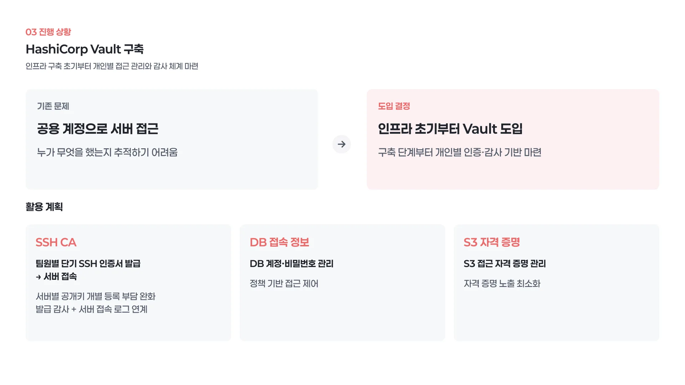
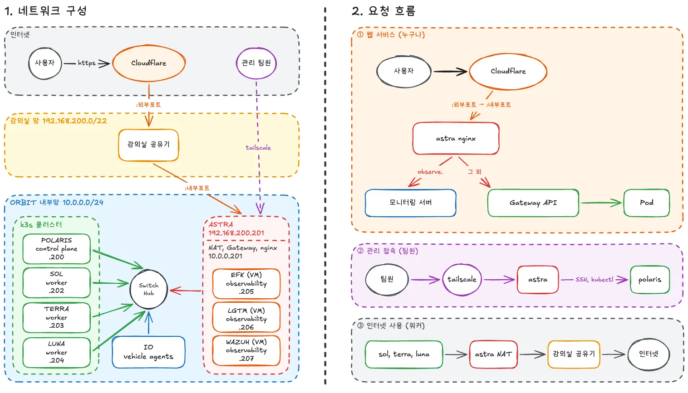

> ### 들어가며
>
> 이번 프로젝트에서 저는 네트워크와 접속 경로를 맡았고, HashiCorp Vault는 다른 팀원이 설계하고 구축했습니다. 그런데 제가 만든 접속 경로의 끝에는 항상 Vault가 있었고, 팀원에게 Vault 접속 가이드를 써 주다 보니 제가 Vault를 제대로 모른다는 것을 알게 됐습니다. 그래서 저장소에 남은 이슈 네 개와 PR 세 개, Ansible role, 스크립트, 운영 문서를 처음부터 읽고, 모르는 설정이 나올 때마다 Vault 공식 문서를 옆에 두고 대조했습니다. 본 포스트는 제가 직접 구축하고 남긴 작업 기록이 아니며, **구축된 내용을 이해하기 위해** 작성한 내용입니다.

> ### 목차
>
> 1. [프로젝트에서 Vault에 기대한 역할](#s1)  
> 2. [Vault 기본 개념](#s2)  
> 3. [전체 완성된 구성](#s3)  
> 4. [Vault 서버 구성 (이슈 #7)](#s4)  
> 5. [로그인과 권한](#s5)  
> 6. [SSH CA](#s6)  
> 7. [개인 계정 분리 (이슈 #15)](#s7)  
> 8. [팀원 PC의 인증서 자동 갱신 스크립트](#s8)  
> 9. [앱 비밀값과 Kubernetes 인증 (이슈 #13)](#s9)  
> 10. [백업과 복구 (이슈 #11)](#s10)  
> 11. [네트워크 접속 경로 작업과의 연결](#s11)  
> 12. [공식 권장 사항과 ORBIT 구성의 차이](#s12)  
> 13. [Wazuh에서 할 수 있는 감사](#s13)  
> 14. [향후 계획](#s14)  
> 15. [마무리](#s15)  

글에서 사용하는 호스트 이름과 역할은 다음과 같습니다.

| 호스트 이름 | 기기 | 역할 |
|---|---|---|
| polaris | ODROID-M1S (SBC) | k3s Control Plane. Vault의 Kubernetes 인증이 이 API를 바라봄 |
| astra | 데스크탑 | 게이트웨이(NAT), subnet router, 모니터링 VM 호스트. **Vault가 여기에 있음** |
| sol, terra, luna | 갤럭시북 | k3s Worker |
| efk, lgtm, wazuh | astra 안의 VM | 모니터링 스택 |

읽은 자료는 모두 공개 저장소 [`ORBIT-CLOUD-LABS/orbit-infrastructure`](https://github.com/ORBIT-CLOUD-LABS/orbit-infrastructure)에 있습니다. 글 안의 이슈와 PR 번호는 이 저장소 기준이고, 번호를 누르면 GitHub로 갑니다.

| 구분 | 내용 | 시점 |
|---|---|---|
| [이슈 #7](https://github.com/ORBIT-CLOUD-LABS/orbit-infrastructure/issues/7), [PR #9](https://github.com/ORBIT-CLOUD-LABS/orbit-infrastructure/pull/9) | astra에 Vault 설치와 SSH CA 구성 | 10/29 작성, 11/02 머지 |
| [이슈 #13](https://github.com/ORBIT-CLOUD-LABS/orbit-infrastructure/issues/13), [PR #14](https://github.com/ORBIT-CLOUD-LABS/orbit-infrastructure/pull/14) | KV v2, Kubernetes 인증, 앱 정책 추가 | 11/02 |
| [이슈 #15](https://github.com/ORBIT-CLOUD-LABS/orbit-infrastructure/issues/15), [PR #20](https://github.com/ORBIT-CLOUD-LABS/orbit-infrastructure/pull/20) | 개인별 Linux 계정과 Vault SSH 권한 분리 | 11/02 작성, 11/03 머지 |
| [이슈 #11](https://github.com/ORBIT-CLOUD-LABS/orbit-infrastructure/issues/11) | Vault 스냅샷 AWS S3 주기 백업 | 열림 |
| [`docs/vault.md`](https://github.com/ORBIT-CLOUD-LABS/orbit-infrastructure/blob/develop/docs/vault.md), [`docs/personal-accounts.md`](https://github.com/ORBIT-CLOUD-LABS/orbit-infrastructure/blob/develop/docs/personal-accounts.md) | 운영 문서 | |
| `ansible/roles/vault`, [`roles/ssh_ca`](https://github.com/ORBIT-CLOUD-LABS/orbit-infrastructure/tree/develop/ansible/roles/ssh_ca), [`roles/personal_accounts`](https://github.com/ORBIT-CLOUD-LABS/orbit-infrastructure/tree/develop/ansible/roles/personal_accounts) | 구성 코드 | |
| [`scripts/orbit-ssh-setup.sh`](https://github.com/ORBIT-CLOUD-LABS/orbit-infrastructure/blob/develop/scripts/orbit-ssh-setup.sh), [`scripts/orbit-ssh-refresh.sh`](https://github.com/ORBIT-CLOUD-LABS/orbit-infrastructure/blob/develop/scripts/orbit-ssh-refresh.sh) | 팀원 PC용 스크립트 | |

## 1. 프로젝트에서 Vault에 기대한 역할 {#s1}

Vault 설정을 보기 전에, 왜 이 프로젝트에 Vault가 들어왔는지를 먼저 적습니다. 설정 하나하나가 결국 이 이유에서 나오기 때문입니다.

### 1) Phase 1 회고와 피드백

Phase 1 회고에서 문제로 꼽은 것 중 하나가 서버 접근 방식이었습니다. 모든 작업자가 `orbit`이라는 공용 계정으로 서버에 들어갔기 때문에 누가 무엇을 했는지 추적할 수 없었고, AI를 활용해 작업하면서 작업자 본인도 모든 변경을 알지 못하는 상황이 생기자 "이 서버의 지금 상태에 책임지는 사람이 없다"는 느낌이 들었습니다. 발표 피드백도 같은 방향이었습니다. 보안과 네트워크 단절을 설계에 포함해야 한다는 말은, 저희에게는 침입 탐지와 대응, 감사, 시크릿 관리를 처음부터 챙기라는 뜻으로 받아들여졌습니다.

프로젝트의 범위도 다시 잡았습니다. OTA 서버를 만드는 것이 아니라 OTA를 시나리오로 삼아 "주어진 물리 자원으로 클라우드 네이티브 환경을 어떻게 설계하고 운영했는가"를 보여 주기로 했으니, 운영의 일부인 접근 통제와 감사를 빼고 갈 수는 없었습니다.

### 2) 설계상 Vault의 역할



[1차 발표](https://hyn128.site/project-5-orbit-phase2-week1-presentation/)에서 Vault에 맡기기로 한 일은 세 가지였습니다.

| 역할 | 하려던 것 | 지금 상태 |
|---|---|---|
| SSH CA | 팀원마다 짧은 유효기간의 SSH 인증서를 발급받아 서버에 접속. 서버마다 공개키를 등록하지 않아도 되고, 발급 기록이 Vault 감사 로그에, 접속 기록이 서버 sshd 로그에 남음 | 적용됨 ([#7](https://github.com/ORBIT-CLOUD-LABS/orbit-infrastructure/issues/7), [#15](https://github.com/ORBIT-CLOUD-LABS/orbit-infrastructure/issues/15)) |
| DB 접속 정보 | 앱이 쓰는 DB 계정과 비밀번호를 Vault에서 관리하고 정책으로 접근 제어 | Vault 쪽 준비됨 ([#13](https://github.com/ORBIT-CLOUD-LABS/orbit-infrastructure/issues/13)). 클러스터 연동은 다음 주 |
| S3 자격 증명 | AWS S3 접근 키를 코드와 ConfigMap 밖에 두기 | AWS 전환 작업과 함께 진행 예정 |

그리고 Phase 2 설계 문서(`orbit` 저장소의 [`docs/flow.md`](https://github.com/ORBIT-CLOUD-LABS/orbit/blob/main/docs/flow.md))에는 Vault의 네 번째 역할이 적혀 있습니다. 펌웨어 서명입니다. OTA 서버가 장악되거나 관리자 토큰이 유출되면 악성 파일을 등록하고 그 해시를 매니페스트에 넣을 수 있으므로, 펌웨어 서명은 서버 밖의 개인 키로 만들고 차량이 직접 검증하도록 설계했습니다. 그 개인 키를 [Vault Transit 엔진](https://developer.hashicorp.com/vault/docs/secrets/transit)에 두고(`exportable=false`, Vault 밖으로 나가지 않음) 팀원이 각자의 Vault 계정으로 서명하는 구성입니다. 이 부분은 아직 코드가 없어서 글 마지막에 계획으로만 적습니다.

### 3) astra 호스트 설치와 구축 초기 도입의 이유



Vault는 k3s 클러스터 안이 아니라 astra 호스트에 직접 설치했습니다. 설계 문서에는 "클러스터 밖이고 상시 켜져 있어서"라고 적혀 있고, [이슈 #7](https://github.com/ORBIT-CLOUD-LABS/orbit-infrastructure/issues/7)에는 "k3s 장애와 독립적으로 사용할 수 있도록"이라고 적혀 있습니다. 서버 접속 인증서를 발급하는 곳이 클러스터 안에 있으면, 클러스터가 죽었을 때 클러스터를 고치러 들어갈 인증서를 받을 수 없게 됩니다. 접속 수단은 접속 대상보다 바깥에 있어야 한다는 원칙입니다.

대신 astra에 역할이 몰리는 문제가 생깁니다. 게이트웨이, nginx, 모니터링 VM 호스트, Vault를 모두 맡고 있어서 astra 장애의 영향이 큽니다. 설계 문서에도 "Vault는 S3 스냅샷 백업 필수"라고 적혀 있고, 이것이 [이슈 #11](https://github.com/ORBIT-CLOUD-LABS/orbit-infrastructure/issues/11)로 이어집니다.

시점에 대해서는 발표에서 "보통 Vault는 서비스가 올라간 뒤에 붙이는 경우가 많지만 인프라 구축 초기에 두기로 했다"고 설명했습니다. 공용 계정 문제를 구축 단계부터 막고 싶었기 때문입니다. 실제로 개인 계정이 8대에 적용된 11월 3일부터는 제 네트워크 작업도 개인 인증서와 개인 계정으로 하고 있습니다.

## 2. Vault 기본 개념 {#s2}

저도 Vault를 "비밀번호를 암호화해서 넣어 두는 금고" 정도로만 알고 있었는데, 설정을 읽다 보니 그 이해로는 절반도 설명이 되지 않았습니다. 아래는 저장소의 설정을 이해하는 데 필요했던 만큼만 정리한 개념입니다.

### 1) 단순한 금고같지만 발급소 역할을 하는 Vault

Vault의 요청 처리는 항상 같은 순서를 따릅니다.

```text
누구인가(인증 방식)  →  토큰  →  무엇을 할 수 있나(정책)  →  무엇을 받아 가나(시크릿 엔진)
                                                         ↘ 모든 요청과 응답은 감사 장치에 기록
```

| 구성 요소 | 뜻 | ORBIT 프로젝트에서 |
|---|---|---|
| 인증 방식 (auth method) | 사용자나 프로그램이 자기가 누구인지 증명하는 방법. 로그인하면 Vault 토큰을 받음 | GitHub PAT, userpass(비상용), Kubernetes ServiceAccount |
| 토큰 | 로그인 결과. 유효기간과 정책 목록이 붙어 있음 | 기본 8시간, 최대 24시간 |
| 정책 (policy) | 어떤 경로에 어떤 동작(`read`, `update`, `patch` 등)을 허용하는지 적은 규칙. 토큰에 붙음 | `ssh-orbit`, `ssh-personal-<계정명>`, `orbit-secrets-write`, `eso-orbit` |
| 시크릿 엔진 (secrets engine) | 실제로 값을 저장하거나 발급하는 부품. 경로마다 하나씩 켬 | `ssh-client-signer/` (SSH CA), `secret/` (KV v2) |
| 감사 장치 (audit device) | 모든 API 요청과 응답을 기록. 값은 HMAC으로 가려서 남김 | 파일 `/var/log/vault/audit.log` |

"발급소"라고 적은 이유는 SSH CA 때문입니다. KV는 넣어 둔 값을 돌려주지만, SSH CA는 요청할 때마다 새 인증서를 만들어 주고 그 인증서는 Vault에 저장하지 않습니다. [공식 문서](https://developer.hashicorp.com/vault/api-docs/secret/ssh)도 서명 응답을 설명하면서 "발급된 인증서는 Vault가 저장하지 않으므로 응답에서 받아 두어야 한다"고 적고 있습니다.

### 2) seal, unseal, root token

Vault는 시작하면 항상 잠긴(sealed) 상태입니다. 저장소의 데이터는 읽을 수 있지만 복호화할 수 없습니다. 복호화 키(root key)는 다시 unseal 키로 암호화되어 있고, unseal 키는 Shamir 비밀 분산으로 여러 조각으로 나뉘어 있습니다. 정족수만큼 조각을 넣어야 열립니다. [공식 문서](https://developer.hashicorp.com/vault/docs/concepts/seal)는 "재시작하면 다시 sealed가 된다"고 적고 있어서, 재부팅이나 설정 변경 뒤에는 누군가 키를 넣어야 합니다.

root token은 모든 정책을 무시하는 최고 권한 토큰입니다. 초기화 때 한 번 나오고, [공식 하드닝 가이드](https://developer.hashicorp.com/vault/tutorials/operations/production-hardening)는 "설정에만 쓰고 폐기해야 하며, 필요하면 다시 만들어야 한다"고 권합니다. 다시 만드는 명령이 `generate-root`이고, 이것도 unseal 키 정족수가 필요합니다.

### 3) SSH 인증서와 authorized_keys의 차이

지금까지 서버에 들어가는 방법은 내 공개키를 서버의 `~/.ssh/authorized_keys`에 넣는 것이었습니다. 이 방식의 문제는 서버가 늘어날수록 등록할 곳이 늘고, 사람이 나가면 모든 서버를 돌며 지워야 하고, 키에는 유효기간이 없다는 점입니다.

SSH 인증서 방식은 서버에 사람의 키 대신 CA의 공개키 하나만 등록합니다(`TrustedUserCAKeys`). 사람은 자기 공개키를 CA에 가져가 서명을 받고, 그 서명된 인증서를 개인키 옆에 두고 접속합니다. 서버는 아래의 내용을 확인합니다.

- 이 인증서가 신뢰할 수 있는(서버의 `TrustedUserCAKeys`에 미리 등록된) CA의 서명인지
- 유효기간이 남아 있는지
- 인증서의 principal(인증서에 적힌, 로그인이 허용된 계정 이름)이 현재 로그인하려는 계정과 일치하는지

```text
authorized_keys 방식         서버 8대 × 사람 5명 = 공개키 40개 등록, 만료 없음
SSH 인증서 방식              서버 8대 × CA 공개키 1개, 인증서는 8시간 뒤 저절로 만료
```

여기서 확인할 점은 **서버가 Vault에 접속하지 않는다**는 것입니다. 서버는 미리 받아 둔 CA 공개키로 인증서를 검증할 뿐이라, Vault가 꺼져 있어도 이미 받은 인증서로는 만료 전까지 들어갈 수 있습니다. 뒤에 나오는 장애 대응은 이 동작을 전제로 합니다.

## 3. 전체 완성된 구성 {#s3}

세 번의 PR을 거친 뒤의 모습입니다. 자세한 내용은 뒤에서 하나씩 봅니다.

| 항목 | 값 |
|---|---|
| 위치 | astra 호스트에 직접 설치. systemd `vault`, 버전 2.2.1 고정 |
| 주소 | 내부망 `https://10.0.0.201:8200` (팀원은 Tailscale subnet router 경유), astra 안에서는 `127.0.0.1:8200` |
| TLS | 내부 CA `vault-ca.crt` (10년), 서버 인증서 (825일). 팀원에게는 CA 인증서만 배포 |
| 저장소 | 단일 노드 Raft `/opt/vault/data`. 클러스터 포트 8201은 `127.0.0.1`에만 |
| 방화벽 | 8200은 `lo`, `br0`, `tailscale0`에서만. 나머지 인터페이스는 DROP |
| unseal | Shamir 5개 중 2개. 팀원 5명이 하나씩 보관 |
| 감사 로그 | `/var/log/vault/audit.log`. 매일 회전, 14개 보관 |
| 로그인 | GitHub (`ORBIT-CLOUD-LABS`의 `orbit` 팀), 비상용 userpass 2개 |
| SSH CA | 엔진 `ssh-client-signer`, CA 키 ed25519. 공용 역할 `orbit`, 개인 역할 `personal-<계정명>` |
| 인증서 | 최대 8시간. 인증서 ID는 서버가 정함 (`github-<아이디>`) |
| 노드 | 노드 5대와 VM 3대 모두 CA 공개키 신뢰. 개인 계정은 인증서로만 로그인 |
| 앱 비밀값 | KV v2 `secret/orbit/<앱 이름>` |
| Kubernetes 인증 | polaris의 k3s API로 TokenReview. ESO용 역할 `eso` |

팀원이 서버에 들어가는 흐름은 이렇습니다.

```text
① 팀원 Mac    ──GitHub PAT──▶  Vault auth/github/login        → 토큰 (정책: ssh-personal-<나>, ssh-orbit, orbit-secrets-write)
② 팀원 Mac    ──내 공개키───▶  Vault ssh-client-signer/sign/personal-<나>   → 인증서 (principal <나>, 8시간, ID github-<나>)
③ 팀원 Mac    ──인증서+개인키─▶  sol sshd : TrustedUserCAKeys로 서명 확인, /etc/ssh/orbit-principals/<나>와 principal 대조
④ sol 로그     "Accepted publickey for <나> ... ED25519-CERT ID github-<나>"
```

①과 ②는 Vault 감사 로그에, ④는 노드 로그에 남습니다. 회고에서 원했던 "누가 언제 어느 서버에 들어갔는지"가 이 두 로그를 합치면 나오게 됩니다.

## 4. Vault 서버 구성 ([이슈 #7](https://github.com/ORBIT-CLOUD-LABS/orbit-infrastructure/issues/7)) {#s4}

[`roles/vault/tasks/main.yml`](https://github.com/ORBIT-CLOUD-LABS/orbit-infrastructure/blob/develop/ansible/roles/vault/tasks/main.yml)과 [`vault.hcl.j2`](https://github.com/ORBIT-CLOUD-LABS/orbit-infrastructure/blob/develop/ansible/roles/vault/templates/vault.hcl.j2)를 읽으면서 정리해 본 것입니다. 설정값과 공식 문서에 안내된 내용을 함께 정리했습니다.

### 1) 설치와 버전 고정

HashiCorp apt 저장소를 `deb822_repository`로 등록하고 `vault=2.2.1-1`을 설치한 뒤 `dpkg_selections`로 hold를 겁니다. `apt upgrade`로 버전이 바뀌지 않게 하려는 것입니다. [공식 하드닝 가이드](https://developer.hashicorp.com/vault/tutorials/operations/production-hardening)는 "자주 업그레이드해야 한다"와 "불변 업그레이드(새 버전 서버를 띄우고 옛 서버를 내림)를 해야 한다"고 권하는데, 단일 노드에서는 후자가 불가능하므로 버전을 고정해 두고 의도한 때만 올리는 쪽을 택한 것으로 읽었습니다. 버전이 바뀌면 재시작되어 sealed가 되므로 "unseal할 사람 2명이 있을 때 실행"이라는 주석이 플레이북 맨 위에 있습니다.

role은 같은 저장소가 다른 파일(`hashicorp.list` 등)에도 등록되어 있으면 지우지 않고 멈춥니다. "남이 만든 파일일 수 있어서"라는 주석이 붙어 있고, 실제로 astra에는 손으로 넣어 둔 저장소 파일이 있어서 PR 본문에 정리했다고 적혀 있습니다.

### 2) 저장소와 메모리

```hcl
ui            = false
disable_mlock = true
storage "raft" {
  path    = "/opt/vault/data"
  node_id = "astra"
}
```

- Raft(integrated storage)는 Vault가 자체 제공하는 저장소입니다. 외부 DB가 필요 없어서 단일 호스트에 맞습니다. `node_id`를 `astra`로 고정해 둔 이유는 복구 절에서 나옵니다. 스냅샷을 복구할 때 `node_id`가 원래와 다르면 복구 뒤 스스로 sealed가 됩니다.
- `disable_mlock = true`는 처음에 "메모리 잠금을 끄면 위험한 것 아닌가" 싶었는데, [공식 설정 문서](https://developer.hashicorp.com/vault/docs/configuration)는 Raft를 쓸 때는 이 값을 반드시 명시해야 하고 **true를 강하게 권장**한다고 적고 있습니다. Raft가 쓰는 BoltDB가 메모리 맵 파일을 쓰기 때문에 mlock과 궁합이 나쁘고, 전체 데이터가 RAM에 올라올 수 있다는 이유입니다. 대신 "시스템 swap을 꺼야 한다"가 따라옵니다.
- 그런데 astra는 VM 3대를 돌리느라 swap이 켜져 있습니다. role은 시스템 swap을 끄는 대신 systemd drop-in으로 Vault 프로세스만 swap을 못 쓰게 합니다.

```ini
# /etc/systemd/system/vault.service.d/10-orbit-noswap.conf
[Service]
MemorySwapMax=0
```

확인 단계(`verify.yml`)에서 `/sys/fs/cgroup/system.slice/vault.service/memory.swap.max`가 `0`인지 읽어서, 설정 파일만 있고 재시작이 안 된 경우를 잡아냅니다. 공식 문서의 "swap 비활성화"를 호스트 전체가 아니라 cgroup v2로 프로세스 단위에 적용한 것인데, 한 호스트가 여러 역할을 겸하는 ORBIT 프로젝트 사정에 맞춘 절충입니다.

- `ui = false`는 공식 기본값 그대로입니다. 웹 UI를 쓰지 않으니 노출면을 줄인 것입니다.

### 3) TLS

Vault는 TLS 없이도 뜰 수 있지만, [이슈 #7](https://github.com/ORBIT-CLOUD-LABS/orbit-infrastructure/issues/7)은 "nginx로 공개하지 않고 TLS를 적용한다"고 정했습니다. 인증서는 공개 CA가 아니라 role이 만드는 내부 CA입니다.

| 파일 | 내용 |
|---|---|
| `vault-ca.key`, `vault-ca.crt` | 내부 CA. ECC secp384r1, 10년. `basic_constraints` CA:TRUE, pathlen 0 |
| `vault.key`, `vault.crt` | 서버 인증서. ECC secp256r1, 825일. `ownca`로 내부 CA가 서명 |
| SAN | `astra`, `localhost`, `127.0.0.1`, `10.0.0.201`, astra의 Tailscale 주소 |

팀원에게는 `vault-ca.crt`만 나눠 주고 `VAULT_CACERT`로 지정하게 합니다. CA 개인키는 `0600 root`라 Vault 프로세스도 읽지 못합니다.

SAN은 제 작업과 바로 부딪힌 지점이었습니다. subnet router 작업 뒤 Vault 주소를 `astra.orbit-labs.space`로 통일할까 했는데, SAN에 그 이름이 없어서 TLS 검증에 실패합니다. 서버 인증서를 다시 만들어야 하고(SAN이 바뀌면 role이 다시 발급하도록 되어 있긴 합니다) 그때 reload가 일어나므로, 주소는 `10.0.0.201`로 두었습니다. 한편 [공식 문서](https://developer.hashicorp.com/vault/docs/configuration/listener/tcp)는 `tls_min_version` 기본이 `tls12`이고 가능하면 1.3을 권하는데, ORBIT 프로젝트의 설정도 `tls12`라 이 부분은 올릴 여지가 있습니다.

### 4) 방화벽

```text
INPUT 맨 앞:  -A INPUT -p tcp --dport 8200 -j ORBIT-VAULT
ORBIT-VAULT:  -i lo ACCEPT / -i br0 ACCEPT / -i tailscale0 ACCEPT / DROP
```

astra의 INPUT 기본 정책이 ACCEPT라서 허용 규칙만 넣으면 강의실 와이파이 인터페이스에서도 8200이 열려 있게 됩니다. 그래서 전용 체인을 만들어 허용할 인터페이스를 나열한 뒤 나머지를 DROP합니다. `firewall.yml`은 `iptables -S`로 지금 규칙을 읽어 원하는 모양과 비교하고, 다르면 `iptables-restore --noflush`로 한 번에 바꿉니다. 규칙을 하나씩 넣으면 "바꾸는 사이에 8200이 열리는 순간"이 생기기 때문이라는 주석이 있습니다.

Tailscale이 재시작하면 자기 체인(`ts-input`)을 INPUT 맨 앞에 다시 넣어서 `ORBIT-VAULT` 체인이 두 번째로 밀리는데, `ts-input`은 `tailscale0`만 받으므로 그 사이에도 안전하고 플레이북을 다시 돌리면 교정된다는 설명도 있습니다. 공식 하드닝의 "필요한 트래픽만 허용"을 호스트 방화벽에서 한 것입니다. 참고로 지금은 Tailscale 정책에서도 팀원이 내부망으로 갈 수 있는 포트를 22와 8200으로 좁혀 두어서 두 겹이 됐습니다.

### 5) 감사 로그

감사 장치는 Vault 안의 설정이라 `configure.yml`에서 API로 켭니다(`sys/audit/file`, `mode 0600`). 바깥에서는 logrotate가 매일 회전하고 14개를 보관하며, `postrotate`에서 `systemctl reload vault`를 보냅니다. 회전 뒤 Vault가 새 파일에 쓰게 하려면 SIGHUP이 필요하기 때문입니다. [PR #9](https://github.com/ORBIT-CLOUD-LABS/orbit-infrastructure/pull/9) 검증에는 "강제 회전 후 새 파일에 기록 확인"이 있습니다.

[공식 문서](https://developer.hashicorp.com/vault/docs/audit)에서 처음 알게 된 것이 **blocked audit device** 동작입니다. Vault는 켜진 감사 장치 중 최소 하나에 기록을 보장하고, 하나도 기록할 수 없으면 그 요청 자체를 거부합니다. 디스크가 차거나 파일 권한이 꼬이면 Vault가 "기록 못 하니 서비스 안 함"으로 돌아선다는 뜻이고, 그래서 공식 문서는 감사 장치를 최소 두 개 켜야 한다고 권합니다. ORBIT 프로젝트에서는 하나입니다. 운영 문서 주의 절에 "감사 로그를 쓰지 못하면 Vault가 요청을 거부한다"고 적혀 있어서 알고 둔 것인데, 나중에 Wazuh로 보낼 때 syslog 장치를 하나 더 켜면 Wazuh 연동과 감사 장치 2개 권장을 같이 해결할 수 있습니다.

### 6) 초기화, unseal, root token

초기화와 unseal은 Ansible이 하지 않고 사람이 합니다. `verify.yml`은 상태를 읽어 "초기화 전이면 `vault operator init -key-shares=5 -key-threshold=2`를, sealed면 `vault operator unseal`을 실행해야 한다"고 다음 할 일만 알려 줍니다. 키가 화면에 나오는 작업을 자동화 로그에 남기지 않으려는 것입니다.

| 항목 | ORBIT 프로젝트 | 공식 기본값 |
|---|---|---|
| 키 조각 수 | 5 (팀원 5명이 하나씩) | 5 |
| 정족수 | 2 | 3 |

정족수를 2로 낮춘 이유는 가용성입니다. astra가 재부팅되면 Vault가 잠기는데, 다섯 명이 늘 같은 자리에 있는 것이 아니라서 "두 명만 모이면 연다"로 정한 것입니다. 대신 두 명이 짜면 Vault를 열 수 있다는 점은 받아들인 위험입니다. 키를 받은 뒤 제가 정리해 둔 메모에도 "한 사람이 키를 2개 가지면 혼자 열 수 있어서 나눈 의미가 없어진다"는 규칙을 적어 두었습니다.

auto-unseal(KMS나 HSM에 unseal 키를 맡기는 방식)은 [이슈 #7](https://github.com/ORBIT-CLOUD-LABS/orbit-infrastructure/issues/7)에서 후속으로 뺐습니다. [공식 문서](https://developer.hashicorp.com/vault/docs/concepts/seal)는 auto-unseal을 쓰면 수동 unseal의 운영 부담이 사라지지만, 그 KMS 키가 사라지면 백업이 있어도 복구할 수 없다고 경고합니다. 지금은 사람 다섯 명이 KMS 역할을 하는 셈입니다.

root token은 이슈에 "설정을 마친 뒤 폐기하고, 필요할 때 `generate-root`로 다시 만든다"고 적혀 있습니다. 그런데 운영 문서를 읽다가 이 부분이 Vault 2.x에서 달라졌다는 것을 알았습니다.

> Vault 2.x부터 `generate-root`는 기본으로 인증을 요구한다. 토큰 없이 unseal 키 정족수만으로 root를 생성하려면 `vault.hcl`의 `enable_unauthenticated_access = ["generate-root"]`를 임시로 켜야 한다.

찾아보니 Vault 2.0.0의 breaking change였습니다. `sys/generate-root`와 `sys/rekey`가 원래는 인증 없이 호출할 수 있었는데, 누구나 절차를 시작하고 취소하기를 반복해 하나뿐인 진행 슬롯을 점유할 수 있는 서비스 거부 취약점([CVE-2026-5807](https://nvd.nist.gov/vuln/detail/CVE-2026-5807))이 있어서 토큰을 요구하도록 바뀌었고, 옛 동작은 `enable_unauthenticated_access` 설정으로만 되살릴 수 있습니다. 그래서 role에 `hvault_allow_generate_root`라는 변수가 있고, 기본은 `false`입니다. root token을 폐기한 뒤 관리 작업이 필요하면 ① 이 값을 켜고 플레이북 실행(재시작, sealed) → ② unseal → ③ `generate-root`로 임시 root 생성 → ④ 작업 → ⑤ 토큰 폐기 → ⑥ 값을 끄고 플레이북 실행(재시작, sealed) → ⑦ unseal의 순서가 됩니다. 재시작이 두 번 들어가므로 unseal도 두 번입니다. 이 번거로움 때문인지 [PR #14](https://github.com/ORBIT-CLOUD-LABS/orbit-infrastructure/pull/14) 시점까지도 최초 root token 폐기는 보류되어 있고, 운영 문서에 미완료로 남아 있습니다. 공식 하드닝의 "root token을 피해야 한다"와 어긋나는 상태라 남은 일 목록에 있습니다.

### 7) 공식 하드닝 체크리스트 대조

[공식 production hardening 문서](https://developer.hashicorp.com/vault/tutorials/operations/production-hardening)의 항목을 ORBIT 프로젝트의 구성에 하나씩 대 보았습니다.

| 공식 권장 | ORBIT 프로젝트 | 비고 |
|---|---|---|
| root로 실행하지 않기 | 패키지가 만든 `vault` 계정으로 실행 | 데이터 폴더 `0700 vault` |
| 단일 테넌시 (한 머신에 Vault만, 베어메탈 > VM > 컨테이너) | astra 호스트에 직접 설치했지만 NAT, nginx, VM 호스트와 겸함 | 자원 제약으로 받아들인 부분. 대신 방화벽과 swap 제한으로 보완 |
| 종단 간 TLS | 내부 CA로 TLS. nginx나 프록시를 거치지 않음 | |
| swap 비활성화 | 프로세스 단위 `MemorySwapMax=0` | VM 때문에 호스트 swap은 유지 |
| 방화벽 | 인터페이스 기준 허용 목록 + Tailscale 정책 | |
| root token 피하기 | 폐기 절차와 generate-root 절차는 문서화됨. 최초 root는 아직 보류 | 남은 일 |
| 감사 장치 켜기 (2개 이상 권장) | 파일 1개 | Wazuh 연동 때 syslog 추가 검토 |
| 짧은 TTL | 토큰 8h/24h, 인증서 8h, ESO 토큰 1h | |
| 비밀값은 stdin으로 | unseal 키, PAT, root token 모두 프롬프트나 `read -rs`로 입력하도록 문서화 | 스크립트도 PAT와 토큰을 인자로 넘기지 않음 |
| 오프보딩 절차 | 명단 삭제, 플레이북 2개 적용, GitHub 팀 제외, 토큰 폐기, 세션 종료 순서로 문서화 | [`docs/personal-accounts.md`](https://github.com/ORBIT-CLOUD-LABS/orbit-infrastructure/blob/develop/docs/personal-accounts.md) |
| 단순하고 명시적인 정책 | 정책마다 경로 하나, capability 최소 | 뒤에서 다룸 |
| 셸 히스토리에 남기지 않기 | 문서 곳곳에 "키를 인자로 쓰지 않음(history에 남음)" | |
| 코어 덤프 비활성화 | 확인하지 못함 | 패키지의 systemd 유닛 설정을 봐야 함 |
| 시계 동기화 | 확인하지 못함 | TTL과 인증서 유효기간에 영향 |

마지막 두 항목은 코드에 명시적인 처리가 없어서 "확인하지 못함"으로 두었습니다. 실제 astra의 유닛 파일을 보면 알 수 있는 부분이라 다음에 들어갈 때 확인하려고 합니다.

## 5. 로그인과 권한 {#s5}

### 1) GitHub 로그인

팀원이 Vault에 로그인하는 수단은 GitHub 개인 액세스 토큰(PAT)입니다. 별도 계정 체계를 만들지 않고 이미 모두가 쓰는 GitHub 조직 멤버십을 신원으로 삼은 것입니다.

| 설정 | 값 | [공식 문서](https://developer.hashicorp.com/vault/docs/auth/github)에서 |
|---|---|---|
| 조직 | `ORBIT-CLOUD-LABS` | 이 조직 멤버가 아니면 로그인 실패 |
| PAT scope | `read:org` 하나 | 조직과 팀 소속을 읽는 데 필요한 최소 권한 |
| 팀 매핑 `map/teams/orbit` | `ssh-orbit,orbit-secrets-write` | 팀 이름은 slug 형식 |
| 사용자 매핑 `map/users/<아이디>` | `ssh-personal-<계정명>` | **팀 정책에 더해진다**(additive) |
| 토큰 TTL | 8시간, 최대 24시간 | `token_ttl`, `token_max_ttl` |

공식 문서에 적힌 경고 중 확인해 둘 것이 둘 있었습니다. 하나는 "PAT가 유출되고 Vault에 네트워크로 닿을 수 있으면 그 사람으로 로그인할 수 있다"는 것입니다. ORBIT 프로젝트에서는 Vault가 Tailscale을 거쳐야 닿으므로 PAT 하나로는 부족하지만, 그래도 PAT 만료를 짧게 두어야 한다는 안내가 문서마다 반복되는 이유입니다. 다른 하나는 사용자 매핑이 팀 매핑에 **추가**된다는 점입니다. 사소해 보이는데, 이 성질 때문에 "팀에서 빼면 끝"이 아니게 됩니다. GitHub 로그인은 조직 멤버이기만 하면 성공하고 사용자 매핑은 팀과 무관하게 붙으므로, `orbit` 팀에서 빠져도 조직에 남아 있으면 개인 인증서를 계속 받을 수 있습니다. 운영 문서가 "명단에서 지우고 Vault 플레이북을 적용해야 한다"고 강조하고, 플레이북에 명단 밖 항목을 지우는 단계가 있는 이유가 여기에 있습니다.

토큰의 display name이 `github-<아이디>`가 되는데, 이것이 뒤에서 SSH 인증서 ID가 됩니다.

### 2) 비상 계정

강의실 와이파이가 끊기면 GitHub에 닿지 못해 로그인이 안 됩니다. 그래서 userpass 방식으로 `breakglass1`, `breakglass2` 두 계정을 두었습니다. 정책은 `ssh-orbit` 하나, 즉 공용 `orbit` 역할의 서명만 가능합니다. 비밀번호는 ansible-vault로 암호화된 `vault.yml`에만 있고, 계정을 처음 만들 때만 쓰입니다(`create_body`로 분리되어 있어서 재실행 때 비밀번호를 다시 쓰지 않습니다). [공식 문서](https://developer.hashicorp.com/vault/docs/concepts/user-lockout)는 userpass에 기본으로 로그인 잠금(user lockout)이 켜져 있다고 하는데, 비상 계정이 잠기면 곤란하므로 임계값을 확인해 둘 필요가 있어 보였습니다.

### 3) 정책

정책 파일 네 개가 전부입니다. 각각 경로 하나에 capability 몇 개입니다.

```hcl
# ssh-orbit: 공용 역할 서명만
path "ssh-client-signer/sign/orbit" { capabilities = ["update"] }

# ssh-personal-<계정명>: 본인 역할 서명만
path "ssh-client-signer/sign/personal-<계정명>" { capabilities = ["update"] }

# orbit-secrets-write: 앱 비밀값 조회·생성·교체·부분 수정. 삭제와 목록 조회 없음
path "secret/data/orbit/*" { capabilities = ["create", "read", "update", "patch"] }

# eso-orbit: 읽기만
path "secret/data/orbit/*" { capabilities = ["read"] }
```

`sign` 경로에 `update`만 있는 것이 처음에는 이상했는데, 서명 요청이 HTTP POST라서 그렇습니다. 역할 설정(`roles/<이름>`)에는 권한이 없으므로 팀원이 자기 역할의 TTL이나 허용 계정을 바꿀 수 없습니다. 공식 하드닝의 "와일드카드와 글롭을 줄이고 명시적으로"에 잘 맞습니다. 다만 `orbit-secrets-write`는 `orbit/*`라 팀원 전원이 모든 앱의 비밀값을 읽고 바꿀 수 있습니다. [PR #14](https://github.com/ORBIT-CLOUD-LABS/orbit-infrastructure/pull/14) 본문도 이것을 리뷰어에게 알리고 있고, 앱별 격리는 하지 않기로 한 상태입니다. 다섯 명이 모두 앱 담당이기도 해서 지금은 괜찮지만, 사람이 늘면 앱별로 쪼개야 하는 지점입니다.

## 6. SSH CA {#s6}

### 1) 엔진과 CA 키

`ssh-client-signer` 경로에 SSH 엔진을 켜고 `config/ca`에 `generate_signing_key=true, key_type=ed25519`로 CA 키를 만듭니다. `configure.yml`은 이 항목에 특별한 보호를 걸어 두었습니다.

> CA 키를 다시 만들면 모든 노드의 신뢰가 깨짐. 404로 만드는 건 SSH 엔진을 이번에 새로 만들 때뿐

CA 키가 바뀌면 8대의 `trusted-user-ca-keys.pem`이 전부 무효가 되므로, "키가 없음"이라는 응답(`keys haven't been configured yet`)이 왔을 때만 만들고 그 외에는 멈춥니다. [공식 문서](https://developer.hashicorp.com/vault/docs/secrets/ssh/signed-ssh-certificates)도 CA 설정은 한 번 하는 것이고, 호스트 인증서용 CA는 별도 경로에 두어야 한다고 합니다. ORBIT 프로젝트에서는 호스트 인증서를 쓰지 않습니다(후속으로 뺌).

### 2) 역할 파라미터와 공식 문서 비교

개인 역할 `personal-<계정명>`의 설정을 [공식 API 문서](https://developer.hashicorp.com/vault/api-docs/secret/ssh)의 기본값, [공식 예시](https://developer.hashicorp.com/vault/docs/secrets/ssh/signed-ssh-certificates)와 나란히 놓았습니다.

| 파라미터 | ORBIT 프로젝트 값 | 공식 기본값 / 예시 | 읽으면서 이해한 것 |
|---|---|---|---|
| `key_type` | `ca` | 필수. `otp` 또는 `ca` | OTP 방식도 있지만 ORBIT 프로젝트는 인증서 |
| `allow_user_certificates` | `true` | `false` | 사용자 인증서 발급 허용 |
| `allow_host_certificates` | `false` | `false` | 호스트 인증서는 이 역할로 못 받음 |
| `allowed_users` | `<계정명>` (공용 역할은 `orbit`) | `""`. CA 역할에서 비어 있으면 아무도 허용 안 됨. 공식 예시는 `*` | 공식 예시가 `*`인데, 문서 자체가 OpenSSH 버그 때문에 `*`가 principal 검사를 제대로 못 한다며 구체적 사용자명을 써야 한다고 권합니다. ORBIT 프로젝트에서는 역할마다 계정 하나만 허용했습니다 |
| `default_user` | `<계정명>` | `""` | `valid_principals`를 안 넘겨도 본인 계정이 principal이 됨 |
| `allow_empty_principals` | `false` | `false`. 하위 호환용이라 기본 유지 권장 | principal 없는 인증서(아무 계정으로나 로그인 가능)는 금지 |
| `allowed_extensions` | `permit-pty` | `""`. 비어 있으면 요청자가 확장을 지정할 수 없음 | 요청자가 `permit-port-forwarding` 같은 걸 끼워 넣지 못함 |
| `default_extensions` | `permit-pty: ""` | 없음. `allowed_extensions`의 제한을 받지 않음 | 터미널만 열림. 공식 예시는 `permit-port-forwarding`도 포함 |
| `ttl` / `max_ttl` | 8h / 8h | `""`. 공식 예시는 30분 | 24시간을 요청해도 거부됨 ([PR #9](https://github.com/ORBIT-CLOUD-LABS/orbit-infrastructure/pull/9) 시험) |
| `key_id_format` | `{{token_display_name}}` | `""`. 변수는 `token_display_name`, `role_name`, `public_key_hash` | 인증서 ID가 `github-<아이디>`가 되어 sshd 로그에 남음 |
| `allow_user_key_ids` | `false` | `false`. false면 키 ID는 항상 토큰 display name | 요청자가 ID를 꾸밀 수 없음. 감사 연계의 핵심 |

읽으면서 확인한 것이 두 가지입니다. 첫째, 이 역할 설정은 누가 받았는지를 인증서에 기록하고 받은 사람은 그것을 바꿀 수 없게 되어 있습니다. `key_id_format`과 `allow_user_key_ids=false`의 조합이 그 설정이고, [이슈 #7](https://github.com/ORBIT-CLOUD-LABS/orbit-infrastructure/issues/7)의 "인증서 ID는 서버에서 생성하고 요청자의 임의 지정은 금지" 요구를 그대로 구현한 것입니다. 둘째, 공식 예시보다 보수적입니다. 공식 예시의 `allowed_users=*`와 `permit-port-forwarding`을 모두 쓰지 않았습니다.

그 보수적인 선택이 실제 문제로 나타난 것이 [PR #20](https://github.com/ORBIT-CLOUD-LABS/orbit-infrastructure/pull/20)의 리뷰어 노트에 있습니다.

> 개인 인증서에는 포워딩 확장이 없어 `ssh -J <개인 계정>@astra`로 VM 경유가 막힙니다(`administratively prohibited`).

VM 3대에는 Tailscale이 없어서 astra를 거쳐 들어가야 했는데, 인증서에 `permit-port-forwarding`이 없으니 astra의 sshd가 점프를 거부한 것입니다. 팀원은 "경유 설정은 하지 않기로" 하고 공용 접속 회수 전에 VM 접속 방법을 정해야 한다고 남겼습니다. 이 문제는 제 subnet router 작업으로 풀렸습니다. astra가 내부망을 Tailscale에 광고하면서 VM에 경유 없이 바로 닿게 되었으니, 인증서에 포워딩 확장을 더하지 않아도 되었습니다. [지난 글](https://hyn128.site/project-7-orbit-tailscale-subnet-router/)에서 "개인 인증서로는 경유가 허용되지 않는다"고 적었던 문제의 정확한 원인이 이 확장 설정 하나였다는 것을 이 글을 쓰면서 제대로 이해했습니다.

### 3) 노드의 CA 공개키 배포

노드가 CA를 신뢰하게 만드는 [`roles/ssh_ca`](https://github.com/ORBIT-CLOUD-LABS/orbit-infrastructure/tree/develop/ansible/roles/ssh_ca)는 짧지만 확인할 부분이 있습니다.

- CA 공개키는 Vault의 `ssh-client-signer/public_key` 경로에서 가져옵니다. [공식 문서](https://developer.hashicorp.com/vault/api-docs/secret/ssh)대로 이 경로는 **인증 없이 열려 있는** 경로입니다. 그런데 노드가 Vault에 직접 묻지 않고, Ansible이 astra에서(`delegate_to`) 읽어 와 노드에 파일로 써 줍니다. 노드는 Vault의 존재를 모릅니다.
- 쓰는 파일은 둘입니다. `/etc/ssh/trusted-user-ca-keys.pem`과 `/etc/ssh/sshd_config.d/10-orbit-ssh-ca.conf`(`TrustedUserCAKeys` 한 줄). 파일 이름이 `10-`으로 시작하는 이유는 sshd가 같은 설정이 여러 번 나오면 **처음 나온 값**을 쓰기 때문에, 다른 조각(`50-`, `60-`)보다 앞에 두려는 것입니다.
- 파일을 쓴 뒤 `sshd -t`로 전체 문법을 검사하고 `sshd -T`로 실제 적용될 `trustedusercakeys` 값이 이 파일인지 확인합니다. 하나라도 실패하면 `rescue`에서 바꾸기 전 상태로 되돌리고(있던 파일은 원래 내용으로, 없던 파일은 삭제) reload 없이 멈춥니다. 실행 중인 sshd는 건드리지 않았으므로 지금 열린 세션으로 고칠 수 있습니다.
- 플레이북은 `serial: 1`입니다. 한 대씩 적용하고 실패하면 거기서 멈춥니다. 8대의 sshd를 한 번에 망가뜨리지 않기 위한 것입니다. [PR #9](https://github.com/ORBIT-CLOUD-LABS/orbit-infrastructure/pull/9)는 sol에서 먼저 확인한 뒤 나머지에 적용했고, 8대 모두 같은 CA 지문인지 확인했다고 적고 있습니다.
- 기존 `authorized_keys`는 그대로 둡니다. Vault가 멈췄을 때의 비상 경로이기 때문입니다.

### 4) 접속 흐름과 로그

인증서로 접속하면 sshd 로그에 이렇게 남습니다(운영 문서의 형식).

```text
Accepted publickey for <계정명> from <IP> port ... ED25519-CERT ID github-<아이디> (serial ...) CA ED25519 SHA256:...
```

`ID github-<아이디>`가 Vault 토큰의 display name에서 온 값이고, 그래서 공용 `orbit` 계정으로 들어온 [PR #9](https://github.com/ORBIT-CLOUD-LABS/orbit-infrastructure/pull/9) 시점에도 "누가 들어왔는지"는 이미 구분됐습니다. 비상 계정으로 받으면 `ID userpass-breakglass1`입니다. 계정은 같아도 인증서 ID로 사람이 갈립니다. 이것이 [1차 발표](https://hyn128.site/project-5-orbit-phase2-week1-presentation/)에서 말한 "발급 감사 + 서버 접속 로그 연계"입니다.

## 7. 개인 계정 분리 ([이슈 #15](https://github.com/ORBIT-CLOUD-LABS/orbit-infrastructure/issues/15)) {#s7}

### 1) 공용 orbit 계정의 한계

[PR #9](https://github.com/ORBIT-CLOUD-LABS/orbit-infrastructure/pull/9)가 머지된 시점에는 인증서는 사람별이지만 로그인 계정은 여전히 공용 `orbit`이었습니다. 로그로 사람은 구분되지만, 들어간 뒤의 파일 소유권과 sudo 기록은 모두 `orbit`으로 남고, 한 사람의 접근만 끊을 방법도 없었습니다. [이슈 #15](https://github.com/ORBIT-CLOUD-LABS/orbit-infrastructure/issues/15)는 이것을 풀기 위해 팀원마다 Linux 계정을 만들고 Vault에서는 본인 계정용 인증서만 받게 합니다. 이슈에 "공용 역할에 모든 사용자명을 열어 두는 방식은 사용하지 않는다"고 적혀 있는데, 공식 예시의 `allowed_users=*`를 쓰지 않겠다는 뜻입니다.

### 2) Linux 계정과 sshd 설정

[`roles/personal_accounts`](https://github.com/ORBIT-CLOUD-LABS/orbit-infrastructure/tree/develop/ansible/roles/personal_accounts)가 만드는 것은 계정(UID=GID, 2001부터), 홈(`0700`), 개인 그룹, 개인별 sudoers 파일, 그리고 sshd 조각입니다. sshd 조각이 핵심입니다.

```text
Match User <계정명1>,<계정명2>,...
    AuthenticationMethods publickey
    PubkeyAuthentication yes
    PasswordAuthentication no
    KbdInteractiveAuthentication no
    AuthorizedKeysFile none
    AuthorizedKeysCommand none
    AuthorizedPrincipalsCommand none
    AuthorizedPrincipalsFile /etc/ssh/orbit-principals/%u
Match all
```

개인 계정에는 `authorized_keys`가 없고(`none`) 비밀번호 로그인도 없습니다. 오직 CA가 서명한 인증서만 받고, 그 인증서의 principal이 `/etc/ssh/orbit-principals/<계정명>` 파일에 적힌 이름과 맞아야 합니다. 이 파일은 root 소유라 본인도 못 고칩니다. 그래서 어떤 호스트에서 어떤 사람을 막으려면 그 호스트의 principal 파일을 비우면 됩니다. 명단에서 사람을 빼면 role이 정확히 그렇게 합니다. principal을 비우고 sudoers를 지우되 계정과 홈은 남깁니다.

sudo는 개인 비밀번호를 요구합니다(`PASSWD: ALL`). SSH는 인증서, sudo는 비밀번호로 인증 수단을 둘로 나눈 것인데, 인증서 하나가 유출돼도 바로 root가 되지는 못하게 하려는 것으로 읽었습니다. role은 적용할 때마다 비밀번호 없는 `sudo -n true`가 거부되는지 검사하고, 다른 곳에 NOPASSWD 규칙이 있으면 멈춥니다.

안전장치도 많습니다. 적용 전에 모든 대상의 기존 계정, UID, GID, 홈 소유권, 관리 기록(`/var/lib/orbit/personal-accounts/<계정명>.json`)을 조회해 하나라도 충돌하면 아무것도 바꾸지 않고, 통과하면 한 호스트씩 진행합니다. sshd 조각을 쓴 뒤에는 `sshd -t`와 사용자별 `sshd -T -C`로 검사하고 실패하면 조각을 되돌립니다.

### 3) Vault 개인 역할과 정책

사람마다 Vault 항목 세 개가 생깁니다. 역할 `personal-<계정명>`, 정책 `ssh-personal-<계정명>`, GitHub 사용자 매핑. 5명이니 15개입니다. `configure.yml`은 이 항목들을 "지금 값을 읽어 다를 때만 쓴다"는 같은 방식으로 다루고, 추가로 명단에 없는 개인 항목을 찾아 지웁니다. 순서는 매핑 → 정책 → 역할입니다. 중간에 실패해도 매핑이 먼저 끊겨서 서명 경로가 막히도록 한 순서입니다.

지우는 코드에는 "지우지 않는 경우"가 더 많이 적혀 있습니다. 개인 정책과 다른 정책이 섞인 사용자 매핑은 손으로 넣은 것일 수 있으니 지우지 않고 멈춥니다. 공용 역할·정책 이름이 개인 prefix(`personal-`, `ssh-personal-`)로 시작하면 정리 단계가 공용 항목까지 지울 수 있으므로 Vault를 읽기도 전에 멈춥니다. 기존 개인 역할이 `ca`가 아니라 `otp` 방식이면 자동 전환하지 않습니다. 모르는 상태는 바꾸지 않고 멈추는 것이 이 role의 기본 동작입니다.

### 4) 운영 적용 중 발견한 문제

[`docs/personal-accounts.md`](https://github.com/ORBIT-CLOUD-LABS/orbit-infrastructure/blob/develop/docs/personal-accounts.md)의 전환 기록 표는 sol 한 대에 한 사람으로 시작해서 8대로 넓힌 과정을 날짜별로 적고 있습니다. 그 안에 실제 운영에서만 나오는 문제 둘이 있었습니다.

- polaris에서 개인 인증서가 거부됐습니다. 원인은 `/etc`가 `775`(그룹 쓰기 허용)였던 것입니다. sshd의 `StrictModes`는 principal 파일을 읽기 전에 그 경로의 모든 상위 디렉터리 소유권과 권한을 검사하고, 맞지 않으면 파일을 읽지 않습니다. 이 문제는 `sshd -T -C`로는 드러나지 않고 로그인 때 `bad ownership or modes for directory /etc`로만 나타납니다. `sudo chmod g-w /etc`로 고쳤고, 같은 문제를 적용 전에 멈추도록 사전 검사가 추가됐습니다. 원래 이미지 설정으로 추정된다고 적혀 있는데, polaris만 ARM 보드용 이미지를 쓰고 있어서 그럴 법합니다.
- astra에는 Phase 1 때 손으로 만든 계정 하나가 관리 기록 없이 남아 있어서 사전 검사가 멈췄습니다. 홈을 백업하고 계정을 지운 뒤 role로 다시 만들었습니다. role이 "기록 없는 같은 이름 계정은 UID가 같아도 인수하지 않는다"고 정해 둔 덕에 조용히 덮어쓰지 않고 사람이 판단하게 된 경우입니다.

둘 다 사전 검사가 모르는 상태에서 멈추도록 되어 있어서 잡힌 문제입니다.

## 8. 팀원 PC의 인증서 자동 갱신 스크립트 {#s8}

인증서가 8시간마다 만료되므로 팀원이 매번 `vault login`과 `vault write`를 치는 것은 현실적이지 않습니다. [`scripts/orbit-ssh-setup.sh`](https://github.com/ORBIT-CLOUD-LABS/orbit-infrastructure/blob/develop/scripts/orbit-ssh-setup.sh)와 `orbit-ssh-refresh.sh`는 Vault CLI 없이 `curl`, `jq`, OpenSSH만으로 이것을 숨깁니다. 핵심은 `~/.ssh/config`에 들어가는 이 블록입니다.

```text
Match host 10.0.0.20?,192.168.200.20?,...,*.orbit-labs.space exec "sh ~/.orbit/refresh-cert.sh"
  User <계정명>
  IdentityFile ~/.ssh/id_ed25519
  CertificateFile ~/.ssh/id_ed25519-cert.pub
```

`Match ... exec`는 ssh가 접속 직전에 명령을 실행하는 기능입니다. 갱신 스크립트는 인증서가 10분 넘게 남았고, 지금 공개키로 받은 것이고, principal이 내 계정명뿐이면 아무것도 하지 않고 끝납니다. 아니면 저장된 Vault 토큰으로 서명하고, 토큰이 죽었으면 macOS 키체인의 PAT로 다시 로그인합니다. 스크립트를 읽으며 좋았던 처리들입니다.

| 처리 | 이유 |
|---|---|
| 출력을 전부 stderr로 보내고 stdout은 비움 | ssh의 stdout은 scp, rsync, git이 데이터 통로로 씀 |
| PAT와 토큰을 명령 인자로 넘기지 않고 stdin과 `0600` 파일로만 다룸 | `ps`에 보이지 않게 |
| `mkdir`로 잠금을 잡아 동시에 ssh를 여러 개 열어도 로그인은 한 번 | [PR #9](https://github.com/ORBIT-CLOUD-LABS/orbit-infrastructure/pull/9)에서 5개 동시 실행으로 확인 |
| Vault에 연결 실패하면 표시 파일을 남기고 1분 동안 재시도 안 함 | 와이파이처럼 8200이 DROP인 곳에서 ssh할 때마다 기다리지 않게 |
| 갱신에 실패해도 종료 코드 0 | 남은 인증서로 접속을 시도하게. 막는 것은 sshd가 함 |
| 서명이 403이면 한 번만 재로그인 | 개인 매핑이 생기기 전에 받은 토큰일 수 있음 |
| 개인 정책을 찾지 못하면 설정 단계에서 멈추고 기존 파일을 바꾸지 않음 | 옛 설정(`User orbit`)을 쓰던 사람이 그대로 동작하게 |

마지막 줄이 [PR #20](https://github.com/ORBIT-CLOUD-LABS/orbit-infrastructure/pull/20)의 전환 전략입니다. 새 스크립트가 들어와도 명단에 아직 없는 사람의 설정은 깨지지 않습니다. 참고로 이 스크립트가 처음 머지될 때 PR 본문에 "실제 Vault로는 아직 실행하지 않았다"고 솔직하게 적혀 있었고, 실제 Vault 확인은 [PR #20](https://github.com/ORBIT-CLOUD-LABS/orbit-infrastructure/pull/20)에서 이루어졌습니다. 그리고 제 subnet router 작업에서 이 스크립트의 Vault 주소와 `MATCH_HOSTS`를 내부망 주소와 `*.orbit-labs.space`로 바꿨습니다. 이 글을 쓰기 위해 스크립트를 처음부터 읽고 나니, 그때 제가 고친 줄이 전체에서 어떤 자리인지가 보였습니다.

## 9. 앱 비밀값과 Kubernetes 인증 ([이슈 #13](https://github.com/ORBIT-CLOUD-LABS/orbit-infrastructure/issues/13)) {#s9}

### 1) KV v2 경로와 정책

앱 비밀값은 `secret/` 경로의 KV v2 엔진에 `orbit/<앱 이름>` 규칙으로 둡니다. KV v2에서 헷갈리는 것이 경로입니다.

| 쓰는 곳 | 경로 |
|---|---|
| CLI | `vault kv put -mount=secret orbit/orbit-server ...` |
| 정책과 API | `secret/data/orbit/orbit-server` |
| ESO `remoteRef.key` | `orbit/orbit-server` |

[공식 문서](https://developer.hashicorp.com/vault/docs/secrets/kv/kv-v2)는 KV v2가 `data/`, `metadata/` 같은 prefix를 경로에 끼워 넣고, `data/`는 최신 버전의 값에, `metadata/`는 모든 버전과 삭제에 해당한다고 설명합니다. 그래서 정책의 경로가 `secret/data/orbit/*`이고, `metadata`에 권한이 없으니 팀원은 목록 조회와 삭제를 할 수 없습니다. 운영 문서가 `vault kv metadata delete`는 "앱 경로에는 실행하지 않는다"고 적은 것은 이 명령이 모든 버전을 지우기 때문입니다.

`put`과 `patch`의 차이도 운영 문서에 굵게 적혀 있습니다. `put`은 전체 교체라 생략한 키가 새 버전에서 사라지고, `patch`는 입력한 키만 바꿉니다. [공식 정책 문서](https://developer.hashicorp.com/vault/docs/concepts/policies)에서 `update`는 "경로의 데이터를 **완전히** 덮어쓴다", `patch`는 "명시한 키와 값만 쓴다"로 정의되어 있어서, `orbit-secrets-write`에 `patch` capability를 따로 넣은 이유를 알 수 있었습니다. 값을 넣는 절차는 비밀값이 인자나 history에 남지 않도록 `getpass`로 입력받아 임시 JSON 파일로 넘기고 지우는 식입니다.

### 2) reviewer JWT 없는 Kubernetes 인증

ESO(External Secrets Operator)가 Vault의 값을 읽어 Kubernetes Secret으로 복제하려면 ESO가 Vault에 로그인해야 합니다. Kubernetes 인증 방식은 파드의 ServiceAccount 토큰(JWT)을 받아 Kubernetes API의 TokenReview로 진위를 확인합니다. [공식 문서](https://developer.hashicorp.com/vault/docs/auth/kubernetes)는 이때 Vault가 TokenReview를 호출할 때 쓸 자격 증명(reviewer JWT)을 세 가지 중 하나로 준비해야 한다고 합니다.

| 방식 | 내용 | ORBIT 프로젝트 |
|---|---|---|
| Vault 파드의 로컬 토큰 | Vault가 클러스터 안에서 돌 때 | 해당 없음 (Vault는 astra) |
| 로그인하는 클라이언트의 JWT를 그대로 사용 | Vault가 JWT를 저장하지 않음. 대신 로그인하는 모든 SA에 TokenReview 권한(`system:auth-delegator`) 필요 | **선택** |
| 긴 수명의 `token_reviewer_jwt` 저장 | 옛 방식. 짧은 토큰의 이점을 잃음 | 안 씀. 있으면 플레이북이 멈춤 |

`disable_local_ca_jwt: true`와 "별도 reviewer JWT 없음"의 조합이 두 번째 방식입니다. Vault 안에 클러스터 자격 증명이 하나도 저장되지 않는 대신, ESO의 ServiceAccount에 `system:auth-delegator` ClusterRole을 묶어야 합니다. 운영 문서가 이것을 "클러스터 쪽에서 필요"라고 적어 두고 검증 절차에 ClusterRoleBinding 생성이 들어 있는 이유입니다.

k3s API의 CA 인증서는 polaris의 `/var/lib/rancher/k3s/server/tls/server-ca.crt`를 플레이북이 SSH와 sudo로 직접 읽어 등록합니다. Git에 복사하지 않고, 미리보기에서도 읽어서 실패하면 Vault에 쓰기 전에 멈춥니다. 역할 `eso`는 namespace `external-secrets`의 ServiceAccount `external-secrets`에만, `audience`를 k3s 기본값(`https://kubernetes.default.svc.cluster.local`)으로, 정책 `eso-orbit`(읽기만), 토큰 1시간입니다.

### 3) 검증 방식

[PR #14](https://github.com/ORBIT-CLOUD-LABS/orbit-infrastructure/pull/14)의 검증 절차는 성공만 확인하지 않고 "되면 안 되는 것"을 같이 확인합니다.

| 확인 | 기대 |
|---|---|
| ESO SA로 로그인한 뒤 `secret/orbit/<시험 경로>` 읽기 | 성공 |
| 같은 토큰으로 쓰기 | 403 |
| 같은 토큰으로 다른 경로 읽기 | 403 |
| 같은 namespace의 다른 SA로 로그인 | 실패 (이름 불일치) |
| 다른 namespace의 같은 이름 SA로 로그인 | 실패 (namespace 불일치) |
| GitHub 토큰으로 put, patch, get | 성공. patch 뒤 다른 키 유지 |

거부 시험용 SA에도 `auth-delegator`를 묶어 두는데, 이유가 "단순한 API 권한 부족이 아니라 Vault 역할의 이름과 namespace 제한 때문에 거부되는 것을 확인하기 위해"라고 적혀 있습니다. 실패의 원인까지 맞춰 보는 검증입니다. 시험이 끝나면 토큰은 accessor로 폐기하고 시험 경로는 `metadata delete`로 지웁니다. ESO 설치와 `ClusterSecretStore`, 앱별 `ExternalSecret`은 orbit-gitops에서 Argo CD 이후에 진행하기로 해서 다음 주 범위로 넘어갔습니다.

## 10. 백업과 복구 ([이슈 #11](https://github.com/ORBIT-CLOUD-LABS/orbit-infrastructure/issues/11)) {#s10}

Raft 스냅샷은 `vault operator raft snapshot save`로 받습니다. 운영 문서의 복구 절에서 이해한 것들입니다.

- 스냅샷은 Vault가 암호화한 상태라 unseal 키 없이 열 수 없습니다. 그래도 Git과 공유 드라이브에는 두지 않고, unseal 키와 같은 곳에 두지도 않습니다.
- 스냅샷에는 받은 시점의 토큰이 들어 있습니다. 최초 스냅샷에는 최초 root token이 있으므로, 이것으로 복구하면 나중에 폐기한 root token이 되살아납니다. 복구 뒤 바로 폐기해야 합니다.
- astra를 새로 설치한 경우의 복구는 ① 플레이북으로 설치(`node_id`가 원래와 같은 `astra`여야 함) → ② 새로 `init`(키 개수를 원래와 같게) → ③ 새 root로 `snapshot restore -force` → ④ 몇 초 뒤 sealed가 되면 **원래** unseal 키로 unseal → ⑤ 새 키와 새 root는 버림 → ⑥ 되살아난 root token 폐기. [공식 문서](https://developer.hashicorp.com/vault/docs/commands/operator/raft)도 스냅샷은 같은 클러스터의 같은 unseal 키를 전제로 한다고 적고 있어서, 키 다섯 조각을 잃으면 스냅샷도 쓸모가 없습니다.
- 복구하면 SSH CA 키도 돌아오므로 노드 설정은 바꾸지 않아도 됩니다. `/opt/vault/tls`까지 잃었다면 새 TLS CA가 만들어지므로 팀원에게 `vault-ca.crt`를 다시 나눠 줘야 합니다.

[공식 문서](https://developer.hashicorp.com/vault/docs/commands/operator/raft)에서 자동 스냅샷은 Enterprise 기능이라, 커뮤니티 버전을 쓰는 ORBIT 프로젝트에서는 직접 타이머를 만들어야 합니다. 그것이 [이슈 #11](https://github.com/ORBIT-CLOUD-LABS/orbit-infrastructure/issues/11)입니다. 이슈의 설계는 S3 버킷(퍼블릭 차단, 버전 관리, SSE-S3, HTTPS 강제), 삭제 권한이 없는 백업 전용 IAM 사용자, 그리고 타이머가 root token을 쓰지 않도록 `sys/storage/raft/snapshot` 읽기만 허용하는 정책과 `127.0.0.1`로 제한한 AppRole입니다. 백업 스크립트는 unseal 상태를 확인하고 AppRole 단기 토큰으로 스냅샷을 받아 빈 파일이 아닌지 검증한 뒤 올리고, 끝나면 토큰을 폐기합니다. 백업 자동화에도 최소 권한과 짧은 토큰 원칙이 그대로 적용되어 있습니다.

## 11. 네트워크 접속 경로 작업과의 연결 {#s11}

Vault 구성을 읽고 나서 제가 한 접속 경로 작업의 결정 몇 가지가 왜 그렇게 되어야 했는지 확인할 수 있었습니다.

| 내 작업 | Vault 쪽 이유 |
|---|---|
| Vault 주소를 `astra.orbit-labs.space`가 아니라 `10.0.0.201`로 둠 | 서버 인증서 SAN에 도메인이 없음 |
| Tailscale 정책에서 팀원에게 내부망 22와 8200만 허용 | SSH와 Vault API 외에는 열 필요가 없음 |
| subnet router로 VM에 경유 없이 닿게 함 | 개인 인증서에 포워딩 확장이 없어 `ssh -J`가 막혀 있었음 |
| 접속 스크립트의 `MATCH_HOSTS`에 `*.orbit-labs.space` 추가 | `Match host`에 걸려야 인증서 자동 갱신이 동작함 |
| 팀원용 Notion 가이드에 "정책을 끄지 않아도 setup 재실행이 된다"고 적음 | setup은 서버에 SSH하지 않고 Vault에서 바로 인증서를 받음 |

그리고 Wazuh가 올라오면 Vault 감사 로그의 `ssh-client-signer/sign/personal-<계정명>` 요청과 노드 sshd 로그의 `ID github-<아이디>`를 사람 단위로 맞춰 보는 것이 가능합니다. [지난 글](https://hyn128.site/project-7-orbit-tailscale-subnet-router/)에서 Wazuh에서 할 수 있는 것으로 적었던 항목은 이 두 로그가 있어야 가능하다는 것을 이번에 확인했습니다.

## 12. 공식 권장 사항과 ORBIT 구성의 차이 {#s12}

읽는 동안 "공식 권장과 다른데 왜 그랬을까"를 적어 둔 것입니다. 틀린 것이 아니라 ORBIT 프로젝트 사정에 맞춘 것과, 아직 못 한 것을 나누었습니다.

| 항목 | 공식 | ORBIT 프로젝트 | 분류 |
|---|---|---|---|
| Shamir 정족수 | 기본 5 중 3 | 5 중 2 | 사정. 재부팅 때 두 명만 모이면 되게 |
| 감사 장치 수 | 2개 이상 | 1개 | 못 한 것. Wazuh 연동 때 syslog 추가 후보 |
| 단일 테넌시 | Vault만 있는 머신 | NAT, nginx, VM 호스트와 겸함 | 사정. 물리 자원 6대 |
| swap | 호스트 swap 끄기 | 프로세스만 `MemorySwapMax=0` | 사정. VM 때문에 호스트 swap 필요 |
| 인증서 TTL | 예시 30분 | 8시간 | 사정. 하루 작업 단위. 만료 10분 전 자동 갱신이 있어 더 줄일 수도 있음 |
| `allowed_users` | 예시 `*` (단, 구체 이름 권장) | 계정 하나 | 공식 권장 쪽을 따름 |
| 확장 | 예시 `permit-pty,permit-port-forwarding` | `permit-pty`만 | 보수적. 경유 불가는 subnet router로 해결 |
| 호스트 인증서 | 선택 사항으로 안내 | 안 씀. 호스트 키 지문을 가이드에 표로 적어 사람이 대조 | 후속 후보. 8대뿐이라 지금은 표로 충분 |
| auto-unseal | 선택 사항 | 안 씀 | 후속. 사람 5명이 KMS 역할 |
| root token | 설정 후 폐기 | 최초 root 폐기 보류 | 못 한 것. generate-root 절차에 재시작 2회가 들어가 미룬 것으로 보임 |
| 자동 스냅샷 | Enterprise | 타이머 직접 구성 예정 | [이슈 #11](https://github.com/ORBIT-CLOUD-LABS/orbit-infrastructure/issues/11) |
| TLS 최소 버전 | 1.3 권장 | 1.2 | 올릴 여지 |
| 앱별 비밀값 격리 | 최소 권한 | `orbit/*` 공용 | 사정. 전원이 앱 담당 |

## 13. Wazuh에서 할 수 있는 감사 {#s13}

Vault는 Wazuh를 위한 구성이기도 합니다. 1차 발표에서 모니터링을 로그(EFK), 메트릭(Prometheus와 Grafana), 보안 이벤트(Wazuh) 세 스택으로 나누면서 보안 이벤트를 Wazuh에 맡기기로 했고, Vault와 개인 계정이 있어야 Wazuh가 볼 로그가 사람 단위로 남습니다. 아래는 아직 확정된 계획이 아니라, Vault 구성을 읽고 나서 Wazuh로 무엇을 보고 싶은지 공식 문서의 기능 목록과 맞춰 본 것입니다.

### 1) Wazuh의 기능과 ORBIT 프로젝트에서 볼 것

Wazuh는 각 서버에 에이전트를 두고 서버(manager)가 수집한 것을 규칙으로 평가해 알림을 만듭니다. [공식 문서](https://documentation.wazuh.com/current/getting-started/use-cases/index.html)의 기능 중 ORBIT 프로젝트에 바로 쓸 수 있는 것을 골랐습니다.

| 기능 | 하는 일 | ORBIT 프로젝트에서 |
|---|---|---|
| [로그 수집과 규칙](https://documentation.wazuh.com/current/user-manual/capabilities/log-data-collection/how-it-works.html) | 에이전트가 로그 파일과 journald를 모으고, 서버의 디코더가 필드를 뽑아 규칙과 대조. JSON 로그는 필드가 그대로 검색 필드가 됨 | sshd 로그인(계정, 인증서 ID), sudo 기록, Vault 감사 로그(JSON), 워커의 `orbit-gw` 전환 로그 |
| [파일 무결성 감시(FIM)](https://documentation.wazuh.com/current/user-manual/capabilities/file-integrity/index.html) | 파일의 생성·수정·삭제와 권한 변화를 기준선과 비교해 알림. 실시간과 주기 검사 | `/etc/ssh/sshd_config.d`, `/etc/ssh/orbit-principals`, `/etc/ssh/trusted-user-ca-keys.pem`, `/etc/sudoers.d`, `/etc/netplan`, `/etc/vault.d`. 전부 Ansible이 관리하는 파일이라 플레이북 실행 시각 밖의 변경은 이상 신호 |
| [보안 설정 평가(SCA)](https://documentation.wazuh.com/current/user-manual/capabilities/sec-config-assessment/index.html) | CIS 벤치마크 기반 YAML 정책으로 설정을 점검하고 점수와 조치 안내. 정책을 직접 쓸 수 있음 | sshd 설정, 디렉터리 권한. polaris의 `/etc` 그룹 쓰기 같은 문제를 로그인 실패 전에 잡을 수 있음 |
| [취약점 탐지](https://documentation.wazuh.com/current/user-manual/capabilities/vulnerability-detection/index.html) | 에이전트가 설치된 패키지 목록을 보내면 서버가 Wazuh CTI 취약점 저장소와 대조해 CVE 단위로 알림 | 노드 8대의 Tailscale, OpenSSH, Vault 패키지. Tailworm 때는 공개 소식을 보고 손으로 대응했는데, 이것이 있으면 패키지 버전 기준으로 먼저 알 수 있음 |
| [능동 대응(Active response)](https://documentation.wazuh.com/current/user-manual/capabilities/active-response/index.html) | 규칙이 맞으면 에이전트에서 스크립트 실행. IP 차단처럼 시간이 지나면 되돌리는 것과 한 번만 하는 것이 있음 | 반복 로그인 실패 출발지 차단. 다만 subnet router 뒤의 팀원은 전부 `10.0.0.201`로 보이므로 그 주소를 차단하면 전원이 막힘. 처음에는 알림만 두고 대응은 뒤로 |

### 2) 단계별로 보려는 것

프로젝트 초기에는 권한, 접근, 네트워크 접근처럼 안에서 생기는 일을 위주로 내부 감사를 하고, 중반과 후반에는 외부 침입과 서명처럼 밖에서 들어오는 일에 집중하려고 합니다. 초기에는 아직 외부에 열린 서비스가 없고 팀원의 접근 체계가 막 바뀐 때라, 그 체계가 설계대로 동작하는지를 먼저 확인하는 것이 맞다고 생각했습니다.

초기(접근과 권한):

| 보고 싶은 것 | 근거 로그 | 규칙 또는 화면 |
|---|---|---|
| 누가 어느 서버에 들어왔는지 | 노드 sshd `Accepted publickey for <계정명> ... ID github-<아이디>` | 계정별, 서버별 로그인 집계. 출발지는 SNAT 때문에 전부 `10.0.0.201`이므로 사람 구분은 계정과 인증서 ID로 |
| 설계한 경로 밖의 접속 | 출발지가 `10.0.0.201`이 아닌 로그인(노드 Tailscale 주소로 직접), 공용 `orbit` 로그인, 비상 계정 인증서(`ID userpass-`) | 알림. 공용 접속 회수 뒤에는 `orbit` 로그인 자체가 이상 신호 |
| 누가 인증서를 받아 갔는지 | astra Vault 감사 로그의 `ssh-client-signer/sign/personal-<계정명>` 요청 | 서명 요청과 노드 로그인을 사람 단위로 나란히 |
| sudo 사용 | 노드 journal의 sudo 기록(실행한 사람과 명령) | 계정별 명령 집계, 실패 반복 알림 |
| 앱 비밀값 변경 | Vault 감사 로그의 `secret/data/orbit/*` 쓰기 | 누가 언제 어느 앱 값을 바꿨는지. 값 자체는 HMAC이라 보이지 않음 |
| 설정 파일의 손 변경 | FIM | Ansible 실행 시각과 맞지 않는 변경 알림 |
| 네트워크 전환 | 워커 `orbit-gw` 로그 | 와이파이 전환과 유선 복귀 시각. 지난 글에서 디스코드로 보내려던 알림을 여기로 모을 수도 있음 |
| Vault 상태 | `vault status`를 주기 실행하는 명령 수집 | sealed로 바뀌면 알림 |

중반과 후반(외부와 서명):

| 보고 싶은 것 | 근거 로그 | 규칙 또는 화면 |
|---|---|---|
| 외부에서 들어오는 요청 | astra nginx 접근 로그(공개 경로가 열린 뒤) | 비정상 경로 탐색, 인증 실패 반복, 특정 출발지 집중 |
| 알려진 취약점 | 취약점 탐지 결과 | 노드별 CVE 목록과 심각도. 패치 뒤 사라지는지 확인 |
| 펌웨어 서명 | Vault 감사 로그의 `transit/sign/firmware-signing` 요청 | 누가 어떤 펌웨어에 서명했는지. 등록 API 로그와 맞춰 서명 없는 등록 시도 탐지 |
| 클러스터 안 | 노드 에이전트와 Kubernetes API 감사 | 권한 밖 API 호출, 파드의 이상 프로세스 |
| 침입 흔적 | 루트킷 검사, 인가되지 않은 프로세스와 포트 | 기본 규칙으로 시작해 ORBIT 프로젝트의 정상 목록으로 좁힘 |

### 3) Vault 감사 로그 연결 방법

Vault 감사 로그는 한 줄에 요청 하나인 JSON이라 Wazuh 에이전트의 JSON 로그 수집으로 그대로 읽을 수 있습니다. 요청 경로(`request.path`), 요청자(`auth.display_name`, 여기서 `github-<아이디>`가 나옴), 결과가 필드로 들어오므로 "경로가 `ssh-client-signer/sign/`으로 시작하는 요청"처럼 규칙을 쓸 수 있습니다. 값은 Vault가 HMAC으로 가려서 남기므로 Wazuh로 보내도 비밀값이 새지 않습니다. 파일은 `0600 vault` 소유라 에이전트가 읽을 수 있게 권한을 열어야 하는데, 그 대신 4절에서 적은 대로 syslog 감사 장치를 하나 더 켜서 Wazuh가 syslog로 받는 방법이 있습니다. 이렇게 하면 감사 장치가 두 개가 되어 하나가 막혀도 Vault가 멈추지 않는 효과도 같이 얻습니다. 어느 쪽이 나은지는 Wazuh를 올린 뒤 실제로 받아 보고 정하려고 합니다.

### 4) 대시보드를 직접 구성하는 목표

Wazuh에는 기본 대시보드가 있지만 그것을 그대로 쓰는 것이 목표는 아닙니다. 위 표처럼 "무엇을 보고 싶은지"에서 출발해 어떤 로그를 어떻게 묶어야 그 답이 나오는지를 정하고, 그 필요에 맞는 규칙과 화면을 직접 구성해 보려는 것입니다. 예를 들어 "사람별 하루 활동"이라는 화면 하나를 만들려면 Vault 서명 요청, 노드 로그인, sudo 기록 세 가지를 같은 사람 키(`github-<아이디>`와 Linux 계정명)로 묶어야 하는데, 그 키가 이번 Vault 구성 덕에 로그마다 이미 들어 있습니다. 그 뒤에 취약점 탐지로 CVE를 확인하고, Tailworm 때처럼 공개된 취약점에 패키지 기준으로 대응하는 것까지가 Wazuh에서 하려는 일입니다.

## 14. 향후 계획 {#s14}

[1차 발표](https://hyn128.site/project-5-orbit-phase2-week1-presentation/)의 계획과 설계 문서를 지금 상태에 맞춰 다시 정리하면 이렇습니다.

| 할 일 | 내용 | 어디서 |
|---|---|---|
| ESO 연동 | `ClusterSecretStore`와 앱별 `ExternalSecret`으로 `secret/orbit/<앱>`을 Kubernetes Secret으로 동기화. Argo CD가 먼저 필요해 다음 주 | [orbit-gitops#45](https://github.com/ORBIT-CLOUD-LABS/orbit-gitops/issues/45) |
| AWS 자격 증명 | RDS 비밀번호와 S3 키를 Vault에 두고 ESO로 전달. 키 이름을 AWS 전환 작업과 맞춰야 함 | AWS 마이그레이션 이슈 |
| 펌웨어 서명 | Transit 엔진에 ed25519 키 `firmware-signing`(`exportable=false`). 서명 대상은 파일이 아니라 `orbit-firmware-v1`, model, version, sha256, fileSize 다섯 줄. `keyId`는 Vault 키 버전. 키 교체는 새 공개키를 서버와 에이전트에 먼저 배포한 뒤 rotate | `orbit` [`docs/flow.md`](https://github.com/ORBIT-CLOUD-LABS/orbit/blob/main/docs/flow.md) |
| 스냅샷 S3 백업 | 일 1회 타이머, AppRole 최소 권한, 복구 스크립트 | [이슈 #11](https://github.com/ORBIT-CLOUD-LABS/orbit-infrastructure/issues/11) |
| 최초 root token 폐기 | generate-root 허용을 켜고 끄는 절차가 필요 | 운영 문서 미완료 항목 |
| 공용 `orbit` 접속 회수 | 전원이 개인 계정으로 전환된 것을 확인한 뒤. 팀 매핑에서 `ssh-orbit`을 빼고 `authorized_keys` 정리 | [이슈 #15](https://github.com/ORBIT-CLOUD-LABS/orbit-infrastructure/issues/15)의 마지막 단계 |
| Wazuh 연동 | 13절의 단계별 감사. 감사 로그는 JSON 수집 또는 syslog 감사 장치 추가 | 모니터링 작업 |
| kubectl 권한 | 관리자 kubeconfig를 공유하지 않도록 사람별 클라이언트 인증서와 RBAC | 이슈 초안 (생성 전) |

## 15. 마무리 {#s15}

위와 같은 내용을 알아보며, 처음에 Vault를 단순 `금고`로 생각했던 것이 왜 부족한 설명인지 이해할 수 있었습니다. 현재는 ORBIT 프로젝트의 구성에서 Vault가 저장하는 비밀값은 아직 거의 없지만, 서버 접근 과정은 이미 전부 Vault를 거치고 있습니다. 팀원이 서버에 들어가는 과정을 다시 따라가 보면 Vault가 하는 일은 값을 보관하는 것이 아니라 신원을 확인하고 권한을 정하고 기록을 남기는 것이기 때문입니다.

- 신원: GitHub PAT로 로그인하면 조직과 팀 소속을 확인하고, 그 사람의 아이디가 붙은 8시간짜리 토큰을 발급합니다.
- 권한: 토큰에 붙은 정책이 본인 역할의 서명만 허용하므로, 받을 수 있는 인증서는 본인 계정으로만 로그인되는 8시간짜리 인증서 하나입니다.
- 기록: 누가 언제 인증서를 받았는지는 Vault 감사 로그에, 그 인증서로 어느 서버에 들어갔는지는 인증서 ID와 함께 서버 sshd 로그에 남습니다.

회고에서 문제로 꼽았던 "누가 무엇을 했는지 알 수 없다"는 점은 이 세 단계가 전부 사람 단위로 기록되면서 해결됩니다. 공용 계정일 때는 서버 로그에 `orbit`만 남아 사람을 알 수 없었지만, 지금은 두 로그를 같은 아이디로 묶으면 한 사람의 하루 활동을 따라갈 수 있습니다. 그리고 마지막 단계인 인증서 검증은 서버가 Vault에 묻지 않고 미리 받아 둔 CA 공개키로 하기 때문에, Vault가 멈춰도 이미 받은 인증서로는 접속이 유지되고 비상 경로로 기존 키가 남아 있습니다.

실제 astra 안의 Vault 상태(root token이 아직 살아 있는지, 코어 덤프와 시계 동기화 설정)는 직접 확인하지 못했지만, 후에 Wazuh가 올라오면 Vault 감사 로그를 실제로 읽어 보며 다시 한 번 이해할 수 있을 것 같습니다.
