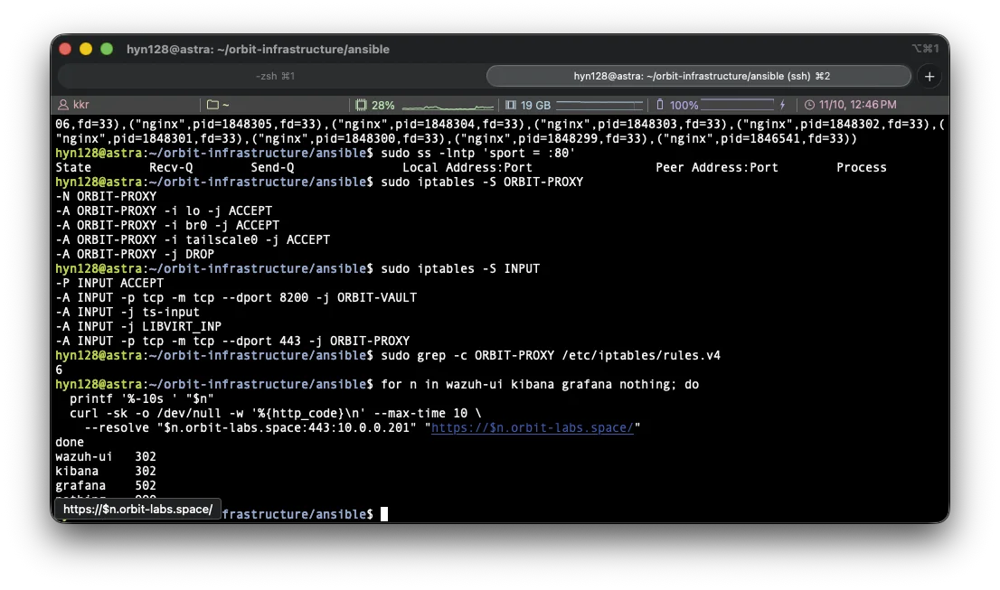
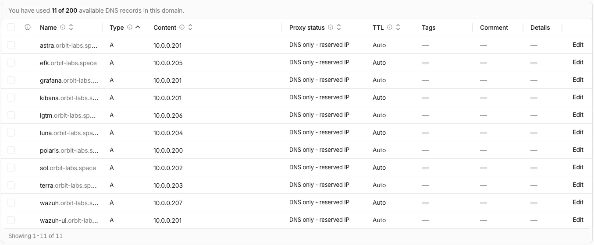
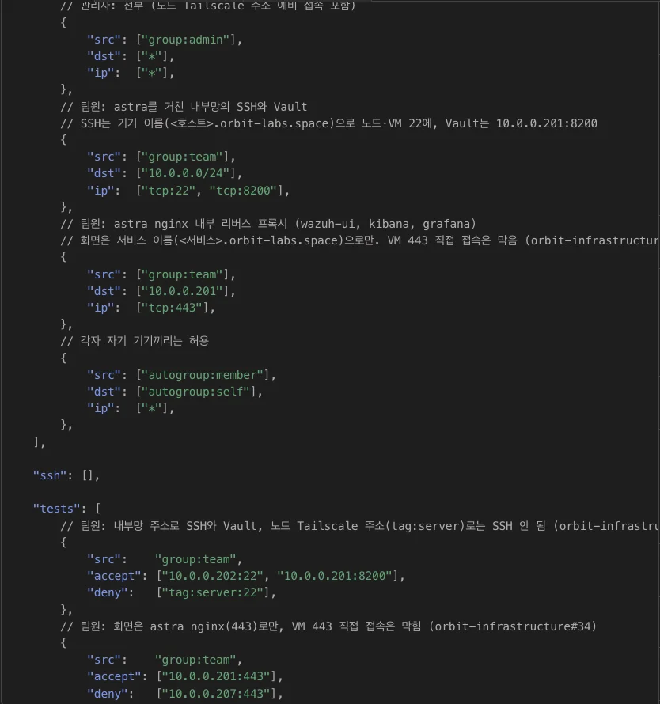
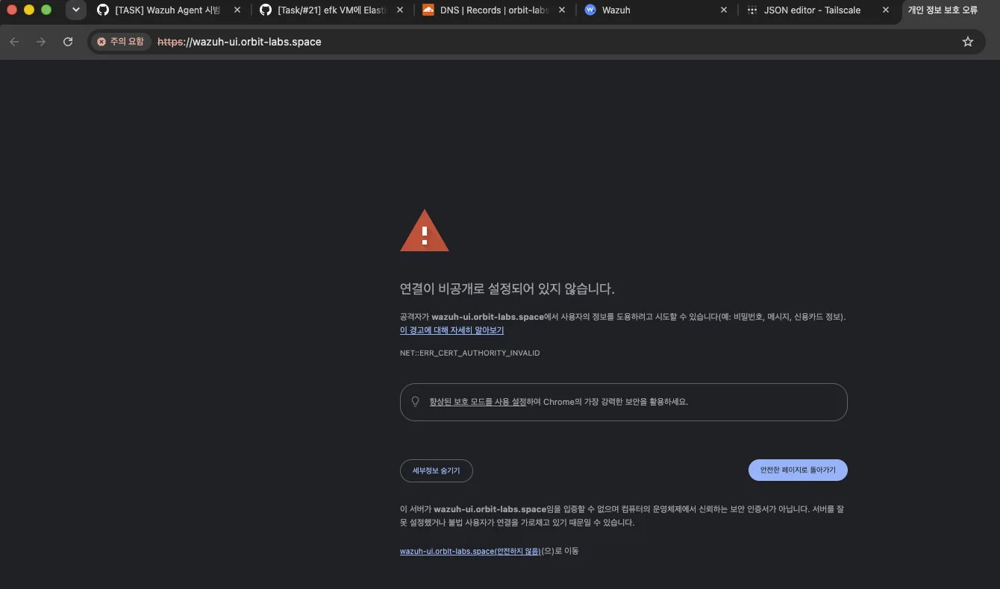
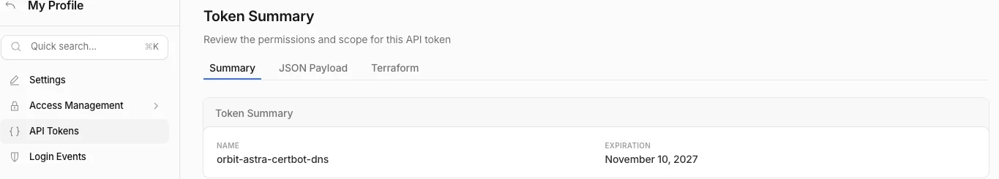
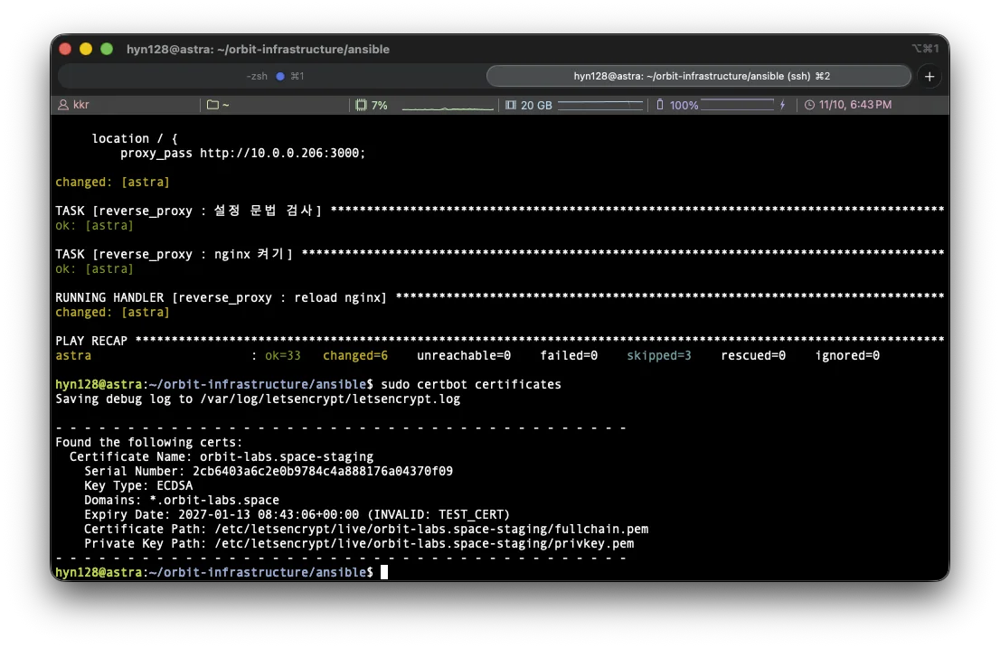
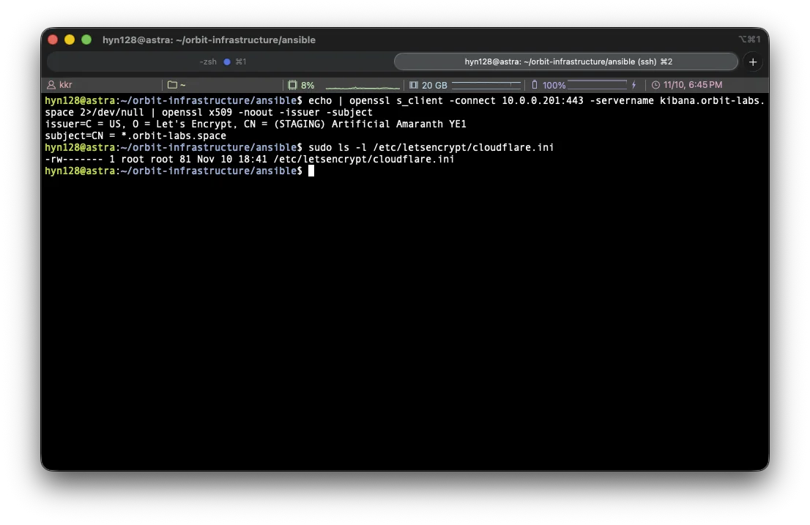
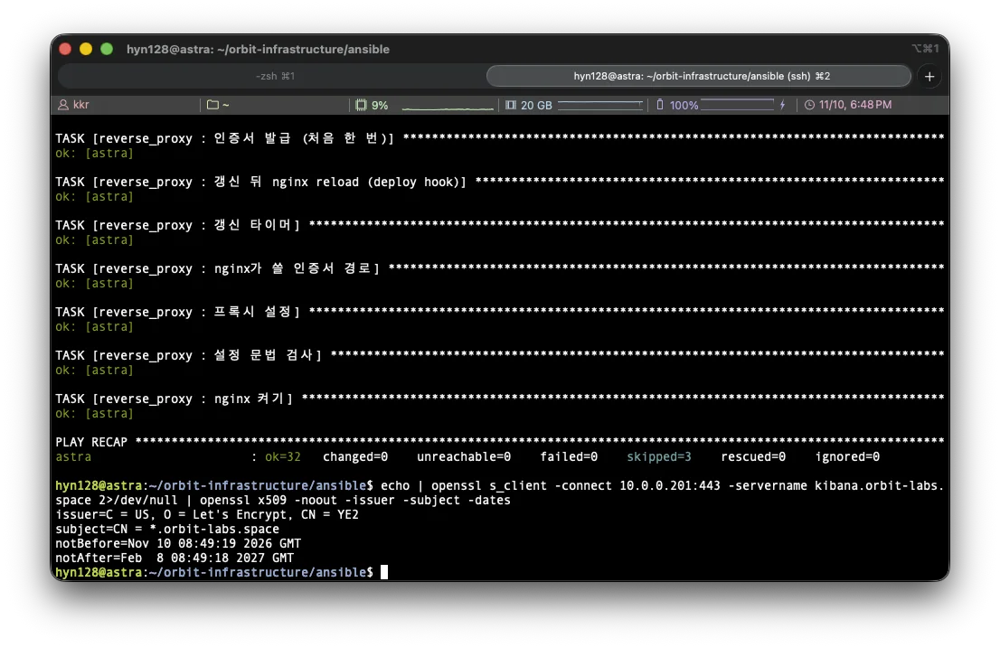
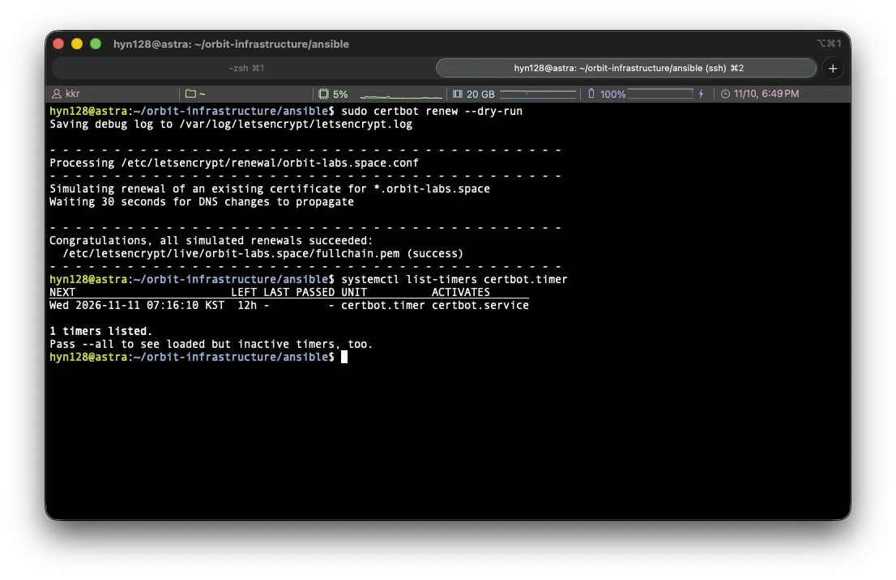

> ### 들어가며
>
> [지난 글](https://hyn128.site/project-7-orbit-tailscale-subnet-router/)에서 astra를 Tailscale subnet router로 바꿔 팀원이 내부망 주소와 이름으로 노드와 VM에 SSH로 접속하게 했습니다. 그 뒤 팀원들이 모니터링 VM에 Wazuh와 EFK를 올리면서 웹 화면이 생겼는데, 화면마다 주소와 포트가 달랐고 Tailscale 정책에는 SSH와 Vault 포트만 열려 있어 팀원 기기에서는 화면이 열리지 않았습니다. 이번에는 astra에 내부 전용 nginx 리버스 프록시를 두어 팀원이 `kibana.orbit-labs.space` 같은 서비스 이름 하나로 화면에 접속하게 하고, 자체 서명 인증서 때문에 뜨던 브라우저 경고를 Let's Encrypt 와일드카드 인증서로 없앤 과정을 정리했습니다. Wazuh와 EFK는 다른 팀원이 구축했으며, 이 글에서 두 스택을 다루는 부분은 직접 구축한 기록이 아니라 구축된 내용을 이해하기 위해 작성한 내용입니다.

> ### 목차
>
> 1. [모니터링 화면의 접속 방식과 문제](#s1)  
> 2. [기기 이름과 서비스 이름](#s2)  
> 3. [전체 완성된 구성](#s3)  
> 4. [astra nginx 리버스 프록시](#s4)  
> 5. [방화벽 체인 ORBIT-PROXY](#s5)  
> 6. [DNS 등록과 접속 확인](#s6)  
> 7. [Tailscale 정책](#s7)  
> 8. [자체 서명 인증서의 한계](#s8)  
> 9. [Let's Encrypt 와일드카드 인증서와 DNS-01](#s9)  
> 10. [Cloudflare 토큰의 권한과 보관](#s10)  
> 11. [Ansible role의 발급 과정](#s11)  
> 12. [staging 발급과 정식 발급](#s12)  
> 13. [자동 갱신](#s13)  
> 14. [적용 중 확인한 문제](#s14)  
> 15. [남은 작업](#s15)  

글에서 사용하는 호스트 이름과 역할은 다음과 같습니다.

| 호스트 이름 | 기기 | 역할 |
|---|---|---|
| polaris | ODROID-M1S (SBC) | k3s Control Plane |
| astra | 데스크탑 | 게이트웨이(NAT), subnet router, Vault, 모니터링 VM 호스트. **이번에 nginx 리버스 프록시** |
| sol, terra, luna | 갤럭시북 | k3s Worker |
| efk | astra 안의 VM | Elasticsearch, Kibana |
| lgtm | astra 안의 VM | Grafana 스택 (Grafana 설치 전) |
| wazuh | astra 안의 VM | Wazuh 서버와 대시보드 |

작업은 공개 저장소 [`ORBIT-CLOUD-LABS/orbit-infrastructure`](https://github.com/ORBIT-CLOUD-LABS/orbit-infrastructure)의 이슈 두 개로 나눠 진행했습니다.

| 구분 | 내용 | 상태 |
|---|---|---|
| [이슈 #34](https://github.com/ORBIT-CLOUD-LABS/orbit-infrastructure/issues/34), [PR #36](https://github.com/ORBIT-CLOUD-LABS/orbit-infrastructure/pull/36) | astra nginx 내부 리버스 프록시와 서비스 이름 구성 | 11/10 머지 |
| [orbit 이슈 #75](https://github.com/ORBIT-CLOUD-LABS/orbit/issues/75), [orbit PR #80](https://github.com/ORBIT-CLOUD-LABS/orbit/pull/80) | 모니터링 화면 내부 전용과 서비스 이름 규칙 문서 반영 | 11/10 머지 |
| [이슈 #38](https://github.com/ORBIT-CLOUD-LABS/orbit-infrastructure/issues/38), [PR #41](https://github.com/ORBIT-CLOUD-LABS/orbit-infrastructure/pull/41) | Let's Encrypt 와일드카드 인증서 적용 | 적용 완료, PR 리뷰 대기 |
| [`docs/reverse-proxy.md`](https://github.com/ORBIT-CLOUD-LABS/orbit-infrastructure/blob/develop/docs/reverse-proxy.md) | 운영 문서 | |
| [`ansible/roles/reverse_proxy`](https://github.com/ORBIT-CLOUD-LABS/orbit-infrastructure/tree/develop/ansible/roles/reverse_proxy) | 구성 코드 | |

## 1. 모니터링 화면의 접속 방식과 문제 {#s1}

### 1) VM마다 다른 주소와 포트

모니터링 스택은 astra 안의 VM 3대에 나뉘어 있고, 화면마다 주소와 포트, 프로토콜이 달랐습니다.

| 화면 | 위치 | 포트 | 프로토콜 |
|---|---|---|---|
| Wazuh 대시보드 | wazuh `10.0.0.207` | 443 | HTTPS (자체 서명) |
| Kibana | efk `10.0.0.205` | 5601 | HTTPS (efk 설치 때 만든 CA) |
| Grafana | lgtm `10.0.0.206` | 3000 | HTTP |

[지난 글](https://hyn128.site/project-7-orbit-tailscale-subnet-router/)의 Tailscale 정책은 팀원에게 내부망의 SSH(22)와 Vault(8200)만 허용했습니다. 그래서 Wazuh 담당 팀원이 대시보드를 올린 뒤 팀원 기기에서 `https://10.0.0.207`을 열었을 때, SSH는 되는데 화면은 열리지 않았습니다. 급한 대로 팀원 규칙에 내부망 전체의 443을 임시로 열었지만, 이 방식을 계속 쓰면 문제가 세 가지 남게 됩니다.

- 화면이 늘 때마다 Tailscale 정책에 VM 주소와 포트를 하나씩 더 열어야 합니다.
- 팀원은 화면마다 주소와 포트를 따로 기억해야 합니다.
- 내부망 전체의 443이 열려 있어, 화면이 아닌 다른 장비의 443에도 팀원 기기가 닿게 됩니다.

### 2) 공개 계획에서 내부 전용으로 변경

[1차 발표](https://hyn128.site/project-5-orbit-phase2-week1-presentation/) 때의 설계와 [지난 글](https://hyn128.site/project-7-orbit-tailscale-subnet-router/)에서는 `grafana`, `kibana` 같은 웹 서비스 이름을 Cloudflare 프록시를 거치는 공개 경로로 두려고 했습니다. 이번에 이 계획을 바꿔, 모니터링 화면은 공개하지 않고 팀원만 내부에서 보도록 정했습니다. 바꾼 이유는 다음과 같습니다.

- Kibana의 로그에는 요청 내용, 계정명, 내부 주소가 그대로 남아 있고, Wazuh 대시보드에는 보안 이벤트와 취약점 목록이 나오게 됩니다. 이 화면들은 팀원만 보면 되는 화면입니다.
- 팀원은 이미 subnet router를 거쳐 내부망에 닿을 수 있어서, 화면을 보려고 공개 경로를 따로 만들 필요가 없습니다.
- 공개 경로에 두면 화면마다 로그인 보호와 공개 범위를 따로 관리해야 합니다.

공개 경로는 이후 클러스터가 준비되면 서비스 자체인 `ota`, `campaign` 두 이름에만 두기로 했고, 이 결정은 [orbit 이슈 #75](https://github.com/ORBIT-CLOUD-LABS/orbit/issues/75)로 설계 문서 [`docs/infrastructure.md`](https://github.com/ORBIT-CLOUD-LABS/orbit/blob/main/docs/infrastructure.md)에 반영했습니다.

## 2. 기기 이름과 서비스 이름 {#s2}

처음 생각한 방식은 팀원이 `wazuh.orbit-labs.space`를 입력하면 astra가 이름을 보고 Wazuh VM의 443으로 넘겨 주는 것이었습니다. 그런데 `wazuh.orbit-labs.space`는 [지난 글](https://hyn128.site/project-7-orbit-tailscale-subnet-router/)에서 Wazuh VM의 주소 `10.0.0.207`을 가리키는 SSH용 이름으로 이미 등록해 둔 상태였습니다.

하나의 이름을 SSH와 웹 화면에 같이 쓸 수는 없었습니다. HTTPS 요청에는 접속하려는 이름(Host 헤더와 SNI)이 들어 있어서 nginx가 이름을 보고 나눌 수 있지만, SSH는 접속할 때 이름을 서버에 보내지 않기 때문에 astra가 중간에서 나눌 방법이 없습니다. 그래서 이름을 두 종류로 나누고 서로 섞지 않기로 했습니다.

| 종류 | 이름 | 가리키는 주소 | 용도 |
|---|---|---|---|
| 기기 이름 | `astra`, `polaris`, `sol`, `terra`, `luna`, `efk`, `lgtm`, `wazuh` | 각 기기의 내부망 주소 | SSH |
| 서비스 이름 | `wazuh-ui`, `kibana`, `grafana` | astra `10.0.0.201` | 웹 화면. astra nginx가 이름을 보고 전달 |

- Wazuh는 VM 이름이 `wazuh`라서 화면 이름을 `wazuh-ui`로 따로 두었습니다. VM 이름을 바꾸는 방법도 생각했지만, 인벤토리와 문서, SSH 접속 이름으로 이미 쓰이고 있어서 그대로 두었습니다.
- 뒤에 붙는 `orbit-labs.space`는 Ansible 변수 `orbit_domain` 하나로 묶고, 서비스 목록에는 앞부분(`kibana`)만 적게 했습니다.
- `argocd`, `hubble`처럼 클러스터 안에 있는 화면은 클러스터 쪽 입구가 준비되면 같은 방식으로 추가할 예정입니다.

## 3. 전체 완성된 구성 {#s3}

두 이슈가 끝난 뒤의 구성은 다음과 같습니다.

```text
1. 이름 묻기:  팀원 기기 --DNS--> Cloudflare  ("kibana.orbit-labs.space는 10.0.0.201")
2. 접속:      팀원 기기 --Tailscale 터널--> astra nginx 10.0.0.201:443
                                             |-- wazuh-ui --> wazuh 10.0.0.207:443   (HTTPS, 확인 끔)
                                             |-- kibana   --> efk   10.0.0.205:5601  (HTTPS, efk CA로 확인)
                                             |-- grafana  --> lgtm  10.0.0.206:3000  (HTTP)
                                             `-- 그 밖의 이름 --> 연결 끊음 (444)
```

| 구간 | 구성 | 다루는 절 |
|---|---|---|
| 이름 | Cloudflare DNS에 서비스 이름 3개를 astra 내부망 주소로 등록 (DNS only) | [6절](#s6) |
| 팀원 기기에서 astra | Tailscale 정책에서 팀원의 443을 astra 하나로 제한 | [7절](#s7) |
| astra의 443 | nginx는 내부망 주소에서만 받고, 방화벽 체인이 허용한 인터페이스 밖의 443을 버림 | [4절](#s4), [5절](#s5) |
| 브라우저와 nginx 사이 인증서 | Let's Encrypt `*.orbit-labs.space` 와일드카드, 자동 갱신 | [9절](#s9)부터 [13절](#s13) |
| nginx에서 각 VM | 내부망으로 직접 전달. Kibana는 인증서 확인, Wazuh는 확인 끔 | [4절](#s4) |

## 4. astra nginx 리버스 프록시 {#s4}

nginx는 astra 호스트에 apt 패키지로 설치하고 [`reverse_proxy` role](https://github.com/ORBIT-CLOUD-LABS/orbit-infrastructure/tree/develop/ansible/roles/reverse_proxy)로 관리합니다. 설정은 템플릿 [`orbit-proxy.conf.j2`](https://github.com/ORBIT-CLOUD-LABS/orbit-infrastructure/blob/develop/ansible/roles/reverse_proxy/templates/orbit-proxy.conf.j2) 하나에서 서비스 목록을 돌며 만들어집니다.

### 1) 내부망 주소에서만 받는 listen

astra에는 와이파이 주소와 내부망 주소가 둘 다 있습니다. [`listen`](https://nginx.org/en/docs/http/ngx_http_core_module.html#listen) 지시어에 주소를 적으면 nginx는 그 주소의 소켓만 열게 되므로, 모든 서버 블록에 `listen 10.0.0.201:443 ssl`을 적어 내부망 주소에서만 받게 했습니다. 80은 열지 않았기 때문에 `http://`로는 접속되지 않고, `https://`로만 접속하게 됩니다.

적용 전에 astra에서 80과 443을 이미 쓰는 프로세스가 없는지 `ss`로 먼저 확인했고, 둘 다 비어 있었습니다.

### 2) 이름별 서버 블록과 default_server

nginx는 요청에 들어 있는 이름과 [`server_name`](https://nginx.org/en/docs/http/ngx_http_core_module.html#server_name)이 맞는 서버 블록을 고르고, 맞는 블록이 없으면 기본 서버로 보내게 됩니다. 기본 서버를 따로 정하지 않으면 첫 번째 서버 블록이 기본이 되는데, 그러면 등록하지 않은 이름이나 IP로 들어온 요청이 Wazuh 화면으로 넘어가게 됩니다. 그래서 `default_server`를 따로 두고 444를 돌려주게 했습니다. [nginx 문서](https://nginx.org/en/docs/http/request_processing.html)에 따르면 444는 응답을 보내지 않고 연결을 닫는 nginx 고유의 코드입니다.

```nginx
# 모르는 이름은 응답 없이 끊음
server {
    listen 10.0.0.201:443 ssl default_server;
    ssl_certificate     /etc/letsencrypt/live/orbit-labs.space/fullchain.pem;
    ssl_certificate_key /etc/letsencrypt/live/orbit-labs.space/privkey.pem;
    return 444;
}

server {
    listen 10.0.0.201:443 ssl;
    server_name kibana.orbit-labs.space;
    ssl_certificate     /etc/letsencrypt/live/orbit-labs.space/fullchain.pem;
    ssl_certificate_key /etc/letsencrypt/live/orbit-labs.space/privkey.pem;

    location / {
        proxy_pass https://10.0.0.205:5601;
        proxy_http_version 1.1;
        proxy_set_header Host $host;
        proxy_set_header X-Forwarded-Proto https;
        proxy_set_header Upgrade $http_upgrade;
        proxy_set_header Connection $connection_upgrade;
        proxy_ssl_verify on;
        proxy_ssl_trusted_certificate /etc/fluent-bit/efk-ca.crt;
        proxy_ssl_name efk;
    }
}
```

- `proxy_set_header Host $host` : 화면이 자기 주소를 서비스 이름으로 알게 합니다.
- `Upgrade`, `Connection` : 화면이 WebSocket을 쓸 때 연결이 이어지도록 [nginx WebSocket 문서](https://nginx.org/en/docs/http/websocket.html)의 `map` 방식을 그대로 넣었습니다.
- 인증서 경로는 [9절](#s9) 이후의 값입니다. [이슈 #34](https://github.com/ORBIT-CLOUD-LABS/orbit-infrastructure/issues/34) 시점에는 `/etc/nginx/tls`의 자체 서명 인증서였습니다.

### 3) 위쪽 서버의 HTTPS 검증

Kibana와 Wazuh 대시보드는 그 자체가 HTTPS로 떠 있어서, nginx도 이 둘에는 HTTPS로 넘겨야 합니다. 이때 nginx가 위쪽 서버(nginx 뒤의 VM)의 인증서를 확인할지는 화면마다 다르게 정했습니다.

| 화면 | 위쪽 주소 | 인증서 확인 | 이유 |
|---|---|---|---|
| Kibana | `https://10.0.0.205:5601` | 켬 | efk 설치 때 만든 CA의 공개 인증서 사본이 astra에 이미 있음 |
| Wazuh | `https://10.0.0.207:443` | 끔 | Wazuh가 설치 때 만든 자체 서명 인증서라 가져올 CA가 없음 |
| Grafana | `http://10.0.0.206:3000` | 해당 없음 | HTTP |

[`proxy_ssl_verify`](https://nginx.org/en/docs/http/ngx_http_proxy_module.html#proxy_ssl_verify)는 기본값이 `off`라서, 켜지 않으면 nginx는 위쪽 서버의 인증서를 확인하지 않고 연결하게 됩니다. Kibana는 확인을 켜고 [`proxy_ssl_trusted_certificate`](https://nginx.org/en/docs/http/ngx_http_proxy_module.html#proxy_ssl_trusted_certificate)에 efk CA를 지정했습니다. 이 CA 파일은 로그를 보내는 `fluent_bit` role이 astra의 `/etc/fluent-bit/efk-ca.crt`에 이미 둔 사본을 그대로 쓰고, 없으면 role이 멈추게 했습니다. 새로 복사해 오면 같은 CA의 사본이 두 군데에 생기기 때문입니다.

확인을 켜면 이름도 맞아야 합니다. nginx는 기본으로 `proxy_pass`에 적은 호스트 부분(`10.0.0.205`)을 인증서의 이름과 비교하는데, Kibana 인증서에 들어 있는 이름은 `efk`입니다. 그래서 [`proxy_ssl_name`](https://nginx.org/en/docs/http/ngx_http_proxy_module.html#proxy_ssl_name)으로 확인에 쓸 이름을 `efk`로 바꿔 주었습니다.

Wazuh 구간은 확인을 끈 상태이지만, 이 구간은 astra와 VM이 같은 호스트 안의 가상 스위치 `br0`로 이어진 내부망입니다. efk VM의 방화벽은 [`docs/efk.md`](https://github.com/ORBIT-CLOUD-LABS/orbit-infrastructure/blob/develop/docs/efk.md)에 적힌 대로 5601을 astra에서 오는 것만 허용하고 있어서, nginx가 astra에서 보내는 요청은 방화벽 변경 없이 그대로 통과했습니다.

### 4) Kibana 바깥 주소

Kibana는 공유 링크나 알림에 넣을 주소를 [`server.publicBaseUrl`](https://www.elastic.co/guide/en/kibana/current/settings.html) 설정에서 가져옵니다. 이 값이 VM 주소로 남아 있으면 Kibana가 만든 링크를 팀원이 열 수 없게 되므로, efk role에 변수 `efk_kibana_public_url`을 새로 두고 `https://kibana.orbit-labs.space`로 설정했습니다. 기존 변수 `efk_kibana_url`은 Ansible이 Kibana API에 접속할 때도 쓰고 있어서 바꾸지 않았습니다.

## 5. 방화벽 체인 ORBIT-PROXY {#s5}

nginx가 내부망 주소의 소켓만 열어도, 그것만으로 와이파이 쪽에서 오는 접속이 막히지는 않습니다. 리눅스는 기본으로 패킷이 어느 인터페이스로 들어왔는지와 관계없이 목적지가 자기 주소면 받기 때문입니다([RFC 1122](https://datatracker.ietf.org/doc/html/rfc1122#section-3.3.4.2)의 Weak ES 모델). 같은 와이파이에 있는 기기가 `10.0.0.201`로 가는 경로를 astra의 와이파이 주소로 잡으면, 패킷은 와이파이 인터페이스로 들어와 nginx에 닿게 됩니다.

그래서 주소가 아니라 인터페이스 기준으로 한 번 더 막았습니다. 443으로 들어오는 패킷을 `ORBIT-PROXY` 체인으로 보내고, 허용한 인터페이스가 아니면 버리게 됩니다.

```text
-A INPUT -p tcp -m tcp --dport 443 -j ORBIT-PROXY
-A ORBIT-PROXY -i lo -j ACCEPT
-A ORBIT-PROXY -i br0 -j ACCEPT
-A ORBIT-PROXY -i tailscale0 -j ACCEPT
-A ORBIT-PROXY -j DROP
```

- `lo` : astra 자신
- `br0` : 내부망
- `tailscale0` : 팀원이 들어오는 Tailscale 터널

이 방식은 [Vault 글](https://hyn128.site/project-8-orbit-vault-ssh-ca-study/)에서 정리한 Vault 8200의 방화벽([`roles/vault/tasks/firewall.yml`](https://github.com/ORBIT-CLOUD-LABS/orbit-infrastructure/blob/develop/ansible/roles/vault/tasks/firewall.yml))과 같은 구조입니다. 다만 체인을 INPUT의 어디에 연결할지는 다르게 정했습니다. Vault role은 자기 연결이 INPUT 맨 앞에 있는지 확인하고 아니면 다시 맨 앞으로 옮깁니다. 프록시도 맨 앞을 요구하면 두 플레이북을 번갈아 실행할 때마다 서로의 위치를 바꾸게 되어, 재실행 시 `changed=0`이 깨지게 됩니다. 그래서 [`firewall.yml`](https://github.com/ORBIT-CLOUD-LABS/orbit-infrastructure/blob/develop/ansible/roles/reverse_proxy/tasks/firewall.yml)은 연결을 INPUT 맨 뒤에 붙이고, 연결이 하나만 있는지만 확인하게 했습니다. 적용 전에 INPUT 앞쪽에 포트를 가리지 않고 받는 ACCEPT 규칙이 없는 것을 확인했기 때문에, 뒤에 붙여도 443은 이 체인을 거치게 됩니다.

규칙은 `iptables-restore --noflush`로 한 번에 적용합니다. 규칙을 한 줄씩 넣으면 넣는 사이에 443이 열려 있는 순간이 생기기 때문입니다.



적용 뒤 astra에서 확인한 화면입니다. `ORBIT-PROXY` 체인과 INPUT 맨 앞의 `ORBIT-VAULT`, 맨 뒤의 `ORBIT-PROXY` 연결이 보이고, 아래쪽은 DNS를 등록하기 전에 `curl --resolve`로 이름을 astra 주소에 직접 붙여 확인한 결과입니다.

| 이름 | 결과 | 의미 |
|---|---|---|
| `wazuh-ui` | 302 | Wazuh 대시보드의 리디렉션 응답 |
| `kibana` | 302 | efk CA와 `proxy_ssl_name efk`로 Kibana 인증서 확인을 통과 |
| `grafana` | 502 | nginx까지는 정상이고, lgtm에 Grafana가 아직 없음 |
| `nothing` (등록하지 않은 이름) | 000 | `default_server`의 444로 응답 없이 끊김 |

## 6. DNS 등록과 접속 확인 {#s6}

Cloudflare DNS에 서비스 이름 3개를 astra의 내부망 주소로 가리키는 A 레코드로 등록했습니다.



기기 이름 8개는 각 기기의 주소를, 서비스 이름 3개(`grafana`, `kibana`, `wazuh-ui`)는 모두 `10.0.0.201`을 가리키게 됩니다. 레코드는 전부 [DNS only](https://developers.cloudflare.com/dns/proxy-status/)(회색 구름)입니다. 프록시를 켜면 Cloudflare의 주소가 대신 응답하게 되는데, Cloudflare는 내부망 주소에 닿을 수 없기 때문입니다. 이름은 누구나 조회할 수 있지만, `10.0.0.201`에 실제로 닿는 것은 Tailscale로 경로를 받은 팀원 기기뿐입니다.

등록한 뒤 Mac에서 `dig`는 `10.0.0.201`을 돌려주는데 브라우저와 `curl`은 이름을 찾지 못하는 상황이 있었습니다. 원인과 해결은 [14절](#s14)에 적었습니다.

## 7. Tailscale 정책 {#s7}

화면이 열리는 것을 확인한 뒤, 임시로 내부망 전체에 열어 둔 팀원의 443을 astra 하나로 줄였습니다. 정책은 [grants](https://tailscale.com/kb/1324/grants) 형식이고, 팀원 규칙을 둘로 나눴습니다.

```json
// 팀원: astra를 거친 내부망의 SSH와 Vault
{"src": ["group:team"], "dst": ["10.0.0.0/24"], "ip": ["tcp:22", "tcp:8200"]},
// 팀원: astra nginx 내부 리버스 프록시 (wazuh-ui, kibana, grafana)
{"src": ["group:team"], "dst": ["10.0.0.201"], "ip": ["tcp:443"]},
```

- SSH(22)는 노드와 VM 전체에 기기 이름으로 접속합니다.
- 화면(443)은 astra nginx 하나로만 들어갑니다. 팀원 기기에서 `https://10.0.0.207`처럼 VM의 443에 직접 접속하는 것은 막히게 됩니다.
- 관리자 그룹은 전부 허용이라, nginx에 문제가 생겼을 때 VM에 직접 접속하는 예비 경로가 남습니다.

이 제한을 VM의 방화벽이 아니라 Tailscale 정책에서 한 이유는 subnet router의 동작 때문입니다. [Tailscale 문서](https://tailscale.com/kb/1019/subnets)에 따르면 subnet router는 기본으로 SNAT를 적용해, 뒤쪽 장비에는 요청이 라우터 자신에게서 온 것으로 보이게 됩니다. 그래서 VM에서 보면 팀원이 직접 보낸 요청과 nginx가 넘긴 요청이 둘 다 `10.0.0.201`에서 온 것으로 보여, VM 방화벽으로는 둘을 구분할 수 없습니다. nginx에서 VM으로 가는 구간은 astra가 내부망으로 직접 보내는 연결이라 Tailscale 정책의 영향을 받지 않습니다.

정책 파일의 [`tests`](https://tailscale.com/kb/1337/policy-syntax#tests)에도 이 조건을 넣었습니다. 저장할 때 Tailscale이 조건을 시험하고, 기대와 다르면 저장을 거부하게 됩니다.



- 팀원 그룹은 `10.0.0.201:443`에는 닿고 `10.0.0.207:443`에는 닿지 않아야 합니다.
- 지난 글에서 넣었던 test는 `src`가 팀원 한 명의 계정이었는데, `group:team`으로 바꿨습니다.

저장한 뒤 팀원 기기에서 `curl -skI https://wazuh-ui.orbit-labs.space/`가 `HTTP/1.1 302`를 돌려주고, `nc -vz -w 3 10.0.0.207 443`은 시간 초과가 되는 것을 확인했습니다.

## 8. 자체 서명 인증서의 한계 {#s8}

[이슈 #34](https://github.com/ORBIT-CLOUD-LABS/orbit-infrastructure/issues/34)에서는 nginx 인증서를 자체 서명으로 시작했습니다. role이 서비스 이름 3개를 SAN에 넣은 인증서 하나를 만들고, 서버 블록이 모두 그 인증서를 쓰는 방식입니다. 화면은 열리지만 브라우저가 이 인증서를 발급한 곳을 모르기 때문에 경고가 뜨게 됩니다.



경고를 없애려면 팀원마다 자기 기기의 키체인에 이 인증서를 신뢰 등록해야 하고, 서비스 이름이 늘어 인증서를 다시 만들면 등록도 다시 해야 합니다. 팀원이 경고를 매번 넘기는 데 익숙해지면, 실제로 인증서가 바뀌었을 때도 구분하지 못하게 됩니다. 그래서 브라우저가 이미 신뢰하는 공인 CA에서 인증서를 받는 작업을 [이슈 #38](https://github.com/ORBIT-CLOUD-LABS/orbit-infrastructure/issues/38)로 이어서 진행했습니다.

## 9. Let's Encrypt 와일드카드 인증서와 DNS-01 {#s9}

### 1) HTTP-01을 쓸 수 없는 이유

Let's Encrypt는 인증서를 발급하기 전에 신청한 쪽이 그 도메인을 실제로 관리하는지 확인합니다. [확인 방식 문서](https://letsencrypt.org/docs/challenge-types/)에 나오는 방식 중 두 가지를 비교했습니다.

| 방식 | 확인 방법 | ORBIT 프로젝트의 구성에서 |
|---|---|---|
| HTTP-01 | Let's Encrypt가 도메인의 80 포트로 접속해 정해진 파일을 읽음 | 서비스 이름이 내부망 주소를 가리켜 Let's Encrypt가 접속할 수 없음. 와일드카드도 발급되지 않음 |
| DNS-01 | 도메인의 `_acme-challenge` TXT 레코드에 정해진 값을 넣고, Let's Encrypt가 DNS로 조회 | 서버를 밖에 열지 않아도 됨. 와일드카드 발급 가능 |

서비스 이름은 모두 `10.0.0.201`을 가리키고 있고 nginx는 80을 열지도 않았기 때문에, HTTP-01은 쓸 수 없었습니다. DNS-01은 DNS에 레코드를 쓸 수 있으면 되므로, 도메인을 관리하는 Cloudflare의 API로 TXT 레코드를 만들고 지우는 방식으로 진행했습니다. 서버는 여전히 밖에 열려 있지 않습니다.

### 2) 와일드카드 하나로 받은 이유

인증서는 서비스 이름마다 받지 않고 `*.orbit-labs.space` 하나로 받았습니다.

- 서비스 이름이 늘어도(`argocd`, `hubble`) 인증서를 다시 받지 않아도 됩니다. nginx 서비스 목록에 한 항목을 더하고 DNS 레코드만 등록하면 됩니다.
- Let's Encrypt는 [발급한 모든 인증서를 인증서 투명성(CT) 로그에 제출](https://letsencrypt.org/docs/ct-logs/)합니다. 이름마다 인증서를 받으면 내부 서비스 이름 목록이 공개 로그에 그대로 남게 되지만, 와일드카드로 받으면 `*.orbit-labs.space`만 남게 됩니다.

## 10. Cloudflare 토큰의 권한과 보관 {#s10}

DNS-01을 자동으로 하려면 서버에 DNS를 바꿀 수 있는 자격 증명을 두어야 합니다. [Let's Encrypt 문서](https://letsencrypt.org/docs/challenge-types/)는 DNS API 자격 증명 전체를 웹 서버에 두면 서버가 침해됐을 때 피해가 커지므로, 범위를 좁힌 자격 증명을 쓰는 것이 좋다고 설명합니다. [certbot Cloudflare 플러그인 문서](https://certbot-dns-cloudflare.readthedocs.io/en/stable/)도 계정 전체 권한인 Global API Key 대신, 인증서가 필요한 zone에만 `Zone:DNS:Edit` 권한을 준 API Token을 권장하고 있습니다.

### 1) 토큰 권한

[Cloudflare 토큰 생성 문서](https://developers.cloudflare.com/fundamentals/api/get-started/create-token/)의 Edit zone DNS 템플릿으로 만들었고, 정한 값은 다음과 같습니다.

| 항목 | 값 | 이유 |
|---|---|---|
| 권한 | DNS Edit 하나 | DNS-01에 필요한 최소 권한 |
| 대상 | zone `orbit-labs.space` 하나 | 계정의 다른 도메인에는 쓸 수 없음 |
| 만료 | 1년 (2027-11-10) | 만료가 없으면 잊힌 토큰이 계속 남고, 90일 이하면 인증서 갱신보다 먼저 끝날 수 있음 |
| IP 제한 | 없음 | 공인 IP를 저장소와 문서에 적지 않기로 해서 이번에는 쓰지 않음 |



### 2) 토큰 보관

토큰은 발급 화면에서 한 번만 보여 주므로 바로 Vault에 넣었습니다. 값이 명령 인자와 셸 history에 남지 않도록, [`docs/vault.md`](https://github.com/ORBIT-CLOUD-LABS/orbit-infrastructure/blob/develop/docs/vault.md)의 방식대로 숨김 입력으로 받아 표준 입력으로 넘겼습니다.

```bash
read -rs CF && printf '%s' "$CF" | vault kv put -mount=secret orbit/infra/cloudflare dns_api_token=- ; unset CF
```

| 위치 | 내용 |
|---|---|
| Vault `secret/orbit/infra/cloudflare` | 원본. 키 `dns_api_token`. 발급자가 직접 넣고 role은 읽기만 함 |
| astra `/etc/letsencrypt/cloudflare.ini` | certbot이 읽는 자격 증명 파일. root `0600`. role이 Vault 값으로 만듦 |
| 저장소, 이슈, PR, 로그 | 남기지 않음. Ansible 단계는 `no_log` |

efk role에는 Vault에 값이 없으면 무작위 값을 만들어 넣는 공용 단계가 있는데, 이 토큰에는 쓰지 않았습니다. Cloudflare가 발급한 값이어야 하므로, 값이 없으면 role이 이유를 알려 주고 멈추게 했습니다.

현재 Vault의 팀 정책은 `secret/orbit/` 아래를 팀원 전원이 읽을 수 있게 되어 있어서, 이 토큰도 팀원이 꺼낼 수 있습니다. 토큰으로 할 수 있는 일을 한 zone의 DNS 편집으로 좁혔기 때문에 이번에는 이 범위를 받아들였고, 경로별로 읽기 권한을 나누는 것은 Vault 정책 작업으로 남겼습니다.

### 3) 토큰 확인

Vault에 넣은 값의 길이가 53자로, 예전 Cloudflare 토큰 길이로 알고 있던 40자와 달랐습니다. 길이만으로는 값이 맞게 들어갔는지 알 수 없어서, Cloudflare의 [토큰 확인 API](https://developers.cloudflare.com/api/resources/user/subresources/tokens/methods/verify/)로 확인했습니다. 토큰은 Vault에서 꺼내 표준 입력으로 `curl`의 헤더에 넘기므로 화면과 history에 남지 않습니다.

```bash
vault kv get -mount=secret -field=dns_api_token orbit/infra/cloudflare | awk '{print "Authorization: Bearer " $0}' | curl -s -H @- https://api.cloudflare.com/client/v4/user/tokens/verify | jq -r '.result.status'
```

결과는 `active`였습니다.

## 11. Ansible role의 발급 과정 {#s11}

발급은 [`letsencrypt.yml`](https://github.com/ORBIT-CLOUD-LABS/orbit-infrastructure/blob/631cb27129f93ea8c858e3b9036ba8f5419e4a34/ansible/roles/reverse_proxy/tasks/letsencrypt.yml)에 두었고, 순서는 다음과 같습니다.

1. `certbot`과 `python3-certbot-dns-cloudflare`를 apt로 설치합니다.
2. Vault API에서 토큰을 읽습니다. 미리보기(`--check`)에서도 읽어서, 토큰이 없으면 적용 전에 알 수 있습니다.
3. 토큰을 읽지 못하면 멈추고, Vault의 응답 코드로 이유를 구분해 알려 줍니다.
   - 503: Vault가 sealed 상태
   - 403: 로그인 토큰이 없거나 만료됨
   - 404: 경로에 값이 없음
4. 자격 증명 파일을 root `0600`으로 만듭니다.
5. 인증서가 아직 없을 때만 `certbot certonly`를 실행합니다.
6. 갱신 뒤 nginx를 reload하는 deploy hook을 둡니다.
7. 갱신 타이머 `certbot.timer`가 켜져 있게 합니다.

5번에서 실행되는 명령은 다음과 같습니다.

```bash
certbot certonly --dns-cloudflare \
  --dns-cloudflare-credentials /etc/letsencrypt/cloudflare.ini \
  --dns-cloudflare-propagation-seconds 30 \
  -d '*.orbit-labs.space' --cert-name orbit-labs.space \
  --non-interactive --agree-tos --register-unsafely-without-email
```

- `--dns-cloudflare-propagation-seconds` : TXT 레코드를 만든 뒤 Let's Encrypt에 확인을 요청하기까지 기다리는 시간입니다. [플러그인 문서](https://certbot-dns-cloudflare.readthedocs.io/en/stable/)의 기본값은 10초이고, 30초로 늘렸습니다.
- `--cert-name` : 인증서 폴더 이름을 고정합니다. nginx 설정의 경로가 이 이름을 따라가게 됩니다.
- `--register-unsafely-without-email` : ACME 계정에 이메일을 등록하지 않습니다. 갱신은 자동으로 하고, 상태는 `certbot certificates`로 확인합니다.
- Ansible의 `creates`에 인증서 파일 경로를 주어, 파일이 이미 있으면 실행하지 않습니다. 이후 갱신은 role이 아니라 타이머가 하게 됩니다.

플러그인 문서에 따르면 API Token을 쓰려면 Python `cloudflare` 모듈이 2.3.1 이상이어야 합니다. 적용 전에 astra에서 `apt-cache policy`로 확인했고, `python3-cloudflare`는 2.11.1, 플러그인은 2.0.0이었습니다.

인증서 방식은 변수로 남겼습니다. `rproxy_tls_mode`가 `letsencrypt`면 위 과정을 거쳐 `/etc/letsencrypt/live`의 인증서를 쓰고, `selfsigned`로 바꿔 적용하면 [8절](#s8)의 자체 서명 인증서로 돌아갑니다. Cloudflare나 Let's Encrypt에 문제가 생겼을 때 되돌릴 방법을 남겨 둔 것이고, 자체 서명 인증서는 어느 방식이든 계속 만들어 둡니다. 이 플레이북은 이제 Vault에서 토큰을 읽어야 하므로 실행할 때 `VAULT_TOKEN`이 필요합니다.

## 12. staging 발급과 정식 발급 {#s12}

Let's Encrypt에는 [발급 횟수 제한](https://letsencrypt.org/docs/rate-limits/)이 있어서, 설정이 틀린 상태로 정식 발급을 반복하면 제한에 걸릴 수 있습니다. [staging 환경 문서](https://letsencrypt.org/docs/staging-environment/)는 정식 환경을 쓰기 전에 staging에서 먼저 시험하는 것을 권장하고 있고, certbot에서는 `--test-cert`로 쓸 수 있습니다. staging의 루트 인증서는 브라우저의 신뢰 목록에 들어 있지 않아서, staging 인증서로는 경고가 계속 뜨게 됩니다.

role에는 변수 `rproxy_le_staging`을 두고, 값에 따라 인증서 이름이 달라지게 했습니다. staging은 `orbit-labs.space-staging`, 정식은 `orbit-labs.space`라서 서로 덮어쓰지 않습니다.

### 1) staging

```bash
ansible-playbook playbooks/reverse-proxy.yml -K --check --diff
ansible-playbook playbooks/reverse-proxy.yml -K --diff
sudo certbot certificates
```

미리보기에서 nginx 설정의 인증서 경로 세 곳이 staging 경로로 바뀌는 것을 확인한 뒤 적용했습니다.



적용 결과는 `changed=6`, `failed=0`이었고, 바뀐 것은 다음 여섯 가지입니다.

- certbot 설치
- 자격 증명 파일
- 인증서 발급
- deploy hook
- nginx 설정
- nginx reload

`certbot certificates`에는 이름 `orbit-labs.space-staging`, 도메인 `*.orbit-labs.space`가 보이고, `INVALID: TEST_CERT`는 staging 인증서라는 표시입니다.

```bash
echo | openssl s_client -connect 10.0.0.201:443 -servername kibana.orbit-labs.space 2>/dev/null | openssl x509 -noout -issuer -subject
sudo ls -l /etc/letsencrypt/cloudflare.ini
```



- nginx가 실제로 내주는 인증서의 발급자에 `(STAGING)`이 들어 있고, 대상은 `*.orbit-labs.space`입니다.
- 자격 증명 파일은 `-rw------- root root`, 81바이트입니다. 앞부분 `dns_cloudflare_api_token = ` 27자, 토큰 53자, 줄바꿈 1자를 더한 값과 같아서, 토큰이 한 줄로 들어간 것을 값을 열어 보지 않고 확인할 수 있었습니다.

### 2) 정식

`rproxy_le_staging`을 `false`로 한 줄 바꿔 커밋하고 다시 적용했습니다. 인증서 이름이 달라져 `creates`가 가리키는 파일이 없으므로, certbot이 정식 환경에서 새로 발급받게 됩니다.



| 항목 | 결과 |
|---|---|
| 재실행 | `ok=32 changed=0` |
| 발급자 | `C=US, O=Let's Encrypt, CN=YE2` |
| 대상 | `CN=*.orbit-labs.space` |
| 유효 기간 | 2026-11-10부터 2027-02-08까지 (90일) |

정식 발급을 확인한 뒤 `sudo certbot delete --cert-name orbit-labs.space-staging`으로 staging 인증서를 지웠습니다.

## 13. 자동 갱신 {#s13}

Let's Encrypt 인증서는 유효 기간이 짧아서 갱신을 자동으로 해 두어야 합니다. 갱신은 두 가지가 맡습니다.

| 구성 | 하는 일 |
|---|---|
| `certbot.timer` | Ubuntu의 certbot 패키지에 들어 있는 systemd 타이머. 주기적으로 `certbot renew`를 실행하고, 갱신할 때가 된 인증서만 갱신 |
| `/etc/letsencrypt/renewal-hooks/deploy/reload-nginx.sh` | 갱신에 성공하면 실행되는 deploy hook. `systemctl reload nginx` 한 줄 |

[certbot 문서](https://eff-certbot.readthedocs.io/en/stable/using.html)에 따르면 `renewal-hooks/deploy` 폴더의 실행 파일은 갱신에 성공했을 때 실행됩니다. nginx는 시작할 때 읽은 인증서를 계속 쓰기 때문에, 파일이 바뀐 뒤 reload를 해 주어야 새 인증서로 응답하게 됩니다.

```bash
sudo certbot renew --dry-run
systemctl list-timers certbot.timer
```



- `--dry-run`은 staging 환경에서 갱신 과정을 시험합니다. Cloudflare에 TXT 레코드를 만들고 30초를 기다린 뒤 성공했습니다. 이 과정은 Vault 토큰 없이 astra의 자격 증명 파일만으로 동작합니다.
- 타이머의 다음 실행 시각이 잡혀 있는 것을 확인했습니다.

갱신과 관련해 두 가지를 더 확인했습니다.

- Cloudflare 토큰이 만료되면 갱신이 실패하게 되고, 마지막으로 받은 인증서가 끝나는 날부터 경고가 다시 뜨게 됩니다. 만료일(2027-11-10)과 교체 방법을 [운영 문서](https://github.com/ORBIT-CLOUD-LABS/orbit-infrastructure/pull/41)의 인증서 절에 적었습니다. 교체는 새 토큰을 Vault에 넣고 플레이북을 적용한 뒤 옛 토큰을 지우는 순서입니다.
- staging에서 받은 인증서는 유효 기간이 90일이 아니라 약 64일이었습니다. Let's Encrypt는 [인증서 유효 기간을 90일에서 45일로 줄여 가는 일정](https://letsencrypt.org/2025/12/02/from-90-to-45)을 발표했고, 기본 발급을 2027년 2월에 64일로, 2028년 2월에 45일로 바꾸며 staging에는 먼저 적용한다고 설명합니다. 이번 staging 인증서의 기간이 이 일정에 따른 것인지는 확인하지 못했습니다. 갱신은 타이머가 맡고 있어서, 기간이 줄어도 설정을 바꿀 필요는 없습니다.

## 14. 적용 중 확인한 문제 {#s14}

### 1) 미리보기에서 없는 폴더

첫 미리보기(`--check`)가 인증서 개인키 단계에서 `The directory /etc/nginx/tls does not exist`로 실패했습니다. 미리보기에서는 nginx 설치와 폴더 만들기가 실제로 일어나지 않기 때문에, 그 뒤 단계가 없는 폴더에 파일을 쓰려다 실패한 것입니다. 폴더가 없으면 미리보기에서 인증서와 설정 단계를 건너뛰게 고쳤고, Let's Encrypt 쪽의 자격 증명 파일과 deploy hook에도 같은 조건을 넣었습니다.

### 2) 자체 서명 인증서의 개인키 경로

첫 적용은 자체 서명 인증서 단계에서 `One of privatekey_path and privatekey_content must be specified for the selfsigned provider`로 실패했습니다. efk role의 인증서 단계를 옮겨 오면서, CA로 서명하는 방식에는 없던 개인키 경로가 빠진 것이었습니다. 이 실패 때문에 방화벽 규칙을 저장하는 handler가 실행되지 않아서, `netfilter-persistent save`를 따로 실행해 재부팅 뒤에도 규칙이 남게 했습니다.

### 3) macOS의 DNS 캐시

DNS 레코드를 등록한 뒤 Mac에서 `dig`는 `10.0.0.201`을 돌려주는데, Chrome은 `ERR_NAME_NOT_RESOLVED`, `curl`은 `Could not resolve host`가 나왔습니다. 레코드를 넣기 전에 브라우저로 그 이름을 먼저 열어 봤기 때문에, macOS의 시스템 DNS 캐시에 "없는 이름"이라는 결과가 남아 있었던 것입니다. `dig`는 시스템 캐시를 거치지 않고 DNS 서버에 직접 묻기 때문에 결과가 달랐습니다.

```bash
sudo dscacheutil -flushcache
sudo killall -HUP mDNSResponder
```

시스템 캐시를 비우고 Chrome의 `chrome://net-internals/#dns`에서 호스트 캐시도 비운 뒤 접속됐습니다. 팀 공지에는 새 주소와 함께 이 방법을 적었습니다.

### 4) 미리보기에서 changed로 표시되는 발급 단계

Let's Encrypt 미리보기에서 인증서 발급 단계가 건너뛰어질 것으로 예상했는데 `changed`로 표시됐습니다. Ansible의 `command`에 `creates`를 주면, 미리보기에서는 그 파일이 없을 때 명령을 실행하지 않고 "실행될 예정"이라는 뜻으로 `changed`를 표시합니다. 실제 발급은 적용 때 처음 일어났습니다.

### 5) dry-run에서 실행되지 않는 deploy hook

[certbot 문서](https://eff-certbot.readthedocs.io/en/stable/using.html)에 따르면 `--dry-run`에서는 deploy hook이 실행되지 않으며, `--run-deploy-hooks`를 함께 주어야 실행됩니다. 그래서 [13절](#s13)의 시험은 갱신 과정만 확인한 것이고, nginx reload hook이 실제로 동작하는지는 아직 확인하지 못했습니다.

## 15. 남은 작업 {#s15}

| 할 일 | 내용 |
|---|---|
| 팀원 기기 확인 | 팀원 브라우저에서 `wazuh-ui`, `kibana`가 경고 없이 열리는지 확인. [이슈 #38](https://github.com/ORBIT-CLOUD-LABS/orbit-infrastructure/issues/38)의 마지막 항목 |
| [PR #41](https://github.com/ORBIT-CLOUD-LABS/orbit-infrastructure/pull/41) 머지 | 리뷰 대기 |
| deploy hook 확인 | astra의 certbot이 `--run-deploy-hooks`를 지원하는지 확인한 뒤 dry-run으로 시험하거나, 첫 실제 갱신 뒤 nginx가 내주는 인증서의 날짜로 확인 |
| Cloudflare 토큰 교체 | 만료일 2027-11-10 전에 교체 |
| Vault 읽기 권한 | 인프라 경로의 값을 팀원 전원이 읽을 수 있는 범위를 경로별로 나눌지 결정 |
| Grafana | lgtm에 Grafana가 설치되면 `grafana.orbit-labs.space` 화면 확인 |
| 클러스터 화면 | `argocd`, `hubble`은 클러스터 쪽 입구를 하나로 정한 뒤 서비스 이름으로 추가. 부모 이슈 [orbit #71](https://github.com/ORBIT-CLOUD-LABS/orbit/issues/71) |
| 공개 경로 | `ota`, `campaign`은 클러스터가 준비된 뒤 별도 이슈로 진행 |

이번 작업으로 확인한 것을 정리하면 다음과 같습니다.

- 팀원은 `https://<서비스 이름>.orbit-labs.space`로 모니터링 화면에 접속하고, 주소와 포트를 따로 알 필요가 없습니다.
- 팀원 기기가 닿는 443은 astra nginx 하나이고, VM의 443에 직접 접속하는 것은 Tailscale 정책에서 막힙니다. 팀원 기기에서 두 가지를 모두 확인했습니다.
- nginx는 내부망 주소에서만 받고, 방화벽 체인이 허용한 인터페이스 밖에서 오는 443을 버립니다. 등록하지 않은 이름은 응답 없이 끊깁니다.
- 인증서는 Let's Encrypt가 발급한 `*.orbit-labs.space`이고, 서버를 밖에 열지 않고 DNS-01로 받았습니다. 갱신 과정은 dry-run으로 확인했습니다.

와이파이 쪽에서 `10.0.0.201:443`으로 접속을 시도해 방화벽 체인이 실제로 버리는지는 직접 시험하지 못했고, 규칙과 인터페이스 구성으로만 확인했습니다. 정식 인증서로 바꾼 뒤 팀원 브라우저에서 경고가 사라졌는지도 아직 확인 전입니다.
